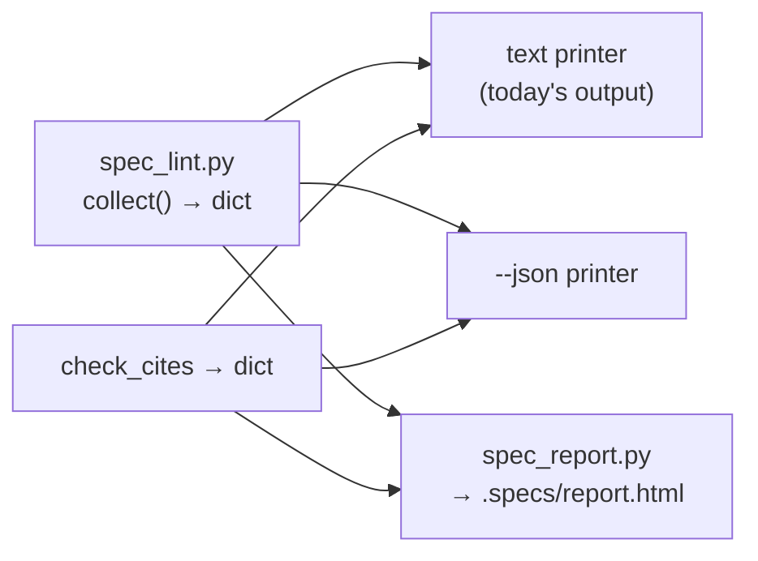

# v020 Report page, citation notations, drift aging, JSON output — Design

## Shape



The linter is split into **collect, then print**. `lint_all(specs)` and `cites(specs)` return plain dicts. The text output
and `--json` print those dicts, and `spec_report.py` imports the same functions. There is one implementation of every check.

## Citations — [REQ-V020-01] [REQ-V020-02] [REQ-V020-03] [REQ-V020-04]

Replace `CITE` (`kit/scripts/spec_lint.py:96`) with one pattern that has an optional prefix and two line notations:

```text
`  [prefix:]  path.ext  ( :A[-B][,C[-D]]...  |  #LA[-[L]B] )  `
```

- **Prefix** ([REQ-V020-01]) is anything before the first `:` that is itself followed by a `path.ext`. A path needs an
  extension, so `<dir>/<file>.py:12` has no prefix. Resolution: `cite_aliases[prefix]`, else an indexed repo folder whose
  basename equals the prefix, else FAIL `unknown repo prefix`. When the prefix resolves, the candidate list is filtered to
  files under that folder before the existing exact, suffix and domain rules run.
- **Ranges** ([REQ-V020-02]) are parsed into a list of `(start, end)`. Each one gets the past-EOF and all-blank checks, and
  the message names the range. The citation counts once.
- **Index** ([REQ-V020-03]): `root.glob("*/.git")` (`kit/scripts/spec_lint.py:105`) becomes `*/.git` plus `*/*/.git`,
  deduplicated. Each repo is listed with `git ls-files` and prefixed with its root-relative folder.
- **Tie-break** ([REQ-V020-04]), applied after the domain rule (`kit/scripts/spec_lint.py:122`): if more than one hit is
  left, drop hits matching `cite_ignore_globs`, and accept the result if exactly one remains.

Order: exact path → prefix scope → suffix match → domain rule → ignore globs → one hit, or FAIL.

## Drift aging — [REQ-V020-05]

`drift_rows(specs)` scans `*.md` outside `kit/` with fenced code removed. A table starts at a header row whose cells, after
lowercasing and stripping, include `drift` (`logged` optional). Each data row maps to `{file, id: first cell, sev: "sev" cell or
"", logged, age_days, resolved: "RESOLVED" in row}`. The date is the first `\d{4}-\d{2}-\d{2}` in the Logged cell, else
`None`. Warnings are emitted only for unresolved rows; the exit code is unchanged. The `null` value comes from
`spec-kit.json`; the default is in `DEFAULTS`.

## JSON — [REQ-V020-06]

`--json` is accepted anywhere in argv. It calls `json.dump(result, sys.stdout)` and suppresses every text line, including
the setup warning, which goes into `warnings`. Return codes come from the same `fails` count.

## Report — [REQ-V020-07]

`kit/scripts/spec_report.py` puts its own folder on `sys.path` first, so `import spec_lint` works under `python3 -I`.
It then calls `lint_all` and `cites`, and adds:

- **Task progress:** `TASK` matches in `tasks.md`, ticked = `[x]`/`[X]`.
- **Status:** `Status: **Done**` / `Status: Done` (case-insensitive) or all ticked → Done; `Blocked on:` → Blocked; then
  none ticked → Not started; else In progress.
- **Uncovered REQs:** defined in `requirements.md`, absent from `tasks.md`. This is the same set the linter fails on, so it
  comes from the lint result.

Rendering uses an f-string template, `html.escape` on every value, and a small inline stylesheet that respects light and
dark (`prefers-color-scheme`). The four sections are cards with a summary row on top (features, open drift, citation
failures), with progress bars as `<div>` widths. Relative links point from the report's folder to the feature files.
The kit version comes from `.specs/kit/VERSION` if present, else `VERSION` two levels up, else `unknown`. Exit 0 once written.

## Wiring — [REQ-V020-08]

- `install.py`: `ensure_line(specs/".gitignore", "report.html")` on install. On uninstall, remove the line, and remove the file
  if it ends up empty.
- Self-test cases:
  - (a) prefix + alias + unknown prefix;
  - (b) multi-range with one bad range;
  - (c) `#L` form;
  - (d) a nested repo two levels down;
  - (e) a tie-break via `cite_ignore_globs`;
  - (f) drift aging: an old row WARNs, a resolved old row doesn't, `null` switches it off;
  - (g) `--json` parses with `python3 -c 'import json,sys; json.load(sys.stdin)'`, and the exit code matches;
  - (h) the report is written, contains no `<script`, and escapes `<b>` taken from a spec;
  - (i) `.gitignore` line present after install and gone after uninstall.

## Risks

| Risk | Mitigation |
|---|---|
| Something that isn't a citation is counted: a dotted host name or IP followed by a port, or a URL | A path needs `name.ext` before the line number, which rules out `host:8080` but not dotted hosts. Write hosts without backticks or as `<host>:<port>`. Skipping them silently would also hide real stale citations such as a bare file name with a line number |
| Previously uncounted multi-range citations now fail on existing projects | Intended. CHANGELOG says so under "Changed" |
| The report goes stale if committed | `.specs/.gitignore` keeps it out; it is regenerated on demand |
