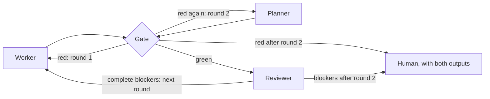

# v060 Staged autonomy, configured per repository — Design

Security-sensitive from slice 2 on: tier routing decides where human review is relaxed. Review on the deep tier.
Stdlib only, Python 3.8+, offline, as the rest of the kit.

## Where the profile lives ([REQ-V060-01])

| Option | For | Against | Ops impact |
|---|---|---|---|
| **`.specs/steering/autonomy.md`** (chosen) | Templates mirror their target paths. Steering already holds the rules every change follows, and these are rules. Markdown tables are how the kit already declares executable rules (the Gates table). The human approves it like any steering file. Absent file = today's behaviour, easy to detect | Tables of globs are wordier than JSON lists | Diffable in review; a bad row stops the script with `file:line` (exit 2) |
| `autonomy` key in `spec-kit.json` | Lists of globs are native JSON; `load_config` already validates keys strictly | `spec-kit.json` tunes the lint, and the installer never rewrites it. Knowledge links in JSON would not be link-checked. No prose next to the rule saying why | Same validation story; harder to read in a PR |
| A new section in `spec-rules.md` | One file fewer | Adopted projects keep their own `spec-rules.md`, so they would have to edit it. "Profile absent" would mean "section absent" inside a file that always exists | Harder to tell an unconfigured repo from a broken one |

No new `spec-kit.json` key: the path is fixed, as `steering/spec-rules.md` is for `gates.py`. Each script that reads
a section takes `--file` for tests.

### Per-codebase configuration: what already exists, what this adds

| Per-repository setting | Today | This spec |
|---|---|---|
| Knowledge base, steering, decision records | The router, spec-rules §4 and `decisions.file`: per repo, but prose | Knowledge table: the same pointers, machine-readable, link-checked, and guarded |
| Gate commands | The spec-rules §7 Gates table, run by `gates.py` | Reused as is; Chores reuse its table shape |
| Risk-tier rules | None (one prose line in the reviewer role) | Tiers table |
| Who reviews each tier | The prose rule "security → deep" | Reviewer and Human columns |
| Evidence thresholds | None | Evidence table |

## The template ([REQ-V060-01] to [REQ-V060-08])

`kit/templates/steering/autonomy.md`, in order. The Tiers table comes before Chores, and has no Gate column, so
`gates.py` skips it and finds the Chores table.

```markdown
# Steering — Autonomy profile

What agents may do here without a human, and on what evidence. Editing this file is always a human-tier change.

## Knowledge
| Knowledge | Where | Read |
|---|---|---|
| Router | [router](../README.md) | start |
| Steering | [spec rules](spec-rules.md), [code standards](code-standards.md) | start |
| Decisions | [decisions](decisions.md), ADRs in [<adr folder>](<relative path>) | before a design |
| Architecture tests | [<test>](<relative path>) | before a design |
| Memory | [lessons](lessons.md) | start |

## Tiers
| Tier | Paths | Reviewer | Human |
|---|---|---|---|
| routine | `<tests glob>` `<docs glob>` `<lockfile>` | standard | none |
| domain | `<source glob>` | standard | spot |
| critical | `<security glob>` `<contracts glob>` `<migrations glob>` `<CI glob>` `CODEOWNERS` | deep | required |

## Chores
Runs: <schedule>, by <cron | launchd | CI schedule>, as `python3 .specs/kit/scripts/gates.py --file .specs/steering/autonomy.md`.

| # | Gate | Command |
|---|---|---|
| C1 | Spec health | `python3 .specs/kit/scripts/spec_lint.py --cites && python3 .specs/kit/scripts/spec_report.py` |

## Guardrails
| Guardrail | Enforced by | Verified |
|---|---|---|
| No direct or force push to the default branch | <platform setting> | <YYYY-MM-DD> |
| … (the eight rows of REQ-V060-07) | | |

## Evidence
| Tier | Window (days) | Min merged | Max reverted % | Max escaped % | Max human-caught % |
|---|---|---|---|---|---|
| routine | <n> | <n> | <n> | <n> | <n> |
```

Setup fills the placeholders; a project that keeps one gets exit 2 from the script that reads it, never a guess.
`kit/templates/steering/lessons.md` is three lines: a heading, "one dated line per correction", and "a lesson seen
twice becomes a check first (a Gates row, a lint rule or a test); prose in spec-rules, code-standards or decisions
only when no check can catch it".

## Slice 1: a solid stage 3

### Knowledge and memory ([REQ-V060-02])

| File | Change |
|---|---|
| `kit/AGENT_RULES.md` | After "Read `.specs/README.md` first": if `steering/autonomy.md` has a Knowledge table, also read its `start` rows, and open the others on their trigger. When the user corrects you, add one dated line to the Memory row's file before the session ends |
| `kit/playbooks/sync.md` | Close-out step: a lesson in the memory file seen twice is proposed as a check first (Gates row, lint rule, test); a steering rule or a decision row only when no check can catch it |

The link check (`broken_links`) already resolves relative links from the file's folder, inside or outside `.specs/`,
so a moved ADR folder fails the lint with no new code.

### One scheduled chore ([REQ-V060-03])

No new runner. `gates.py --file .specs/steering/autonomy.md` reads the first table with Gate and Command columns,
runs it from the project root, stops at the first failure and exits 1. That is the chore contract. The page it
regenerates (`.specs/report.html`) is the dashboard.

`kit/docs/chores.md` (new, short): a crontab line and a launchd plist for a local machine, a scheduled CI job for a
shared one, and the rule that a chore which writes tracked files works on a branch and goes through review. The
scheduler's own failure mail or notification is the alert.

shortcut: every chore runs on the one schedule line; add a per-row cadence when a second chore needs a different one.

### In-flight view ([REQ-V060-04])

`spec_report.py` gains a card after Features: `In flight`, built from `git worktree list --porcelain` and
`git for-each-ref --no-merged=<ref> refs/heads/` (ref resolved as `merged_commits` does). One row per unmerged
branch, plus one per worktree on no such branch (detached, or on a merged commit); the main checkout shows only when
dirty. Per row: worktree path (if any), last commit date, uncommitted file count
(`git --no-optional-locks status --porcelain`, so it never takes an agent's `index.lock`; "—" when the folder is gone),
and the `.specs/features/<name>/` folders in `git diff --name-only --relative <ref>...<head> -- .specs/features`. A branch that touches no feature folder shows "no spec". Git missing or
timing out: one line, "no git data (git missing, not a repo, or merged ref unresolved)". The rest of the page is unchanged.

shortcut: local worktrees and branches only; read remote branches when sessions run on more than one machine.

## Slice 2: risk-tier labels

### `tiers.py` ([REQ-V060-05])

`python3 .specs/kit/scripts/tiers.py [--specs DIR] [--file PATH] [--range A...B] [--json] | --check | --evidence | --help`

1. **Base.** Staged mode: `git merge-base HEAD <merged_ref>`, with merged_ref read from `spec-kit.json` as committed
   at HEAD (`git show HEAD:.specs/spec-kit.json`, never the working tree; else `origin/HEAD`); files are
   `git diff --cached <base>`, so the branch's own commits count. No merged_ref, `origin/HEAD` or merge base: fail
   closed, every file takes the last row, and the block says `base: HEAD (no merge base: last tier)`. Range mode:
   `git merge-base A B`. The block always names the base: `base: <sha> (merge base with <ref>)` or
   `(merge base of A...B)`. Read the profile with `git show <base>:.specs/steering/autonomy.md`. Staged mode is a
   preflight; the binding label is `--range` after the commit, from a trusted copy (Review loop wiring).
   shortcut: a committed merged_ref that names the branch itself makes HEAD the base and hides the branch's commits
   (a merged_ref edit is otherwise in the diff, and guarded); only `--range` binds; upgrade if a staged label ever
   gates a merge.
   Missing at the base: the human tier, reason "no autonomy profile at <base>". `--check` reads the working-tree file.
   Review fix (task 15): git runs from the repo top-level with `-z` (NUL-split, no quoted paths); Tiers globs and guarded
   globs are repo-root-relative even when `.specs/` sits in a subfolder (guarded globs also match under that subfolder);
   every path and glob (guarded globs, Tiers rows, `--check`) is compared under one key, `NFKC` then `upper().casefold()`
   with U+0307 dropped, through `fnmatchcase`: APFS opens `AGENTſ.md` as `AGENTS.md`, `.st` as `.st` and an NFD name as
   its NFC file (checked on APFS), NTFS upcases `ı` to `I` (reasoned, not run). Folding more than a filesystem only adds
   matches, and the strictest match wins. A bad `spec-kit.json` exits 2.
2. **Parse.** Same cell split as `gates.py` (`\|` escapes). Validate: unique tier names; every Paths cell holds at
   least one code span; Reviewer in {standard, deep}; Human in {none, spot, required}, non-decreasing down the table;
   the last row `required`; no `<…>` placeholder. Any failure: exit 2 with `file:line`.
3. **Files.** `changed_files` from `spec_sync_check.py` (imported the way `spec_report.py` imports `spec_lint`).
   Renames count under both paths, deletions under their old path.
4. **Label.** Guarded globs first (`tiers.GUARDED`, which also takes `AGENTS*.md`, `CLAUDE*.md`, `GEMINI*.md` at any
   depth, nested `.claude/`, `.cursor/` and `.github/*instructions*`): `.specs/steering/*`, `.specs/spec-kit.json`, `.specs/kit/*`, the in-repo targets
   of Knowledge links (a folder becomes `<folder>/*`), and the agent paths from `install.py`'s `AGENTS` table plus
   `AGENTS.md` (imported, not copied, so a new agent is guarded the day it is added). A guarded file takes the last
   row. Otherwise each file takes the lowest row any of its globs matches, or the last row when none does. The change
   takes the lowest row among its files.
5. **Out.** stdout:

   ```text
   ### Risk tier
   - tier: domain (reviewer: standard, human: spot)
   - set by: src/main/shop/Order.java (`src/main/*`)
   - files: 4 (routine 2, domain 2)
   - base: 1a2b3c4 (merge base with main)
   - profile: .specs/steering/autonomy.md at 1a2b3c4
   - autonomy: labels only; every change still gets the human check
   ```

   `--json`: `{tier, reviewer, human, set_by: {file, glob}, counts, profile_commit, labels_only}`. Exit 0.

Why the lowest row wins: a file matching both `src/*` and `*/security/*` must land on `critical`. The cost is that a
test kept next to the source takes the source's tier (open decision).

### Review loop wiring ([REQ-V060-05])

| File | Change |
|---|---|
| `kit/docs/review-loop.md` | Step 3: run `tiers.py` on the frozen diff; the reviewer tier is the label's. Step 5 unchanged in slice 2; paste the `### Risk tier` block next to `### Gates` |
| `kit/docs/review-loop.md`, `kit/roles/reviewer.md`, `docs/reference.md` (review fix) | `tiers.py` and `ready.py` run from a trusted copy, never the PR's `.specs/kit/`: `git worktree add --detach <tmp> <base>`, then `python3 <tmp>/.specs/kit/scripts/… --specs .specs`. Two modes: staged with `--pr` is a preflight before the commit; `--range <base>...HEAD --pr` after the commit is the only binding check. The first upgrade to 0.7.0 has no kit at its base: run the scripts from the specter release |
| `kit/roles/reviewer.md`, `kit/docs/model-routing.md` | "deep when the diff touches security" becomes "the tier `tiers.py` gives; deep when the profile is absent and the diff touches security" |
| `kit/templates/steering/spec-rules.md` §7.4 | Points to the profile's Tiers table |

### Decide once ([REQ-V060-06])

`decision_rows` keeps its shape and also returns the `checked by` cell when the header has one. `landings` checks
each non-empty cell against the labels of `gates.gate_rows(spec-rules.md)` (the `#` plus the Gate name, or either
alone). Unknown label: FAIL with `file:line`. No column: no check, so 0.5.0 output is unchanged.

### Readiness verdict ([REQ-V060-12])

`gates.py` keeps its runner and changes its report. Today it writes the block only when every row passed
(`kit/scripts/gates.py:109`) and a red run leaves stdout empty (`kit/scripts/gates.py:103-106`). Now it builds the
block row by row and prints it on exit 0 and on exit 1; the failing gate's output still goes to stderr:

```text
### Gates
- G1 Shell syntax: pass (exit 0)
- G2 Example specs lint: pass (spec-lint: 0 FAIL across 1 feature(s))
- G3 Selftest: FAIL (exit 1)
- G4 Specter's own specs: not run
- commit: aabed8b+dirty
- verdict: not ready (1 failed, 1 not run)
```

Review fix: the `commit:` line is read after the gates ran, and a run that changed `git status` or the diff against
HEAD adds `- tree changed during gates`, which `ready.py` refuses: a gate that rewrites a file (a formatter) would
otherwise report a commit that is not what the gates checked.

`tests/selftest.sh:370` pins `- G1 ok: one`; it becomes `- G1 ok: pass (one)`, and the case also checks the verdict
line. The spec-rules template §7.1 (`kit/templates/steering/spec-rules.md:48-49`) gains "put the cheapest rows first:
the run stops at the first failure". No script reorders rows.

| What a red run does | For | Against | Ops impact |
|---|---|---|---|
| **Stop at the first failure; later rows `not run`** (chosen) | Today's run, so no new CI cost. A slow gate never runs after a cheap one failed. `not run` is a FAIL, so a verdict cannot be green by omission | One round shows one failure | Same CI minutes as today |
| Run every row, report all | One round shows every failure, so fewer fix rounds (REQ-V060-15) | A red build still runs the slow rows; a row that needs an earlier one fails noisily | More CI minutes on red runs |

shortcut: the run stops at the first failure; add `--keep-going` when fix rounds are spent on failures found one after
another.

Where the block is checked against the repository:

| Option | For | Against | Ops impact |
|---|---|---|---|
| `gates.py --verify` | One script owns the block format | The script that executes table commands would also parse untrusted PR text; one wrong flag and a check runs commands | The reviewer must trust a flag, not the script |
| **New `ready.py`, which runs no command** (chosen) | Safe to run on any PR text, an agent's included. Imports `gates.gate_rows` and the base logic of `tiers.py`, so no copied parser. Also the home of the Review and Verification checks | One more script | One read-only command for the reviewer and the human |
| Prose: the reviewer compares by eye | No code | A hand-edited or stale block passes; structure is a script's job (`PHILOSOPHY.md` §8) | Depends on the reviewer's care |

### `ready.py` ([REQ-V060-12] [REQ-V060-13] [REQ-V060-14])

`python3 .specs/kit/scripts/ready.py [--specs DIR] [--range A...B] [--pr FILE] [--json] | --help` (PR text from
stdin when `--pr` is absent).

1. **Base and head**, as `tiers.py`: staged mode (the preflight), base `tiers.classify`'s staged base, head the
   index, and the block's commit must be `HEAD` with `+dirty` while files are staged (workers never commit; `+dirty`
   binds no content). Range mode (the binding check, after the commit): base `git merge-base A B`, head `B`; the
   block's commit must be `B` (prefix match, at least 7 hex) and not dirty.
2. **Gates.** Labels from `gates.gate_rows` on `git show <base>:.specs/steering/spec-rules.md`. Each label needs a line
   `- <label>: pass (…)`, and the block needs `- verdict: ready`. A block row whose label the base lacks is a warning.
   The Gates table is also read at the head (the index in staged mode) and must equal the base's rows exactly (order,
   labels, commands), else `not ready` (`Gates table changed in this change: goes to the human`): `gates.py` runs the
   head's table in order, so a row added before a base row, a duplicate label or a changed command all change what
   ran. A block with `- tree changed during gates` is `not ready`. Blocks inside HTML comments or code fences are
   ignored; `FAIL (exit -9)` parses. Scripts set `sys.dont_write_bytecode` (no `__pycache__` in the kit). A bad
   `spec-kit.json` exits 2 in both modes. Run from a trusted copy (base-branch worktree or CI), never the PR's own kit.
   shortcut: equal commands do not mean equal scripts: a PR that edits a script a gate calls (`sh tests/lint.sh`)
   still passes; the Tiers template tells setup to put gate scripts in the last tier; upgrade by comparing the files a
   command names.
3. **Review** and 4. **Verification**: the next two sections.
5. **Out**, stdout:

   ```text
   ### Readiness
   - gates: 4/4 pass at 1a2b3c4
   - review: claude-sonnet-5-5 reviewed by gpt-5-1 (deep); rules at base 9f8e7d6; blockers 0, advisory 2
   - verification: 2 artifacts (1 path at head, 1 URL declared, not fetched)
   - verdict: ready
   ```

   `--json`: `{verdict, gates, review, verification, warnings}`. Exit 0 ready, 1 not ready, 2 bad argument or
   unreadable input.

The PR text is untrusted input. `ready.py` passes values to git as argv items, never through a shell, and refuses a
path that is absolute, starts with `-` or holds `..`. It never runs a Gates command.

### Review contract ([REQ-V060-13])

The lead (the session that runs the loop) writes the block from the reviewer's output; `ready.py` checks it:

```text
### Review
- implementer: claude-sonnet-5-5
- reviewer: gpt-5-1 (deep)
- rules: 9f8e7d6
| Severity | Location | Evidence | Trigger | Consequence | Fix |
|---|---|---|---|---|---|
| blocker | src/shop/Order.java:42 | "if (total > 0)" | an order whose total is exactly 0 | it skips payment and ships free | ">= 0", and a test for 0 |
| advisory | src/shop/Cart.java:10 | | | | follow-up: tasks.md task 9 |
```

Checks: both model ids present; `rules:` equals the base (prefix match); each `blocker` row has a Location matching
`<path>:<line>`, and a non-empty Evidence, Trigger and Consequence, else it is reported `advisory (no <cell>)`; a
complete blocker makes the verdict `not ready`; families compared after dropping a provider prefix (`bedrock/`, `us.anthropic.`); Location forms `path:42`, `:42-45` (hyphen or en dash), `:42:7`, backticked, `#L42`, `#L42-L45`; a blocker whose non-empty Location is none of these is `not ready` (`blocker location unreadable: <loc>`), never advisory; a reviewer tier below the label's warns (blocking in slice 4). A Verification target is normalised (`./docs/a.png` is `docs/a.png`); a directory or `.` is `not a file`. The table uses the `gates.py` cell split.

shortcut: families are a prefix list plus the first `-` token (`o3` vs `gpt-5` and unlisted regions are missed); it
only warns, replace it with a profile table before slice 4 lets a family bar Human `none`.

shortcut: a reviewer tier below the label's reviewer is a warning until slice 4 makes it blocking.

shortcut: Evidence is checked for presence, not matched against the cited line; match the quote against the file at
the head when reviewers are caught inventing quotes.

| File | Change |
|---|---|
| `kit/docs/review-loop.md` | Step 3: the reviewer reads the rules at the base (`git show <base>:AGENTS.md`, and each `.specs/steering/*` and Knowledge `start` file), never the working tree; the new verdict table and blocker rule in the reviewer prompt. Step 4: only complete blockers go back; each advisory becomes a follow-up. Step 5: the human reads `### Review` and `### Readiness` next to `### Gates` |
| `kit/roles/reviewer.md` | The same verdict table, the blocker rule, and "a blocker missing any of the four cells is advisory" |
| `kit/roles/generator.md` | Acts on complete blockers only; files no follow-ups itself |
| `kit/templates/feature/tasks.md` | The PR task names `### Gates`, `### Review` and, when there are artifacts, `### Verification` |

How a family is read (Open decisions):

| Option | For | Against | Ops impact |
|---|---|---|---|
| **The model id's first `-`-separated token** (default) | No config; fits `claude-…`, `gpt-…`, `gemini-…`, `llama-…` | Wrong for an id without a vendor prefix (`o3`, a local fine-tune) and for one vendor with two families | A wrong family shows in the `### Readiness` line, where the human sees it |
| A `\| Family \| Id prefix \|` table in the profile | Exact and per repository, as everything else here | One more section; a new model id is refused (exit 2) until listed | Editing it is a guarded-path change |
| A free-text `family:` line | Simplest | Spelling varies (`Anthropic`, `claude`); nothing is derived | Compared lowercased; drift goes unnoticed |

What a shared family does (Open decisions):

| Option | For | Against | Ops impact |
|---|---|---|---|
| **WARN, and it bars Human `none` once REQ-V060-09 lands** (default) | A single-vendor repository (an org that approves one vendor) keeps working; autonomy still needs a second family | Slices 2 and 3 accept a same-family review with a WARN only | Nothing new to configure |
| `not ready` on every tier | Strictest | A single-vendor repository is never ready | Forces a second vendor contract |
| No check | Nothing to build | Drops the point of E4 | — |

shortcut: model ids are self-declared; the proof is the platform's review record (one bot account per vendor),
declared as a guardrail row when a repository needs it.

### Verification artifacts ([REQ-V060-14])

```text
### Verification
- [REQ-<FEAT>-NN] docs/verification/zero-total.png: the order summary at total 0 shows "payment required"
- [REQ-<FEAT>-NN] https://ci.example/runs/123/checkout.mp4: the checkout flow, recorded in the test pod
```

`ready.py` reads each line: the REQ id must be defined in a feature's `requirements.md` (the definition regex of
`spec_lint`, imported); a relative path must exist at the head (`git cat-file -e <head>:<path>`, or `:<path>` for the
index in staged mode); a URL is reported `declared, not fetched`. The reviewer prompt gains: "open each
`### Verification` artifact and say whether it shows that REQ's acceptance; one that does not is a blocker with the
artifact as its evidence."

A declared path missing at the head (Open decisions):

| Option | For | Against | Ops impact |
|---|---|---|---|
| **FAIL, `not ready`** (default) | A declared artifact that is not there is a false claim, and the review would judge a file nobody can open | A large artifact kept out of git must be given as a URL | A missing screenshot blocks until committed or relinked |
| WARN | Lets a repository commit artifacts after the review | The review then rests on nothing, behind an easy-to-miss line | No new failures on upgrade |

shortcut: URLs are never fetched (offline); a dead link shows only when the reviewer opens it. Prefer URLs for video:
artifacts committed to git grow the repository for good.

## Slice 3: guardrails and evidence

### Guardrails ([REQ-V060-07])

`tiers.py` parses the Guardrails table. When any row lacks a non-placeholder "Enforced by" or a dated "Verified",
a tier with Human `none` is reported as `spot`, with `- guardrails: <n> undeclared, none → spot`. `--check` lists the
rows. Nothing probes the platform: specter cannot see branch protection, and says "declared", never "enforced".

The template's rows seven and eight (research E8):

| Guardrail | Enforced by | Verified |
|---|---|---|
| An agent job triggered by untrusted text (issue, PR, comment, outside contribution) runs read-only, without secrets; its writes go through a separate step that validates them | <CI permissions and the platform's safe-output step, or "no such job, checked <how>"> | <YYYY-MM-DD> |
| Scheduled chores run from a clean clone or the CI checkout of the default branch, never a working copy | <the scheduler entry, or "no chores, checked <how>"> | <YYYY-MM-DD> |

`kit/docs/chores.md` "On your machine" ends with a pointer to row eight; the rule itself stays where it is
(`kit/docs/chores.md:19-21`). The acme-shop example fills both rows. No new code: the downgrade above counts rows, so
an undeclared row seven turns `none` into `spot` like any other.

shortcut: row seven is declared, not probed; scan CI files for untrusted triggers that get secrets (such as
`pull_request_target`) when a repository asks for it.

### Evidence ([REQ-V060-08])

| Metric | Source on `merged_ref`, first-parent, inside the tier's window |
|---|---|
| merged | commits, each labelled with the profile as of its first parent (unprofiled ones are left out and counted separately) |
| reverted | a later first-parent commit whose change set (the commit, or for a merge every commit it brought in, `F^1..F`) has `This reverts commit <sha>` (git's own revert text) naming any commit of this one's change set |
| escaped | the same, with a `Fixes: <sha>` trailer (prefix match, 7 to 64 hex; "later" is the position on the first-parent chain, not the date) |
| human-caught | caught / commits that carry a `Human-Findings:` line, read from the commit's own body, written at the human check; the max over its lines, caught when above 0 or when a value is not exactly ASCII digits |

Verdict per tier: `hold (n < min)` · `hold (Human-Findings on k of n merges)` when that limit is set and k, the commits
that carry a trailer, is below max(Min merged, 1): a merge without the trailer is no data, never "no findings" · `breach (<metric> x% > y%)` · else `eligible`. Exit 0; `--json` has the counts. `kit/docs/review-loop.md` step 5
and `sync.md` document the two trailers.

shortcut: one git log per run, no cache; cache by commit when a window holds thousands of merges.

## Slice 4: the pipeline

### Human check by tier ([REQ-V060-09])

Starts only after the auto-merge decision is recorded in `steering/decisions.md`. Review-loop step 5 then branches on
the label: `required` as today; `spot` as defined in the requirement; `none` documents the platform recipe (required
checks = the Gates, auto-merge on green, CODEOWNERS for `required` paths, and a merge queue per REQ-V060-16) and
nothing in the kit merges. The `labels_only` flag goes `false`. A change whose `### Review` shows a shared model
family is labelled `spot`, not `none` (REQ-V060-13).

### Fix-round cap ([REQ-V060-15])

Today the kit bounds the loop only up to the deep tier (`kit/docs/model-routing.md:28-29`). The cap closes it:



| File | Change |
|---|---|
| `kit/docs/review-loop.md` | The diagram above; step 4 counts rounds and states the cap; the lead writes `rounds: <n>` in `### Review` |
| `kit/docs/model-routing.md` | Rule 3 gains "a failed deep round goes to the human with both outputs; no third round" |
| `kit/roles/generator.md`, `kit/playbooks/next-task.md` | "Two fix rounds per task, then stop and hand both outputs to the human" |
| `kit/scripts/ready.py` | `rounds: <n>` above 2: `not ready (fix-round cap)`; missing: a WARN |

| Does the planner's escalation count? (Open decisions) | For | Against | Ops impact |
|---|---|---|---|
| **Yes: worker retry, planner, then the human** (default) | Matches the research (at most 2 CI rounds, then a human) and today's routing rules, which already spend round 2 on the planner | A worker never gets a second try at its own review findings | The human sees a task after at most one deep run |
| No: two worker rounds, then the planner, then the human | Cheap rounds first | Three rounds before a human, against the research row | More tokens on a stuck task |

shortcut: the cap is fixed at 2 in the kit; make it a profile value when a repository asks for another number.
shortcut: rounds are declared by the lead, not counted by a script; count them from the frozen patch files when the
declared numbers prove wrong.

### Demotion on breach ([REQ-V060-16])

`tiers.py --evidence` adds one line under a breached tier:

```text
- domain: breach (reverted 4.0% > 2%)
  demote: .specs/steering/autonomy.md:12 Human spot → required (a human edit; tiers.py changes nothing)
```

| Option | For | Against | Ops impact |
|---|---|---|---|
| **Report the demotion; the human edits the profile** (chosen, the maintainer's brief) | The profile stays the single, reviewed source; a demotion is visible in history as a guarded-path commit | Until the human acts, a breached `spot` tier stays `spot` | One more line in the evidence report |
| Demote at label time while in breach | Immediate | Every label run scans the window's history; the tier flaps as the window slides; the effective rule is no longer the one written in the profile | Harder to explain a label from the profile alone |

For `none` the label-time effect exists anyway: REQ-V060-09 lets a tier take `none` only while it is `eligible`.

### Hand-offs ([REQ-V060-10])

`kit/docs/pipeline.md`:

| Stage | Role and playbook | Hands on | Human enters when |
|---|---|---|---|
| Triage | planner, `new-feature.md` (small changes skip it) | approved spec and tasks, or "small change" | spec approval |
| Implement | generator, `next-task.md` | frozen patch and `### Gates` block | fix-round cap reached (REQ-V060-15) |
| Review | reviewer at the label's tier | `### Review` block, `### Readiness` block and `### Risk tier` block | disputed finding; fix-round cap reached; Human `spot` or `required` |
| Merge | the platform | merge commit with trailers | guarded path; `Deploy impact` not `none` |

The queue is whatever the host has: issues, draft PRs, a CI queue. Kiro's advice applies: a pipeline before an
orchestrator.

## Setup ([REQ-V060-11])

`kit/playbooks/setup.md` gets Q10, ask-if-unclear: "Set up an autonomy profile now? Knowledge: <found ADR folder,
arch tests>; tiers from <found test, docs, migration, contract, CI paths>. [not now]". On yes, Phase 5 writes
`steering/autonomy.md` (Knowledge and Chores in slice 1; later slices add their sections) and `steering/lessons.md`.
Adopt mode never writes it.

## Tests ([REQ-V060-11])

`tests/selftest.sh` case 13, in a `mktemp` git project, grown per slice:

- 13 and 13a (slice 1): the In flight card lists unmerged branches, fresh and detached worktrees and their features,
  hides a clean main checkout and merged branches, and degrades without git (13); a Knowledge link to a missing ADR
  folder fails the lint, `gates.py --file` runs the Chores table past a Tiers table, a placeholder chore exits 2 (13a).
- 13b (slice 2): no profile → human tier; strictest file wins; unmatched → last row; an edit to `autonomy.md` → last
  row; a profile added in the staged change is not used; a decreasing Human column exits 2; `Checked by` naming no
  gate FAILs; a 0.5.0-shaped project lints unchanged. Added for the research rows: a red table prints a block with
  `FAIL (exit n)`, `not run` and `verdict: not ready`, exit 1, and case 11 expects `pass (…)` lines; `ready.py`
  reports `not ready` for a block missing a row of the base's table (the change deleted it), for another commit, for
  `rules:` not at the base, for a complete blocker and for a declared path missing at the head; an incomplete blocker
  is `advisory (no trigger)`; a shared family is a WARN with exit 0; a URL artifact is `declared, not fetched`; a
  Gates row whose command would create a file leaves no file after `ready.py` (it ran nothing).
- 13c (slice 3): `none` → `spot` with an undeclared guardrail; evidence with a revert, a `Fixes:` and no
  `Human-Findings` gives `breach` and `hold`. Added: the template has eight guardrail rows; row seven left as a
  placeholder downgrades `none`, and "no such job, checked …" with a date counts as declared.
- 13d (slice 4): `rounds: 3` is `not ready (fix-round cap)`, a missing `rounds:` is a WARN; a breach prints the
  `demote:` line with the tier row's `file:line`, and the profile is byte-identical afterwards.

## Rollout / rollback

Nothing changes until a repository adds `steering/autonomy.md`. Rollback: delete the file; every change is back to
the human. Each slice is its own release (0.6.0 = slice 1), so a slice can be reverted alone.

Two exceptions reach every project on upgrade to 0.7.0, profile or not: the `### Gates` block format
(REQ-V060-12; `pass (…)` lines, a block on red runs, a verdict line; exit codes unchanged) and the review-loop docs
(REQ-V060-13; `blocker`/`advisory` replaces `blocker/major/minor`). The CHANGELOG says so. `ready.py` runs only when
called. Rollback: reinstall 0.6.0.

## Spec and doc impact

- `docs/reference.md`: a section per slice; `README.md`: one subsection; `CHANGELOG.md`: per release.
- `examples/acme-shop/.specs/steering/autonomy.md`: Knowledge and Chores in slice 1, then Tiers and the rest.
- Kit docs per research row: `review-loop.md`, `roles/reviewer.md`, `roles/generator.md`, the feature `tasks.md`
  template and spec-rules §7.1 (slice 2); `chores.md` (slice 3); `model-routing.md`, `next-task.md`, `pipeline.md`
  (slice 4). `docs/reference.md` documents `ready.py` and the three PR blocks.
