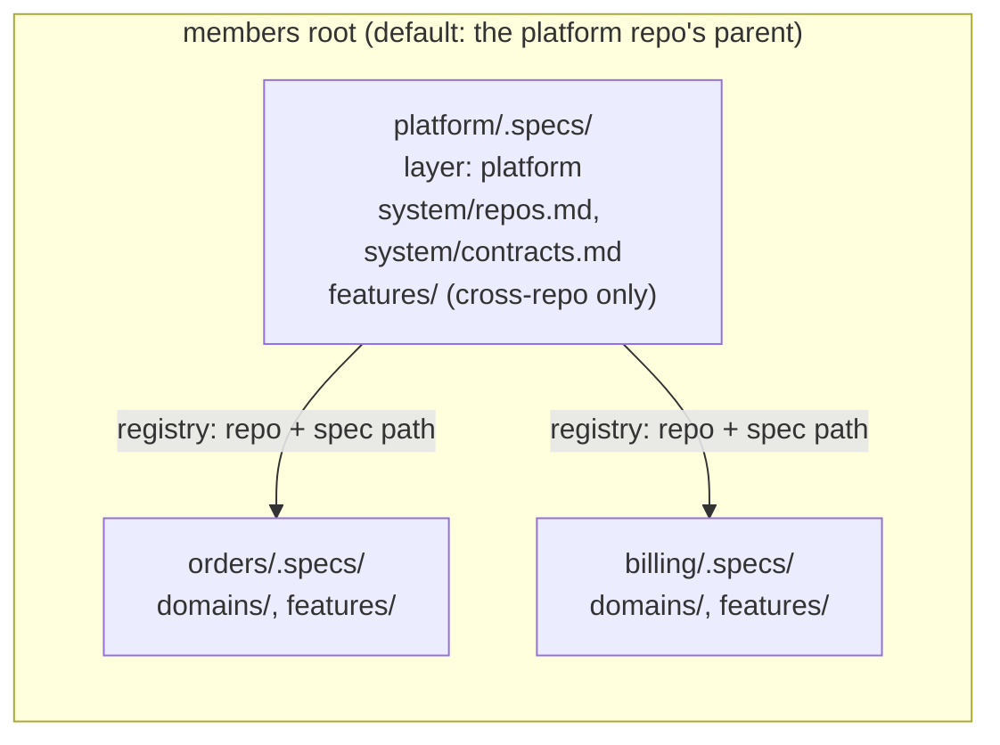

# v080 Platform layer — Design

The first slice: G2, G3, G11 of [`input.md`](input.md) and the part of G1 they need. Everything below sits behind
`"layer": "platform"`, so a root without it lints as today ([REQ-V080-01]).

## Rules for every worker

- Stdlib only, Python 3.8+, offline, no new dependency, no git call. All code goes into `kit/scripts/spec_lint.py`;
  `spec_report.py` gets the new resolution for free through `lint_all()` and is not edited.
- Red first: add the task's rows to selftest section 27, run `SELFTEST_ONLY=27 sh tests/selftest.sh` (with the task's
  subsection), see each fail for the stated reason, then fix, then `sh tests/gates.sh --docker` (G1 to G4).
- One task per dispatch. Tasks 3, 4 and 5 all start from task 2 and touch `spec_lint.py` and the `DEPS` line of the
  selftest; land them one after another, or rebase each on the last.
- Each task updates the `spec_lint.py` docstring and the `docs/reference.md` lines for what it changes. Task 6 writes
  the CHANGELOG entry.
- Messages keep the existing forms: `FAIL <file>:<line>: <why>` for a registry row, `FAIL task N: <why>` under the
  feature, `WARN <why>`.
- Requirement ids in this spec are written `REQ-ORD-nn`, so the spec does not define them; the fixtures use real
  numbers. Never cite a line number in backticks in a spec (G4 checks citations). Name the function.

## Layout

A member never points back: its lint reads only its own `.specs/`.

## Decisions

Each row is a recommendation until task 1 records the maintainer's answer.

| # | Decision | Recommended | Alternatives and trade-off |
|---|---|---|---|
| 1 | Where `layer` lives | **`spec-kit.json`**, validated by `load_config()`; setup also records it as a Facts row of the profile | The profile is prose that setup rewrites and the lint reads only for `status: setup-incomplete`; a second parser for one key. `spec-kit.json` already holds every key the lint obeys |
| 2 | How the lint finds a member checkout | **`--members-root DIR`, else `members_root` in `spec-kit.json`, else `..`** (siblings of the platform repo). Each member is `<root>/<repo>/<spec path>` from `system/repos.md` | Siblings only: breaks for a workspace folder or a CI job that checks out under `repos/`. Config only: one committed layout for every machine. An env var: invisible in a Gates row and in CI logs. Two inputs is the cost; the flag is for CI, the key for the team's layout |
| 3 | A member with no checkout | **WARN plus a named count on the summary line; exit unchanged** (the maintainer's call: fail visibly, not a FAIL) | FAIL: a developer with half the repos cloned could never lint the platform. Silent skip: what G2 is about. Cost: a CI job that forgets a checkout still exits 0, with the gap on its last line. Recorded as `shortcut:`, upgrade trigger: the first CI job that runs `--members` gets a flag that turns it into a FAIL |
| 4 | Which code lints a member | **The platform's `lint_all()`, in-process, with the member's own `spec-kit.json`** | Running each member's vendored `spec_lint.py` in a subprocess matches the member's own gate exactly, but spawns one interpreter per repo (slow on scanned laptops) and needs a kit in every checkout. Cost: a member on an older kit may get a different verdict here than in its own gate, until G9 compares kit versions |
| 5 | Which member files define ids | **`domains/*/requirements.md` and `features/*/requirements.md`** | Domains only: a platform task usually points at a member feature still in flight, whose ids move to `domains/` only at close-out. Features too means an id of a dropped member feature still resolves |
| 6 | An id defined nowhere while a member is not checked out | **WARN naming the members not checked; FAIL when all are checked out** | Always FAIL: forces every checkout for a plain platform lint. A REQ prefix column in `repos.md` would say which repo must define it: exact, but one more column to keep true. Cost: a typo in an id is only a WARN while any member is missing. `shortcut:`, upgrade trigger: a typo that reaches a merge |
| 7 | An id two repos define | **FAIL as ambiguous, only for ids a platform feature or doc cites** | First match wins: a cite silently points at whichever repo sorts first. Checking every id of every member, cited or not, reports collisions nobody depends on |
| 8 | A member id in brackets in a platform `requirements.md` | **Keep today's rule: brackets in `requirements.md` define. Cite member ids there without brackets; design and tasks bracket them as usual** | Treating a bracketed id that a member defines as a cite: then the same file means two things depending on which members are checked out, and the tracing FAILs come and go with a checkout. The keep costs writers one rule, which the tasks template and the playbook state, and a wrong bracket still FAILs visibly ("does not trace") |
| 9 | Which task lines the format applies to | **Every task in every feature of a platform root** | An opt-in marker per feature: a platform feature is cross-repo by definition, and `platform:` covers work in no repo |
| 10 | How far the child check goes | **Format always; the path must exist when that member is checked out; a PR is format only** | Also checking that a ticked task's child is Done: that is the readiness view, G10. Format only: a typo in a child path passes until someone clicks it |
| 11 | Chart twins on one line (`a, b: …`) | **Not in this slice: one line per repo, twins as two lines with the same `after:`** | The model that worked allowed a shared line; it doubles the parsing and the repo check for a rare case. Cost: a slightly longer task list |

Smaller calls, no decision needed: `layer` and `members_root` go into `DEFAULTS` only, not into the installed
`kit/spec-kit.json`, so an upgrade leaves every config byte-identical (selftest section 9); `docs/reference.md` lists
them. Feature names and `--cites` with `--members` are a usage error (exit 2): citations across repos are G4.

## [REQ-V080-01] [REQ-V080-02] Task 2: the layer key, the registry and the members root

- **Touches:** `load_config()` (`layer`, `members_root` in `DEFAULTS`, validated); new `registry(specs)` returning the
  rows (repo, spec path, line) and the FAILs; new `members(specs, config, root=None)` returning (repo, spec dir or
  None) per row; `lint_all()` (a `members_root=None` argument; on a platform root the registry FAILs join
  `result["refs"]`, so they print as `FAIL …` and count); `main()` (`--members-root DIR`, read like `--specs`); the
  docstring; `kit/templates/system/repos.md` and `kit/templates/system/contracts.md`; `kit/playbooks/setup.md`
  (Layout row: a fourth layout, platform; Phase 5: copy both registries, fill them from Phase 1, set `"layer"`);
  `GO.md` (Layout row: "platform over N repos"); `docs/reference.md`.
- **Fixture:** section 27 defines `p27 <dir>`: `<dir>/platform/.specs` (`"layer": "platform"`, a profile with
  `status: active`, `system/repos.md` listing `orders` and `billing`), `<dir>/orders/.specs` and
  `<dir>/billing/.specs` (`"layer": "member"`, a profile, one domain each defining one id). No git. Later subsections
  call `p27` on a fresh `$TMP/p27x` and add what they need.
- **Red rows (27):**
  - (a) `"layer": "plat"` exits non-zero with `layer must be "platform", "member" or null`. Today: exit 0, no message.
  - (b) `"members_root": 3` exits non-zero with `members_root must be a path string`. Today: exit 0.
  - (c) Platform root without `system/repos.md`: exit 1, `FAIL system/repos.md: no registry table (Repo, Spec path)`.
    Today: exit 0.
  - (d) A row `../evil`, a row `pay` with spec path `/abs`, a row `ship` with spec path `../x`, and `billing` listed
    twice: one FAIL each, every one starting `system/repos.md:<line>:`. Today: exit 0.
  - (e) The shipped `repos.md` template, copied as is, FAILs on its `<repo>` placeholder row; the shipped
    `contracts.md` copied as is lints clean.
  - (f) [REQ-V080-01] `orders` lints the same, byte for byte, before and after `rm -rf <dir>/platform`; a root with no
    `layer` and a broken `system/repos.md` lints as today (exit 0).
- **Fix:** the registry is the first table under `system/repos.md` whose header (case-folded, backticks dropped) has
  `repo` and `spec path`. A repo matches `^[A-Za-z0-9][A-Za-z0-9._-]*$`; a spec path is relative with no `..` part.
  `members()` joins `root / repo / spec path` (root: the argument, else `specs.parent / members_root`), returns None
  unless it is a directory, and drops a row whose path resolves to `specs` itself.
- **Check:** `SELFTEST_ONLY=27 sh tests/selftest.sh`, then G1 to G4.
- **Depends on:** task 1.

## [REQ-V080-03] Task 3: `--members`

- **Touches:** `main()` (the flag, the usage errors, the per-repo printing, the summary line, the exit code); the
  existing text printing moves into one function called once per repo; the docstring; `docs/reference.md`.
- **Red rows (27b):**
  - (a) The clean fixture: exit 0, `== platform`, `== orders`, `== billing` headers in registry order, last line
    `spec-lint --members: 0 FAIL across 3 repo(s)`. Today: the flag is dropped, no header (grep fails).
  - (b) An `orders` feature without `design.md`: exit 1, its FAIL under `== orders`, summary `1 FAIL across 3`.
  - (c) `billing` removed: `WARN member billing: no checkout at <path>`, summary ends `; 1 not checked: billing`,
    exit 0.
  - (d) `orders` sets `required_sections` that its feature lacks: that WARN prints under `== orders` only (each member
    lints with its own config).
  - (e) Members moved to `<dir>/elsewhere`: `--members-root <dir>/elsewhere` finds both; `"members_root":
    "../elsewhere"` in the platform's config finds both; with neither, both are not checked.
  - (f) `--members` on a root with no `layer`, with `--cites`, or with a feature name: exit 2 and a usage line.
  - (g) `--json --members`: one object with `platform`, `members` (repo to result, null when not checked) and
    `unchecked`; exit 1 on fixture (b), 0 on (c).
- **Fix:** lint the platform with `lint_all(specs, members_root=…)`, then `lint_all(member)` per checked-out member
  (its `load_config` reads its own `spec-kit.json`; a member that is itself a platform root is linted without
  `--members`, no recursion). `shortcut:` comment on the WARN (decision 3).
- **Check:** `SELFTEST_ONLY=27b sh tests/selftest.sh`, then G1 to G4.
- **Depends on:** task 2.

## [REQ-V080-04] Task 4: member ids resolve on a platform root

- **Touches:** `lint_all()` (on a platform root, read each checked-out member's `domains/*/requirements.md` and
  `features/*/requirements.md` with the platform's `req_id_pattern` into id → repos; the platform's own ids count as
  repo `platform`); `lint_feature()` (a dangling id is resolved, ambiguous, a WARN or a FAIL, decisions 6 and 7);
  `refs()` and `cited_ids()` (the member ids count as defined; `landings()` keeps the platform's own `req_defs`, so a
  decision row that lands on a member id still FAILs as undefined); the docstring; `docs/reference.md`.
- **Red rows (27c):** a platform feature `cross-a` whose design and tasks cite `REQ-ORD-nn` (fixture: defined in
  `orders/.specs/domains/`) and `REQ-BIL-nn` (fixture: defined in a `billing` feature).
  - (a) Plain lint, no `--members`: exit 0. Today: exit 1, `referenced but never defined`.
  - (b) A third id that no repo defines: exit 1, `referenced but never defined`, as today.
  - (c) `billing` removed: the `REQ-BIL-nn` cite is a WARN ending `not checked: billing`, exit 0; the orders cite
    still resolves.
  - (d) `billing`'s domain defines the orders id too: exit 1, `REQ-ORD-nn is ambiguous: defined in billing, orders`.
  - (e) `system/architecture.md` cites the orders id: no `cited but defined in no requirements.md` WARN. Today: that
    WARN.
  - (f) The orders id in brackets in `cross-a/requirements.md`: still `design.md does not trace` if design lacks it
    (decision 8, the rule unchanged).
- **Fix:** pass the id → repos map and the list of members not checked into `lint_feature()` as two optional
  arguments, default empty, so every other caller is unchanged.
- **Check:** `SELFTEST_ONLY=27c sh tests/selftest.sh`, then G1 to G4.
- **Depends on:** task 2. Can run beside task 3 on its own branch; land them as the worker rules say.

## [REQ-V080-05] Task 5: cross-repo task lines

- **Touches:** new `platform_tasks(text, rows, members)` returning `task N: <why>` FAILs; `lint_feature()` (called with
  the registry on a platform root, its FAILs join the feature's, so a Done or Dropped feature demotes them to
  `history:` WARNs as today); `kit/templates/feature/tasks.md` (one note line: on a platform root each task reads
  `- [ ] N <repo>: <what> → <repo>/.specs/features/<f>/ · after: N — [REQ-…]`, `platform:` for work in no repo,
  member ids unbracketed in `requirements.md`); `kit/playbooks/new-feature.md` §4 (one bullet, same rule); the
  docstring; `docs/reference.md`.
- **Red rows (27d):** a platform feature `cross-b` with `1 platform: decision`, `2 orders: … → orders/.specs/features/f/
  · after: 1`, `3 billing: … → https://example.invalid/pull/12 · after: 2`, `4 billing: … → billing#13 · after: 1, 3`,
  and `5 orders: …` wrapped so that `→` and `after:` sit on the continuation line, using `->`. That file lints clean;
  each row below changes one line, and today every one exits 0.
  - (a) `6 shipping: …` → `task 6: unknown repo 'shipping' (not in system/repos.md)`.
  - (b) Task 2 without its arrow → `task 2: no child (→ orders/.specs/features/<f>/ or a PR)`.
  - (c) Task 2 → `billing/.specs/features/f/` or `→ billing#2` → `task 2: child is not an orders feature or PR`.
  - (d) Task 2's child `orders/.specs/features/nope/` → `task 2: child … not found`; the same with `orders` removed
    → no FAIL (not checked).
  - (e) `after: 9` → `task 3: after 9: no such task`.
  - (f) Task 2 `after: 3`, task 3 `after: 2` → `after: cycle 2 → 3 → 2`, reported once; `after: 4` on task 4 is a
    cycle too.
  - (g) A task with no number → `task line without a number: '…'`; two tasks numbered 3 → `task 3: number used twice`.
  - (h) `Status: Done 2026-11-25 (#1)` with (a) in place: `history: task 6: unknown repo …` WARN, exit 0.
  - (i) [REQ-V080-01] The same broken `tasks.md` under a root with no `layer`: lints as today.
- **Fix:** per `task_blocks()` item: the number and `<who>` from the checkbox line
  (`- [ ] (\d+) ([\w.-]+): `); the child is the first token after `→` or `->` anywhere in the item; `after:` takes a
  comma-separated list of numbers. A PR child is `https?://\S+`, `#\d+` or `<repo>#\d+` with the line's repo. Cycles:
  a depth-first walk over the `after` edges, first cycle reported.
- **Check:** `SELFTEST_ONLY=27d sh tests/selftest.sh`, then G1 to G4.
- **Depends on:** task 2.

## [REQ-V080-01] [REQ-V080-02] [REQ-V080-03] [REQ-V080-04] [REQ-V080-05] Task 6: close-out

- **Touches:** `CHANGELOG.md` (the release entry), `docs/reference.md` (one pass over what tasks 2 to 5 wrote),
  `docs/overview/` at the release (deck, roadmap: v080 first slice shipped, the rest open).
- **Check:** `sh tests/gates.sh --docker`, every gate exit 0 read from its own exit code; `gate-review` on the whole
  diff (the registry parser reads paths from a committed file: review it as a trust boundary); the PR carries the
  Gates, Review and Verification blocks.
- **Depends on:** tasks 2 to 5.

## Tests

All in selftest section 27 (27, 27b, 27c, 27d; `DEPS` gains `27b:27 27c:27 27d:27`, since `p27` is defined in 27).
No git and no network: about 40 `python3` launches, a few seconds. Edges covered above: no registry, a bad and a
duplicate row, a missing member, a moved members root, an ambiguous id, a cycle, a self-loop, a wrapped task, Done
history, and the no-`layer` root unchanged.

## Rollout and rollback

Off by default: nothing changes until a root sets `"layer": "platform"`. Installing on a platform repo is a normal
single-repo install; setup's note sets the key. Rollback is reverting the PR; an older lint ignores the two new keys,
so a platform's `spec-kit.json` stays valid.

## Spec and doc impact

Specter has no `domains/`, so nothing to sync. Docs: `docs/reference.md`, `kit/playbooks/setup.md`, `GO.md`,
`kit/playbooks/new-feature.md`, `kit/templates/feature/tasks.md`, the two new `kit/templates/system/` files,
`CHANGELOG.md`; the overview deck and roadmap at the release.

## Out of scope

None of these is needed for G2, G3 or G11; each is its own later slice.

- **G1, the rest:** an installer `--layer` flag, marker-block lines per layer, setup interview questions beyond the
  Layout note.
- **G4:** a cites root for a platform in a sibling folder and `<repo>:path` cites into members; `--cites --members` is
  a usage error until then (not checked whether `cite_aliases` with a `../` path already covers it).
- **G5:** relative markdown links into another repo (pass if absent, check if present); task children are plain text,
  not markdown links, so G11 does not need it.
- **G6:** a contracts-registry check and a traceability reachability check; `contracts.md` ships as a template only.
- **G7:** one Drift Register location in the marker block.
- **G8:** a "platform rules live at…" marker line and a platform fetch helper.
- **G9:** comparing member kit versions with the platform's (decision 4 leans on it later).
- **G10:** a cross-repo readiness view in `spec_report.py` (a ticked task whose child is not Done).
- **G12:** Superseded and Moved statuses.
- **G13:** content-anchored or commit-pinned cites, and members read at their default branch: this slice lints each
  checkout as it is on disk.
- **G14:** a trimmed member kit or a fetch.
- **Private platforms:** the leak gate for member repos that must not name the platform ("Model that worked", last
  bullet of `input.md`).
