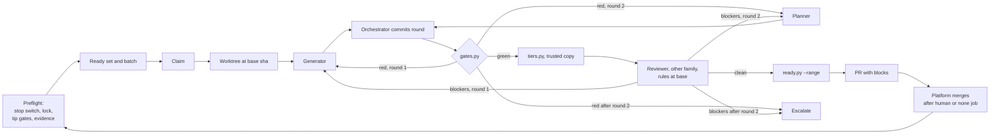

# v090 Orchestrator (stage 5) — Design

A proposal. Nothing here is built, and nothing is built before task 1 (the decision gate) is ticked. Working name:
`specter-run`.

## Recommendation in short

Build a thin command-line reconciler on top of the kit, in plain stdlib Python, that a human starts from a terminal.
Each invocation reads the state of one feature (the spec at the `merged_ref` tip, the plan issue, open PRs, its own
journal), moves every task it can one step forward through the existing review loop, and exits. It dispatches agents
through configured runners, so Claude Code, Codex or any other headless agent CLI can fill a role. It calls the kit's
own scripts from a trusted worktree of the base for every verdict. It opens PRs and comments on issues, and never
approves, merges or edits a trust-layer file: the platform and the humans keep those.

The first slice is offline and single-task: `plan` (what would run, no writes) and `task` (one task end to end in a
sandbox clone, no platform calls), measured on the acme-shop eval set (#35). Platform writes, parallel batches, resume
and a CI trigger come in later slices, each earned on the eval set.

## [REQ-V090-01] What the orchestrator owns, where it lives, how it stays agent-neutral

### Owns vs stays in the kit

| Concern | Kit (unchanged) | Orchestrator |
|---|---|---|
| Rules: spec rules, Gates table, autonomy profile, lessons, playbooks | Owns them; a human edits them | Reads them at the base sha; never edits them |
| Verdicts: gates, risk tier, readiness, evidence | `gates.py`, `tiers.py`, `ready.py`, `--evidence` | Runs them as programs and acts on the exit code |
| Role briefs | `kit/roles/` | Wraps them into prompt files |
| Sequencing: which task, which role, which round | `next-task.md`, `review-loop.md`, `parallel.md` (prose) | Does it, as code |
| Worktrees, claims, landing, the Resume state | A human, by the playbook | Does it, and journals it |
| Merge and approval | The platform, and a human or the `--auto-merge` job | Nothing |

The kit keeps its decision "no orchestrator or merge bot in the kit". The orchestrator is a client of the kit, like a
human lead is today.

### Where it lives

A top-level `orchestrator/` folder in the specter repository: outside `kit/`, never copied by `install.sh`, versioned and
released with specter, on specter's `trust` tier (Human `required`) once its paths are added to the profile by a human.
It runs against a pinned specter release in the target project: it uses the scripts installed in that project's
`.specs/kit/`, read from a trusted worktree of the base, so the project's own version of the rules decides, as
review-loop step 3 does by hand. This is open decision O1; a separate repository is the alternative.

`shortcut: one repo with specter, split into its own repository when it gets its own release cadence or a second
maintainer.`

### Dependencies

Python 3.8+ stdlib, `git`, `gh` for the platform (slice 2 on), Docker for the gates (the existing `--docker` path), and
the agent CLIs named in the run configuration. No Python package, no service, no database. The kit's "Markdown and
stdlib Python only" decision holds for the layer on top too.

### Runners: agent-neutral by configuration

A runner is a command line plus two declared facts. The orchestrator writes a prompt file, starts the command with the
worktree as its working directory and the prompt on stdin, waits for it to exit, and reads the report file it names in
the prompt. It never parses an agent's free text for a verdict: the reviewer's verdict comes from the verdict table the
review loop defines, and the gate verdict comes from `gates.py`.

| Field | Example | Used for |
|---|---|---|
| `cmd` | the agent's headless mode (`claude -p …`, `codex exec …`), as a list, never through a shell | starting the role |
| `model` | a full model id, never an alias (model-routing rule 5) | the `### Review` block and the family check |
| `family` | defaults to the first `-` token of `model`, as `ready.py` reads it | refusing a reviewer in the implementer's family |
| `report` | how the runner returns: the file the prompt names | reading the result |

The exact headless flags of each CLI (non-interactive mode, permission settings, how a run reports tokens) are UNKNOWN
until slice 1 probes them on the installed versions; the design does not depend on any one of them.

## [REQ-V090-02] Inputs and preconditions

| Input | Where it comes from | Checked how |
|---|---|---|
| Goal | one line on the command line or the plan issue title | shown in prompts and the plan comment; never parsed for instructions |
| Approved spec | the feature folder at the `merged_ref` tip, full sha | exists at the tip; `Status:` is `In progress`; no unticked `DECISION`; `spec_lint.py` exits 0 for it |
| Autonomy profile | `.specs/steering/autonomy.md` at the base | only through `tiers.py`; the orchestrator does not read it itself |
| Plan issue | the pinned issue that lists one issue per task (slice 2 on) | its task issues match `tasks.md` line for line, else escalation |
| Run configuration | a JSON file under `$HOME/.specter-run/`, outside the repository | written by a human; a PR cannot change it; read once at start |

The spec gets to the tip with `Status: In progress` only through a merge a human approved (the spec PR), so "approved"
needs no new marker. The run configuration lives outside the repository for the same reason `tiers.py` reads the profile
at the base: a change cannot rewrite the limits it runs under.

## [REQ-V090-03] The loop

Per task:

1. **Worktree.** `git worktree add --detach <dir> <base sha>` under `$HOME/.specter-run/work/`, then check that
   `git rev-parse HEAD` equals the base sha (parallel.md "Base check"). The branch is `orch/<feature>/task-<n>`.
2. **Dispatch the generator** with a prompt built from: the generator brief at the base, the task line, the feature's
   three files at the base, the design's worker rules if it has a section for them, and the output contract (write the
   report to the named file; do not commit; do not touch files outside the task). Environment: an allowlist
   (`PATH`, `HOME`, the runner's own credential variable, `PYTHONDONTWRITEBYTECODE=1`, `TMPDIR` set to a `mktemp -d`
   of its own). No platform token.
3. **Commit the round.** The orchestrator, not the worker, commits what the worker left in the worktree (review-loop
   step 1: workers never commit). A commit is the frozen diff of step 2 of the review loop, and it gives `gates.py`,
   `tiers.py` and `ready.py` a sha to bind to, so the gates run once per round, not twice.
4. **Trust-path check.** If the commit touches a trust-layer file (the list in REQ-V090-06), stop and escalate. No PR.
   `shortcut: the orchestrator keeps its own list, mirroring the guarded paths of tiers.py (profile, installed kit,
   Knowledge targets, agent files) plus the Gates table and lessons.md; tiers.py --json names only the strictest file
   (set_by), so ask the kit for a per-file guarded flag if the two lists ever drift.`
5. **Gate.** `gates.py` inside the gate container the run configuration names (for acme-shop the JDK 21 image G5
   uses), on a copy of the worktree, as `tests/gates.sh --docker` does; no secrets passed, network off unless the run
   configuration allows it for a gate that needs it (G5 fills a Maven cache on its first run). Output to a `mktemp`
   file; read the exit code. Red: a fix round (step 8). No image named: it runs on the host and the journal says so.
6. **Label.** `tiers.py --specs .specs --range <base sha>...<head sha>` from the trusted base worktree.
7. **Review.** A reviewer runner whose family differs from the implementer's, in a fresh process, in a detached
   worktree of the head, with the rules read by `git show <base>:…` as review-loop step 3 says, at the tier the label
   gives. After it exits, `git status` in its worktree must be clean (a reviewer does not edit code); otherwise the
   review is void and the task escalates. The verdict table goes into `### Review`; complete blockers start a fix round;
   advisories become follow-up issues.
8. **Fix rounds.** One counter per task, shared by gate and review failures. Round 1: the generator again with the full
   output. Round 2: the planner with the spec, the diff and both outputs. A third failure is an escalation, and the
   orchestrator dispatches nothing more for that task until a human removes the escalation.
9. **Readiness and PR.** The orchestrator writes the PR text (Gates, Risk tier, Review with `rounds:` from its counter,
   Verification), runs `ready.py --range <base sha>...<head sha> --pr <file>` from the trusted copy, and adds its
   `### Readiness` block. `ready`: push the branch, open the PR. `not ready`: open it as a draft with the reason, and
   escalate.
10. **After the merge** (a later invocation): the task is done when its PR is merged. The orchestrator never asks for
    the merge.

Counting rounds in code closes the review loop's own shortcut ("rounds are declared by the lead, not counted by a
script") for every change the orchestrator runs.

### Task states

| State | Meaning | Recorded as |
|---|---|---|
| queued | unticked, prerequisites not merged | nothing |
| ready | unticked, prerequisites merged, not claimed | nothing |
| claimed | the orchestrator took it | issue comment by its identity; journal |
| round `r` | a dispatch is running or finished | journal (PID, runner, prompt sha256) |
| in review | PR open, waiting for the platform | PR; label `specter:in-review` |
| merged | PR merged | platform |
| escalated | waiting for a human | label `specter:escalated`, comment with both outputs |

## [REQ-V090-04] Outputs

| Output | Content | Who reads it |
|---|---|---|
| One PR per task | the five blocks above; `Closes #<task issue>`; `Deploy impact:` from the worker's report, defaulting to "unknown", which escalates | the human at `required` or `spot`; the `--auto-merge` job at `none` |
| Plan-issue comment | one comment the orchestrator edits: per task its state, PR link and rounds; the next batch; open escalations | the maintainer, at any time |
| Escalation | label on the task issue, and a comment with the gate output or verdict table of both rounds, the patch file names and the journal lines | the maintainer |
| Follow-up issues | one per advisory, linked from the PR | whoever triages |
| Journal | JSON lines per run under `$HOME/.specter-run/` | audits, the eval report, resume |
| Offline mode (slice 1) | the same PR text as a file, the branch in a local bare remote, the escalation as a file | the person running the eval |

Ticks in `tasks.md` and the "▶ Resume here" block are open decision O3: by default they land in one small PR per batch,
not in each task PR, because parallel PRs that tick adjacent lines of `tasks.md` conflict (the dropped-task-line lesson).

## [REQ-V090-05] Dispatch rules as code, and resume

### parallel.md, rule by rule

| parallel.md rule | In code |
|---|---|
| At most 3 agents per batch | `max_agents` in the run configuration, capped at 3 |
| Group by functions and files; no two workers in the same code | a task joins a batch only if it declares what it touches (a `**Touches:**` line in its design section, as v061 wrote them) and that set is disjoint from every other task in the batch; a task that declares nothing runs alone |
| One worktree per worker, under `$HOME` | step 1 above |
| Base check | step 1 above; a mismatch stops the task |
| No bytecode, unique temp files | the worker's environment and its own `TMPDIR` |
| Claim on the issue | before the dispatch, as its identity (slice 2) |
| Red first | in the generator brief; the reviewer checks it |
| No polling loops | the orchestrator never sleeps in a loop: it exits and is started again by a human (or, later, by a platform event) |
| Gate output to a file, read the rc | step 5 above |
| Landing by cherry-pick, count task lines | replaced: each task lands as its own PR; the tick PR is generated, so no task line can drop |
| Gates once on the tip | preflight of each invocation, once per new tip sha (cached in the journal), in the container |
| Stop leftovers; kill by PID | the journal records each child PID; preflight kills recorded PIDs still alive from a dead run; never by pattern |

### Resume

The orchestrator holds no state that is not on disk or on the platform. Each invocation rebuilds the task states from:
the feature at the tip, the `orch/` branches, the PRs and labels, and the journal. The rules are the fail-closed ones:

| Found | Action |
|---|---|
| a claimed task with a live recorded PID | leave it, report it |
| a claimed task whose PID is dead and whose round has no result | count the round as used, then continue or escalate under the cap |
| an `orch/` branch or PR with no journal entry, or the reverse | escalate; never redo |
| a PR whose head moved since the orchestrator pushed it | escalate (someone else pushed) |
| the run configuration changed since the claim | finish nothing new under it until a human confirms with a flag |

A lost journal is rebuilt only as far as the platform shows (PR blocks carry `rounds:`); anything else escalates.

## [REQ-V090-06] Human touchpoints and the trust-layer boundary

| Touchpoint | Trust-layer source | What the orchestrator does |
|---|---|---|
| Spec approval | pipeline.md "Spec approval" | runs only a spec at the tip with Status `In progress`; never edits Status, a DECISION task or a requirement |
| An open DECISION | next-task.md step 2 | stops and escalates |
| Rule changes | parallel.md "Changing this file"; guarded paths in `tiers.py` | never edits the profile, the Gates table, the installed kit, agent files, `lessons.md`, its own code or its run configuration; a worker diff that does is an escalation, not a PR. A lesson it proposes goes into the escalation or eval report for a human to write |
| Human `required` | `tiers.py` label | opens the PR and waits; the human reruns the gates and reads the verdict table |
| Human `spot` | `tiers.py` label | the same; the PR names the flagged files |
| Human `none` | review-loop step 5, `ready.py --auto-merge` | nothing: it holds no approver credential, and the platform job decides |
| Fix-round cap | review-loop step 4 | counts the rounds and escalates after round 2 |
| A disputed finding | pipeline.md | the planner round, then escalation |
| A `demote:` line or `breach` | `tiers.py --evidence` | pauses dispatch for that tier and escalates; never edits the profile |
| `Deploy impact` not `none` | spec-rules Definition of Done | escalates before the PR leaves draft |
| A red tip | parallel.md "Landing" | dispatches nothing until a human clears it |
| Any state it cannot explain | REQ-V090-07 | escalates |

The orchestrator never merges past what `ready.py --auto-merge` allows because it never merges at all, and it never
approves. The only path to a merge without a human is the platform job of review-loop step 5, which the orchestrator
neither runs nor configures.

## [REQ-V090-07] Safety

### Credentials and permissions

| Who | Holds | Cannot |
|---|---|---|
| Agent processes | the model vendor's credential their CLI needs, nothing else | reach the platform, push, read the orchestrator's token |
| The gate container | nothing: no env passed, network off unless the run configuration allows it | read a secret; reach the network when not allowed |
| The orchestrator | one platform identity of its own (open decision O4): contents write limited by a ruleset to `orch/*`, issues and PR write | push to the default branch, create tags or `refs/replace/`, merge, change settings (platform-enforced); approve (its code has no approve call, and it is the author of every PR it opens, which the platform refuses to let it approve) |
| The approver of Human `none` | unchanged: the App of review-loop step 5 | is never configured or read by the orchestrator |

The Guardrails rows "Agent credentials cannot approve or merge" and "Agent permissions come from the host's
configuration, not from a prompt" are declared for the orchestrator's identity and the runners' settings files by a
human, on a dated check, like every other row. Whether a token with PR write can approve another author's PR on the
chosen platform is checked live in slice 2; until then the "no approve call" selftest is the control.

### Untrusted text

Prompts are built only from the spec at the base sha, the kit's role briefs at the base, and the orchestrator's own
templates. Issue bodies, PR comments and review comments are never pasted into a prompt. The orchestrator reads from
the platform only labels (and checks that a maintainer set the ones that change its behaviour) and its own marker
comments (checked by author). This is research guardrail E8 applied to the orchestrator itself.

### Cost and resources

| Limit | Default (run configuration) | Why |
|---|---|---|
| Agents at once | 1 in slice 1, at most 3 later | parallel.md; scanners on the corporate laptop slow every process |
| Gate containers at once | 1, `--memory 2g` | as `tests/gates.sh --docker` |
| Wall clock per dispatch | 45 minutes | a stuck agent must not hold a slot for hours |
| Dispatches per task | 6 (generator, its retry, the planner, up to 3 reviews) | the fix-round cap, plus a review after each round |
| Dispatches and tokens per run | set per run; tokens only where the runner reports them | budget; a runner that reports nothing counts dispatches only |
| Processes | one child per agent, tracked by PID | the stray-process lessons |

### Kill switch

A file `$HOME/.specter-run/STOP` or a `specter:stop` label on the plan issue stops the run: checked before every dispatch
and every platform write. `specter-run stop` kills the PIDs the journal recorded for the live run, never by pattern, and
journals the stop. Ctrl-C does the same for its own children.

### Audit log

Append-only JSON lines, one file per run: timestamp, task, round, role, runner, model id, prompt sha256, base and head
shas, exit codes of every kit script, verdict, and every platform call with its target and response status. The PR
blocks are the public half of the same record.

### Failing closed

Every branch the orchestrator does not expect ends the task in `escalated`, with the reason: an unknown exit code, an
unparseable verdict table, `ready.py` exit 2, a moved sha, a missing runner, a budget it cannot read, a stop switch it
cannot read, a platform error. It never retries a platform write blindly and never guesses a verdict.

## [REQ-V090-08] Earning trust on the eval set

Issue #35 gives the set: in `examples/acme-shop/eval/`, 3 to 5 goals of rising difficulty (a docs-only change, a
one-file bug fix with a failing test, a small feature across two layers, a change on a guarded path, a goal that must
escalate). Each stage runs the set from a clean copy, with G5 in the JDK container, and writes
`docs/evals/<date>-acme-orchestrator.md`. The first report is a baseline run by hand, the v061 way, so human minutes
and wall time have something to compare against.

| Stage | Runs | Writes allowed | Moves on when (recommended, O7) |
|---|---|---|---|
| R0 dry run | `plan` only | none | the plan for each eval goal matches the one the maintainer would make; the batches it prints for v061's tasks respect v061's lanes table |
| R1 shadow | `task`, one at a time, in a sandbox clone with a local bare remote | the sandbox | two full runs of the set: every expected escalation escalated, every label as #35 expects, no trust-layer file touched, every non-escalating goal delivered at least once |
| R2 assisted | real PRs and issues on a sandbox GitHub repository of acme-shop | `orch/*` branches, issues, PRs there | three full runs and at least 10 tasks with no write outside that list; human minutes per PR at or below the baseline |
| R3 real use | a real repository, tiers `required` and `spot` | the same | reviewed by the maintainer every 20 tasks |
| Human `none` | unchanged | unchanged | stage 4's live verification, and the tier `eligible`, as today |

Metrics per run and per goal class (research recommendation 8; never raw PR counts): delivered, merge rate, revert
rate, fix rounds, gates green on the first try, labels as expected, escalations expected vs actual, writes outside the
stage, trust-layer files touched, wall time, human minutes per PR, tokens per merged PR where reported. Two are zero
tolerance at every stage: a missed expected escalation and a write the stage does not allow. Either moves the
orchestrator back one stage, and the fix ships with a selftest row that would have caught it (the lessons rule).

## Alternatives considered

| Option | Pros | Cons | Ops impact |
|---|---|---|---|
| A. Keep it a playbook (today) | No code; the human sees everything | The human is the scheduler; the lessons show the slips repeat; does not scale past one lead | Monitoring is the human's attention; nothing to roll back |
| B. Adopt an agent framework (Composio Agent Orchestrator, Kiro Crew, OpenHands; an agent SDK) | The issue → worktree → PR → CI-fix loop exists; less code to write | None of them knows the trust layer's rules (rules at base, round cap, other-family reviewer, trusted kit copy), so they would be re-encoded as configuration or patches; a new dependency against "stdlib only"; young projects (Kiro Crew 0.1.x); an agent SDK ties the loop to one vendor | Another system to monitor and upgrade; debugging spans their code and ours; rollback is uninstalling it |
| C. CI-driven (GitHub Actions with Claude Code Action or gh-aw) | Platform permissions and safe outputs; logs per run; no laptop needed | Needs Nikos's OK for Actions (local-first CI); GitHub-only; secrets and agent runs in CI widen the attack surface the guardrails warn about; slow to debug | CI minutes and agent cost per event; rollback is disabling the workflow. Kept as a later trigger for the same CLI (O6) |
| **D. Thin reconciler CLI on top of the kit (recommended)** | Reuses every kit verdict as a program; agent-neutral by configuration; no daemon, so no polling and resume for free; same code runs from a terminal now and from CI later; stdlib only | We own the code (an estimated 600 to 1,000 lines of Python plus a selftest for slices 1 to 3); each CLI's headless flags drift and must be probed | The journal and the plan comment are the monitoring; the journal and PR blocks the debugging; rollback is not running it, since it never holds merge rights |
| E. Long-running service (a daemon, Temporal) | Durable workflows, retries, scale | Infrastructure for a solo maintainer; a daemon tempts polling; no measured bottleneck (the research: "only after a measured bottleneck") | A service to keep alive and secure |

D borrows from B and C what fits: Composio's loop shape, OpenAI Symphony's state board (the plan comment) and gh-aw's
split between a read-only agent job and a validated write step (agents never write to the platform; the orchestrator's
own step does, after the kit's scripts say yes).

## Decisions (taken by this proposal; approving task 1 accepts them)

| # | Decision | Chosen | Trade-off |
|---|---|---|---|
| 1 | Process model | A reconciler: each invocation advances what it can and exits | No live progress view beyond the plan comment; in exchange no polling, no daemon, and resume is the normal path |
| 2 | Who commits | The orchestrator commits each round on `orch/<feature>/task-<n>`; workers never commit | A round is a commit, so the branch has up to three commits per task; squash merge (which evidence assumes) folds them |
| 3 | Which kit runs the verdicts | The target project's installed kit, from a trusted worktree of the base sha | The orchestrator follows each project's kit version, so it must handle older script outputs; a project below 0.10.0 is refused |
| 4 | Where config and journal live | `$HOME/.specter-run/`, outside every repository | A PR cannot loosen the limits; the journal is per machine, so a second machine starts from the platform state only |
| 5 | Parallelism | Serial unless tasks declare disjoint `Touches:` | Specs without Touches lines run one task at a time; the template gains an optional line only through a separate, human-approved kit change |
| 6 | Reviewer family | Refused at dispatch when it equals the implementer's | Needs two vendors' CLIs to run at all; with one vendor, the review still runs but the run configuration must say so, and `ready.py` keeps warning |
| 7 | Escalation | A label and a comment; it clears only when a maintainer removes the label | One more manual step; in exchange no agent retries what the cap stopped |
| 8 | Gates | In the container path, with no network, once per round | Slower than the host on a fast machine; on a scanned laptop it is the faster path (the scanner lesson) |

## Open decisions for the maintainer

| # | Question | Options | Recommended |
|---|---|---|---|
| O1 | Where does it live? | (a) `orchestrator/` in the specter repo, outside `kit/`, never installed; (b) its own repository now | **(a).** One release, one Gates table, the eval set next to it; split when it needs its own cadence |
| O2 | How does a task land? | (a) one PR per task to the default branch; (b) a feature branch with cherry-picked tasks and one release PR, as v061 did | **(a).** The trust layer judges per change: the size cap, evidence per merged commit and `none` only work on small single-task PRs. A batch PR is always the strictest tier |
| O3 | Where do ticks and the Resume block go? | (a) one tick PR per finished batch; (b) each task PR ticks its own line | **(a).** Parallel PRs ticking adjacent lines conflict; the plan comment shows live state in between |
| O4 | Which identity does it use? | (a) its own GitHub App (separate from the `none` approver App) or machine user, write limited to `orch/*` by a ruleset; (b) the maintainer's own token | **(a).** With (b) every PR is authored by Nikos, who then cannot approve it, and the audit trail cannot tell agent from human |
| O5 | Which runners first? | (a) Claude Code as planner and generator, Codex as reviewer; (b) one vendor with two models | **(a).** Two families are what the review contract and `ready.py` want. (b) works but never reaches `none` |
| O6 | What starts an invocation? | (a) a human runs it from a terminal through R2; (b) a CI job on each push to the default branch | **(a)** now; **(b)** at R3, and only with Nikos's OK under the local-first CI rule |
| O7 | Rollout thresholds | the numbers in the stage table, or others | **The table's numbers**, revisited after the first eval report |
| O8 | Order against other work | (a) #35's first three goals and a hand-run baseline first, then slice 1; (b) slice 1 first | **(a).** Slice 1 is measured on #35. The stage-4 live recipe test is not a prerequisite for R0 to R2, which never use `none` |

## First slice (after approval)

Offline, one task at a time, no platform calls. It proves the loop, the round counting and the fail-closed paths on
real code before the orchestrator gets any credential.

- `orchestrator/specter_run.py plan <feature>`: the preconditions (REQ-V090-02), the ready set and the batches it would
  run, printed. No writes, no agents.
- `orchestrator/specter_run.py task <feature> <n> --sandbox <dir>`: steps 1 to 9 of the loop against a sandbox clone and
  a local bare remote, with the escalation and the PR text written as files, the journal, the stop file and the
  per-dispatch timeout.
- `orchestrator/selftest.sh` with fake runners (shell scripts that edit, fail, block or misbehave on cue) covering the
  acceptance lines of REQ-V090-01, 02, 03, 06 and 07.
- A gate row for the orchestrator's selftest in specter's Gates table and `tests/gates.sh` (a trust-layer change: Nikos
  reviews it).
- The first R1 eval report on #35.

Not in the first slice: the platform (claims, PRs, labels, the plan comment), batches of more than one task, resume
from a dead run, the evidence pause, the tick PR, the triage stage and any CI trigger. They are tasks 4 to 7.

## Traceability

| Requirement | Section |
|---|---|
| [REQ-V090-01] | What the orchestrator owns, where it lives, how it stays agent-neutral |
| [REQ-V090-02] | Inputs and preconditions |
| [REQ-V090-03] | The loop |
| [REQ-V090-04] | Outputs |
| [REQ-V090-05] | Dispatch rules as code, and resume |
| [REQ-V090-06] | Human touchpoints and the trust-layer boundary |
| [REQ-V090-07] | Safety |
| [REQ-V090-08] | Earning trust on the eval set |
