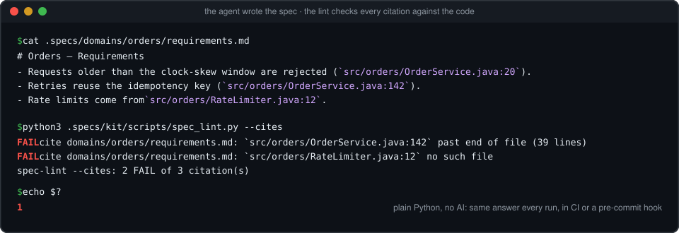
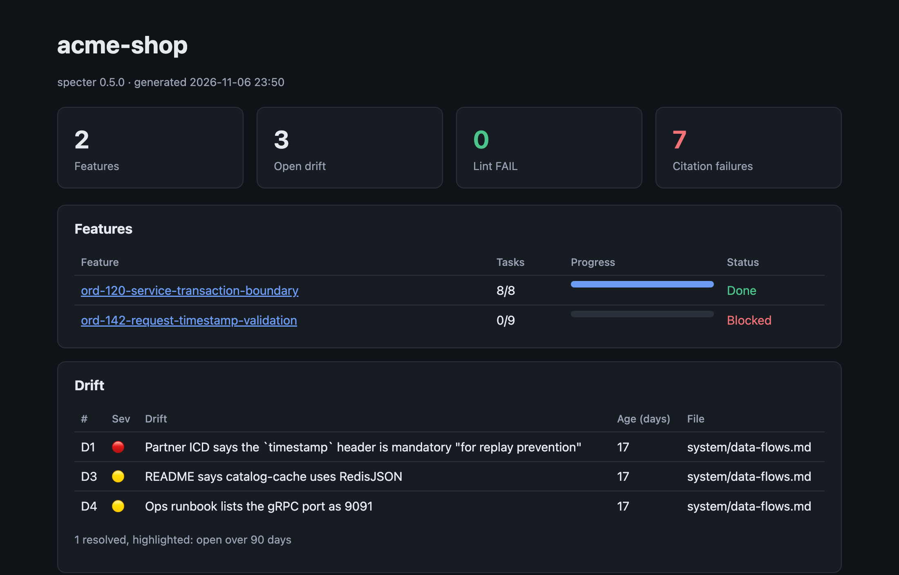
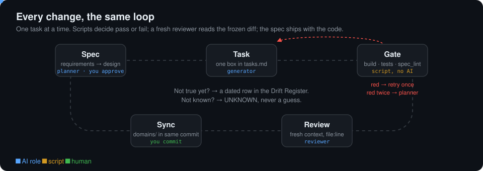

<p align="center"></p>

<h1 align="center">specter</h1>

<p align="center"><b>Specs that don't go stale.</b> A spec-first workflow for <i>any</i> AI coding agent.</p>

<p align="center">
  <a href="LICENSE"></a>
  <a href="CHANGELOG.md"></a>
  
  
</p>

AI agents write specs that sound right and cite code that doesn't exist. Specter makes them cite `path:line` for every
claim, and a plain Python lint fails the build when a citation points at a missing file or a line that isn't there.
It is built for codebases that already exist: setup reads your code, writes as-built docs, and logs what doesn't
match in a dated Drift Register instead of hiding it.

<p align="center"></p>

## Try it in 2 minutes, no install

```bash
git clone https://github.com/natsaros7/specter.git ~/tools/specter && cd ~/tools/specter
python3 kit/scripts/spec_lint.py --specs examples/acme-shop/.specs    # structure and REQ traceability
python3 kit/scripts/spec_report.py --specs examples/acme-shop/.specs --out /tmp/report.html && open /tmp/report.html
```

[`examples/acme-shop/.specs/`](examples/acme-shop/.specs/README.md) is a full spec tree for a fictional shop. The
example ships without its code, so its citation check fails on purpose. The report looks like this:

<p align="center"></p>

## Set it up on your project

Open your agent (Codex, Claude Code, Cursor, Copilot, Gemini CLI…) **in your project** and paste:

```text
Follow ~/tools/specter/GO.md for this project.
```

The agent looks at the project, says what it would set up, and asks before changing anything. It then asks a few
questions (`ok` accepts every default) and writes the specs. Expect about 20 minutes, mostly the agent reading code.
Commit `.specs/` afterwards; teammates get it with the repo and never need specter itself.

<p align="center"></p>

Without AI: `~/tools/specter/install.sh ~/code/my-project` (add `--dry-run` to see every path first).

## How it compares

| | [Spec Kit](https://github.com/github/spec-kit) | [OpenSpec](https://github.com/Fission-AI/OpenSpec) | [Kiro](https://kiro.dev) | **specter** |
|---|---|---|---|---|
| Form | CLI (`uv`, Python 3.11+) | CLI (npm, brew…) | IDE | Markdown + stdlib Python scripts, copied into `.specs/` |
| Starts from | A new feature idea | A change proposal | A prompt in the IDE | Your existing code: setup writes as-built docs first |
| Specter adds | | | | Lint-checked `path:line` citations, a Drift Register, `UNKNOWN` instead of guesses, a pre-commit hook that warns when code changes without its spec |

If you start a greenfield project and want a big community, Spec Kit or OpenSpec are the safer pick. Specter is for
a system that already runs, where the docs have drifted and you want the agent's claims checked.

## Every change, the same loop

<p align="center"></p>

Say these to your agent. With the skill installed, `/spec-first …` (Claude Code) or `$spec-first …` (Codex) also works.

| Say | What happens |
|---|---|
| **"Spec this: <change>"** | requirements → design → tasks with traceable `[REQ-…]` IDs, lint, then it waits for your approval |
| **"Next task on <feature>"** | One task, the project's gate, tick the box |
| **"Sync specs, <feature> landed"** | Marks it done, folds the change into the as-built `domains/` docs, updates traceability and drift |
| **"Refresh the specs"** | Re-reads the latest code and logs new drift |

Small changes (one file, no contract change) skip the spec and go straight to code. The rules behind all this are in
[`PHILOSOPHY.md`](PHILOSOPHY.md), and [`kit/docs/spec-driven.md`](kit/docs/spec-driven.md) explains the method on one
page.

## Supported agents

The installer wires the agents your project already uses (`.claude/`, `.codex/`, `.cursor/`, …) and nothing else.

| Agent | Rules | Skill | Status |
|---|---|---|---|
| Codex | `AGENTS.md` | `.agents/skills/spec-first/` · `$spec-first` | ✅ |
| Claude Code | `CLAUDE.md` block | `.claude/skills/spec-first/` · `/spec-first` + role sub-agents | ✅ |
| Cursor | `.cursor/rules/spec-first.mdc` + `AGENTS.md` | `.cursor/skills/spec-first/` | best-effort |
| Gemini CLI | `GEMINI.md` block | `.gemini/skills/spec-first/` | best-effort |
| GitHub Copilot | `.github/copilot-instructions.md` block | `.github/skills/spec-first/` | best-effort |
| Antigravity (`agy`) | `AGENTS.md` | `.agents/skills/spec-first/` | best-effort |
| Anything else | `AGENTS.md` | — | Paste "Follow `.specs/kit/playbooks/…`" |

## Adding specter to a project that already has specs

Run `./install.sh ~/code/my-project --dry-run`, then without `--dry-run`. When `.specs/` already holds specs and no
kit, the installer adopts them: it adds `.specs/kit/` and the agent marker blocks, changes none of your specs, and
installs no git hook unless you pass `--hook`. Then set `tracker_pattern` and `merged_ref` in `.specs/spec-kit.json`.
Details in [the reference](docs/reference.md#adding-specter-to-a-project-that-already-has-specs).

## Reference

[`docs/reference.md`](docs/reference.md) covers the spec tree layout, the planner/generator/reviewer roles and model
routing, every script, all `spec-kit.json` keys, decisions and denylist, upgrade and uninstall. Changes are in
[`CHANGELOG.md`](CHANGELOG.md).

## FAQ

**Which model should run setup?** Your strongest. On the same app, a frontier model found twice the verified
citations and real code hazards for the Drift Register; a fast model produced a correct but shallow map. Day-to-day
tasks are fine on a mid-tier model.

**Does it need Claude?** No. Everything is markdown and stdlib Python.

**Does anything leave my machine?** Specter sends nothing anywhere. Your agent reads your repo as it always does.

**Can I stop it nagging?** Set `"spec_sync": "off"` in `.specs/spec-kit.json`, or `"block"` to make the hook refuse
commits.

**What does it cost?** Nothing. No service, no CI to pay for.

## Contributing

Issues and PRs are welcome. Every change passes the gates in [`AGENTS.md`](AGENTS.md#working-on-specter-itself);
`sh tests/selftest.sh` runs them offline.

## License and credits

[MIT](LICENSE). Inspired by [Kiro](https://kiro.dev)'s requirements → design → tasks triplet and steering files. The
rest came from running the method on a multi-service production system. Kiro is a trademark of its owner; specter is
independent, not affiliated with or endorsed by Amazon or the Kiro team, and uses no Kiro code, text or assets.
