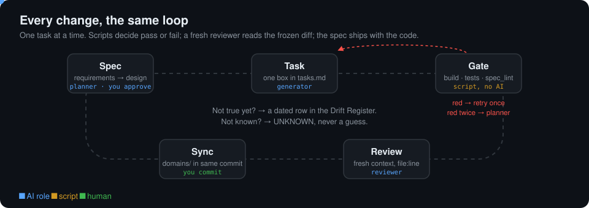
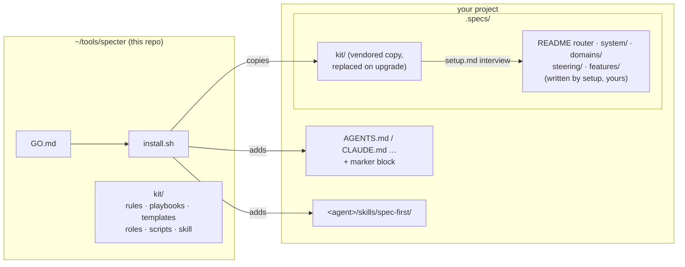
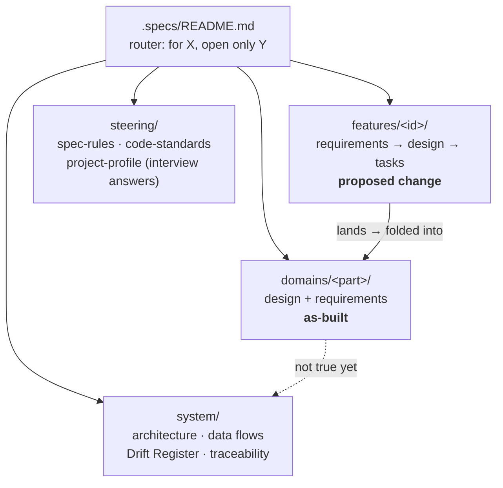

<p align="center"></p>

<h1 align="center">specter</h1>

<p align="center"><b>Specs that don't go stale.</b> A spec-first workflow for <i>any</i> AI coding agent.</p>

## Clone it. Paste one line. Your agent does the rest.

```bash
git clone https://github.com/natsaros7/specter.git ~/tools/specter
```

Open your AI agent (Codex, Claude Code, Cursor, Copilot, Gemini CLI…) **in your project** and paste:

```text
Follow ~/tools/specter/GO.md for this project.
```

That's all. The agent looks at your project, tells you what it would set up, and asks before changing anything. Then
it asks you a few questions (`ok` accepts every default) and writes the specs. About 20 minutes, most of it the agent working.

<p align="center"></p>

When it's done, commit `.specs/`. Your teammates get everything with the repo and never need to clone specter.

> **Other ways in:** open the agent *in the specter folder* and just say **go**, or install without AI with
> `~/tools/specter/install.sh ~/code/my-project`.

## Why

- **AI agents are confident by default.** Specter makes them cite `path:line`, mark what they can't verify as
  `UNKNOWN`, and write the spec *before* the code.
- **Docs rot.** Here the spec ships in the same commit as the code, and anything not true yet goes into a dated
  **Drift Register**, never a silent lie.
- **Scripts judge structure; AI judges content.** Lint, traceability and the spec-sync hook are plain Python: free,
  fast and the same every time.

More in [`PHILOSOPHY.md`](PHILOSOPHY.md) (12 short rules, each learned the hard way). New to spec-driven development? Read
[`kit/docs/spec-driven.md`](kit/docs/spec-driven.md): the method in one page, including EARS-style acceptance criteria.

## Where it goes

`.specs/` lives at the top of whatever you call "the system":

| Your layout | Install at | Git hook |
|---|---|---|
| One repo | The repo root | ✅ warns when code changes without a spec change |
| Monorepo | The repo root (one `domains/` folder per deployable) | ✅ |
| **Several repos for one system** | The **folder holding them** (`git init` it and add the child repos to `.gitignore`) | — commits happen in the child repos; the agent rules and review keep specs in sync |

## Every change, the same loop

<p align="center"></p>

Say these to your agent. With a skill installed, `/spec-first …` (Claude Code) or `$spec-first …` (Codex) works too.

| Say | What happens | Playbook |
|---|---|---|
| **"Spec this: <change>"** | requirements → design → tasks with traceable `[REQ-…]` IDs, lint, then it waits for your approval | `new-feature.md` |
| **"Next task on <feature>"** | One task, the project's gate, tick the box | `next-task.md` |
| **"Sync specs, <feature> landed"** | Close-out: `Status: Done`, folds the change into the as-built `domains/` docs, traceability and drift | `sync.md` |
| **"Refresh the specs"** | Re-grounds against the latest code, logs new drift | `refresh.md` |

Small changes (one file, under the threshold, no contract change) skip the spec and go straight to code.

## What lives where



### The spec tree it builds



## The helpers: three roles

The person who writes the code never approves it, and the expensive model is only used where judgement matters.
The roles are plain markdown briefs in [`kit/roles/`](kit/roles/README.md), so they work with any agent.

| Role | Model tier | Does | Never does |
|---|---|---|---|
| **planner** | deep: your strongest model, high effort | Setup and refresh, feature specs, architecture, root-cause diagnosis, security reviews, escalations | — |
| **generator** | standard: a mid-tier model | Implements **one** task, writes tests, runs the gate, reports the exit code | Commit; decide what the spec left open |
| **reviewer** | standard; deep for security paths | Reads the frozen diff in a **fresh context** and reports findings with `file:line` | Edit code |

How to use them:

- **Any agent:** start a new session: *"Act as `.specs/kit/roles/reviewer.md` on `<patch>`"*.
- **Model profiles:** map *deep* and *standard* to two profiles.
- **Claude Code:** gets the roles as native sub-agents automatically.

The rules are simple: a red gate gets one retry at the same tier, two reds escalate to the planner, and nothing
escalates without a failed gate. Details: [`kit/docs/model-routing.md`](kit/docs/model-routing.md) ·
[`kit/docs/review-loop.md`](kit/docs/review-loop.md).

## Supported agents

The installer detects what you use from the project's own files (`.claude/`, `.codex/`, `.cursor/`, `.agents/rules`, …).
Tools that are only installed on your machine are reported but not wired, so a project doesn't fill up with folders
for tools nobody on the team uses. `GO.md` wires the agent you're running plus any you name, and
`--agents=codex,claude` overrides detection.

| Agent | Rules | Skill | Status |
|---|---|---|---|
| Codex | `AGENTS.md` (native) | `.agents/skills/spec-first/` · `$spec-first` | ✅ official paths |
| Claude Code | `CLAUDE.md` block | `.claude/skills/spec-first/` · `/spec-first` + role sub-agents | ✅ |
| Cursor | `.cursor/rules/spec-first.mdc` + `AGENTS.md` | `.cursor/skills/spec-first/` | best-effort (community docs) |
| Gemini CLI | `GEMINI.md` block (if present) | `.gemini/skills/spec-first/` | best-effort |
| GitHub Copilot | `.github/copilot-instructions.md` block (if present) | `.github/skills/spec-first/` | best-effort |
| Antigravity (`agy`) | `AGENTS.md` | `.agents/skills/spec-first/` | best-effort; dry-run tested end to end |
| Anything else | `AGENTS.md` | — | Paste "Follow `.specs/kit/playbooks/…`" |

If a skill path turns out to be wrong for your tool, nothing breaks: the `AGENTS.md` rules and playbooks still work.

## The scripts (no AI, Python 3.8+, stdlib only)

```bash
python3 .specs/kit/scripts/spec_lint.py           # files present, REQ traced both ways, links resolve
python3 .specs/kit/scripts/spec_lint.py --cites   # every `path:line` citation exists and points at real code
python3 .specs/kit/scripts/spec_lint.py --json    # same checks as JSON on stdout (also with --cites)
python3 .specs/kit/scripts/spec_report.py         # one HTML page: feature progress, open drift, coverage, citations
python3 .specs/kit/scripts/spec_sync_check.py     # code changed but no spec change? (the pre-commit hook)
```

Citations: `path:12`, `path:12-20,31`, `path#L12-L20`, and `<repo>:path:12` (repo = a `cite_aliases` key or a folder name).
Git repos up to two levels below the project are indexed (linked worktrees and submodules, whose `.git` is a file, are skipped).
Each feature's `requirements.md` starts with a `Status:` line (Proposed, In progress, Blocked on …, Done <date> (<branch, commit or PR>),
Dropped <date> (<why>)); the lint WARNs when it is missing or disagrees with the tasks. The report goes to `.specs/report.html` (git-ignored).

New `.specs/spec-kit.json` keys (all optional):

| Key | Default | Effect |
|---|---|---|
| `cite_aliases` | `{}` | Repo prefix to folder, e.g. `{"NS": "tools/load-sim"}` |
| `cite_ignore_globs` | `[]` | fnmatch on the root-relative path; drops these files when a citation matches several |
| `drift_max_age_days` | `90` | Unresolved Drift Register rows older than this WARN; `null` switches it off |
| `tracker_pattern` | `null` | Regex for ticket keys in feature folder names (`"ABC-[0-9]+"`). When set, the lint WARNs if commits on `merged_ref` name a feature's key while its spec says Proposed, has no `Status:` line, or has no task ticked |
| `merged_ref` | `null` | Ref searched for those commits (e.g. `"origin/develop"`), in the project and in every indexed child repo; a repo without it is skipped. Unset: `origin/HEAD`, then `HEAD`. Commits touching only `.specs/` never count |

## Example

[`examples/acme-shop/.specs/`](examples/acme-shop/.specs/README.md) is the whole system on a fictional shop:

- the router, architecture, flows with a Drift Register, and traceability against a client contract;
- a filled-in interview profile and one as-built domain;
- two features:
  - **[ord-142](examples/acme-shop/.specs/features/ord-142-request-timestamp-validation/requirements.md):** a small
    change that is blocked on a decision, with a config-flag rollout and a standalone `AGENT_PROMPT.md`;
  - **[ord-120](examples/acme-shop/.specs/features/ord-120-service-transaction-boundary/requirements.md):** a
    cross-cutting refactor with the safety net first, behaviour-delta sign-off, a ratchet and a `▶ Resume here` block.

## Upgrade, uninstall, versions

```bash
cd ~/tools/specter && git pull && ./install.sh ~/code/my-project   # upgrade: replaces .specs/kit/, keeps your specs and settings
./install.sh ~/code/my-project --uninstall                         # removes the kit, marker blocks, skills, hook; keeps .specs/ content
./install.sh ~/code/my-project --detect                            # which agents it would wire, and why
```

The installed version is in `.specs/kit/VERSION` and in `spec-kit.json`. Changes are listed in [`CHANGELOG.md`](CHANGELOG.md).
Self-test, run locally: `tests/selftest.sh`.

## FAQ

**Which model should run setup?** Your strongest. Setup is planning work: on the same app, a frontier model found
twice the verified citations and real code hazards for the Drift Register, while a fast model produced a correct but
shallow map. Day-to-day tasks are fine on a mid-tier model.

**Does it need Claude?** No. Everything is markdown and stdlib Python. Claude Code, Codex and the others each get a
thin extra when detected.

**Does anything leave my machine?** Specter itself sends nothing anywhere. Your agent reads your repo the way it
always does.

**Can I stop it nagging?** Set `"spec_sync": "off"` in `.specs/spec-kit.json`. You can go the other way too:
`"block"` makes the hook refuse commits.

**What does it cost?** Nothing to run. The scripts are plain Python, and there is no CI or service to pay for.

## License

[MIT](LICENSE). Use it, fork it, adapt it to your team.

## Credits

Specter is **inspired by [Kiro](https://kiro.dev)'s spec-driven workflow**. From Kiro it takes the
*requirements → design → tasks* triplet and the idea of *steering* files for project-wide rules. The rest came from running
the method on a multi-service production system: as-built domain docs, the Drift Register, the evidence/`UNKNOWN`
rule, the setup interview, script gates, roles with a review loop, and support for any agent.

Kiro is a trademark of its owner. Specter is an independent project, not affiliated with or endorsed by Amazon or the
Kiro team, and it uses no Kiro code, text or assets.

