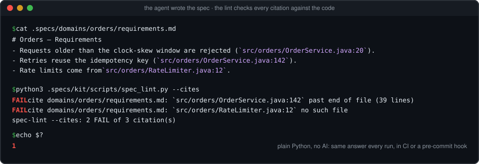
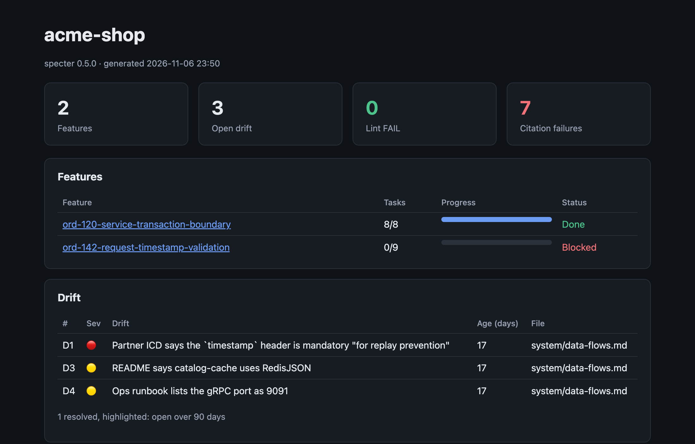
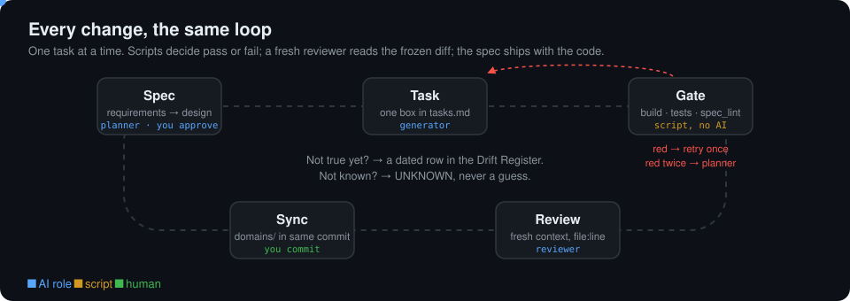
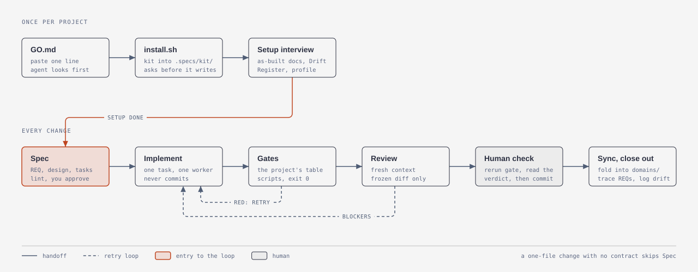
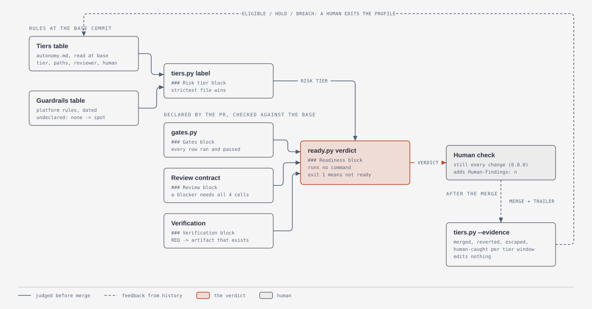
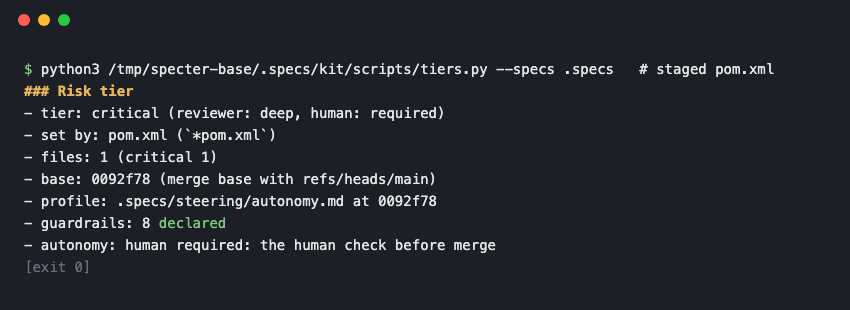
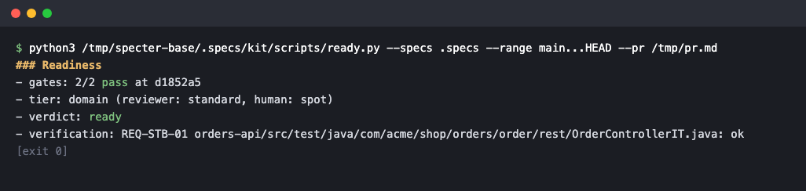
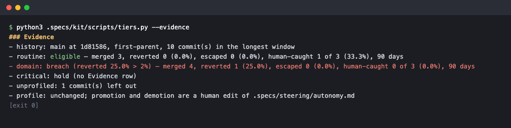
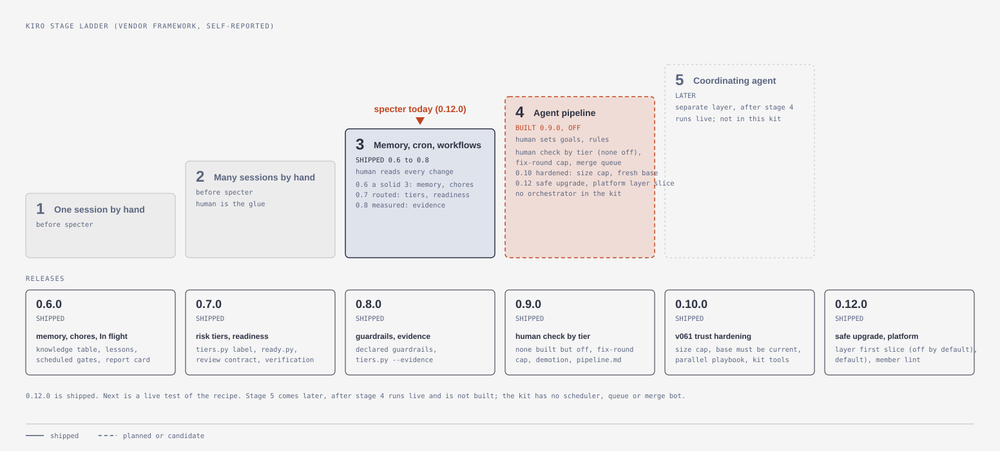

<p align="center"></p>

<h1 align="center">specter</h1>

<p align="center"><b>A spec-first workflow for AI coding agents on existing codebases, with a lint that fails when a citation is wrong.</b></p>

<p align="center">
  <a href="LICENSE"></a>
  <a href="CHANGELOG.md"></a>
</p>

AI agents write specs that sound right and cite code that doesn't exist. Specter makes them cite `path:line` for every
claim, and a stdlib Python lint fails the build when a citation names a missing file or a line that isn't there. It is
for codebases that already run: setup reads your code, writes as-built docs, and logs what doesn't match in a dated
Drift Register. Since 0.7 it also labels each change by risk and says when a human must look. The direction is a
code factory that works from a goal and a spec, with a human in the loop only where the rules say so: see
[where it is going](#where-it-is-going).

<p align="center"></p>

## Try it in 2 minutes, no install

You need `git` and Python 3.8+. Nothing is installed and nothing leaves your machine.

```bash
git clone https://github.com/natsaros7/specter.git ~/tools/specter && cd ~/tools/specter
python3 kit/scripts/spec_lint.py --specs examples/acme-shop/.specs                 # exit 0: structure and REQ traceability
python3 kit/scripts/spec_lint.py --specs examples/acme-shop/.specs --cites         # exit 0: every citation resolves
python3 kit/scripts/spec_lint.py --specs examples/cite-demo/.specs --cites         # exit 1, on purpose: broken citations
python3 kit/scripts/spec_report.py --specs examples/acme-shop/.specs --out /tmp/report.html
python3 -m webbrowser file:///tmp/report.html                                      # any OS with a browser
```

[`examples/acme-shop/.specs/`](examples/acme-shop/.specs/README.md) is a full spec tree for a fictional shop; its
citations resolve against real code. [`examples/cite-demo/`](examples/cite-demo/) is a fixture whose citations break.

<p align="center"></p>

## Set it up on your project

Open your agent (Codex, Claude Code, Cursor, Copilot, Gemini CLI…) **in your project** and paste:

```text
Follow ~/tools/specter/GO.md for this project.
```

The agent looks at the project, says what it would set up, and asks before changing anything. It then asks a few
questions (`ok` accepts every default) and writes the specs; most of the time goes to the agent reading code. Commit
`.specs/`; teammates get it with the repo and never need specter itself.

<p align="center"></p>

Without AI: `~/tools/specter/install.sh ~/code/my-project` (add `--dry-run` to see every path first). Your project
already has specs? See [the reference](docs/reference.md#adding-specter-to-a-project-that-already-has-specs).

## What it does on every change

<p align="center"></p>

Say these to your agent. With the skill installed, `/spec-first …` (Claude Code) or `$spec-first …` (Codex) also works.

| Say | What happens |
|---|---|
| **"Spec this: <change>"** | requirements → design → tasks with traceable `[REQ-…]` IDs, lint, then it waits for your approval |
| **"Next task on <feature>"** | One task, the project's gate, tick the box |
| **"Sync specs, <feature> landed"** | Marks it done, folds the change into the as-built `domains/` docs, updates traceability and drift |
| **"Refresh the specs"** | Re-reads the latest code and logs new drift |

Small changes (one file, no contract change) skip the spec and go straight to code. Each task runs as a
planner → generator → reviewer loop: one agent plans, one writes the code and its failing test first, and a
reviewer from a different model family checks it against the spec. A fix round is capped at two before a human
decides.

### The trust layer

Alongside the loop, three things run offline against your own profile, `.specs/steering/autonomy.md`. A **tier** is
a named group of paths (docs, domain code, build files…); each tier says how much human review its changes need:
`required` (a human approves), `spot` (a human looks after) or `none` (it may merge with no human):

1. **A risk label per change**: `tiers.py` gives each file the lowest tier whose glob matches, and the change its strictest file.
2. **A rule for when a human must look**: `ready.py` reads the PR text (gates, review, verification) and says `ready` or not. `none` also needs a small change (3 files and 50 lines by default, tests only added), a branch based on the trunk's latest commit, and a reviewer who marks it `complexity: trivial`.
3. **Autonomy earned from merged history**: `tiers.py --evidence` counts merged, reverted, escaped and human-caught changes per tier and says `eligible`, `hold` or `breach`. It edits nothing.

<p align="center"></p>
<p align="center"></p>

Real output from the acme-shop example, captured at 0.8.0 (the raw text sits beside each image; the recipe is in
[`docs/overview/`](docs/overview/README.md)):

<p align="center"><br><a href="docs/overview/screenshots/02-tiers-staged.txt">raw text</a></p>
<p align="center"><br><a href="docs/overview/screenshots/05-ready.txt">raw text</a></p>
<p align="center"><br><a href="docs/overview/screenshots/06-evidence.txt">raw text</a></p>

## Where it is going

The goal is a code factory for any existing repository, driven by a goal and a spec. Humans set the goal, approve the
spec and the rules, and decide only what the rules send them. Agents do the rest, and the checks above decide what
merges. It gets there one stage at a time ([Kiro's five-stage ladder](docs/research/README.md)), and each stage is
earned from evidence:

| Stage | Who coordinates | Status |
|---|---|---|
| 3: memory, scheduled chores, the spec loop | a human reads every change | shipped, 0.6 to 0.9 |
| 4: a pipeline; humans set goals and rules | the trust layer decides which changes need a human | built in 0.9, hardened in 0.10; Human `none` stays off until it is verified live |
| 5: an orchestrator runs the agents from the goal and spec | the orchestrator; humans approve specs and handle escalations | later, as a separate layer on top of the kit |

<p align="center"></p>

## Decisions

- Markdown and stdlib Python only: no service, no lock-in, nothing to pay for.
- Citations are checked by a lint, not by trust in the agent.
- Risk is read from paths and from the base commit, never from the change under review, so a change cannot rewrite its own rules.
- No orchestrator or merge bot in the kit; the platform merges.
- `human: none` is earned from merged history, per tier, and a human edits the profile to grant it. Even then it
  covers only small changes a reviewer calls trivial.

The full list is in [the reference](docs/reference.md#decisions-names-deploy-impact-gates); the method in
[`PHILOSOPHY.md`](PHILOSOPHY.md).

## How it compares

| | [Spec Kit](https://github.com/github/spec-kit) | [OpenSpec](https://github.com/Fission-AI/OpenSpec) | [Kiro](https://kiro.dev) | **specter** |
|---|---|---|---|---|
| Form | CLI (`uv`, Python 3.11+) | CLI (npm, brew…) | IDE | Markdown + stdlib Python scripts, copied into `.specs/` |
| Starts from | A new feature idea | A change proposal | A prompt in the IDE | Your existing code: setup writes as-built docs first |
| Specter adds | | | | Lint-checked `path:line` citations, a Drift Register, `UNKNOWN` instead of guesses, risk labels and a readiness verdict, a pre-commit hook that warns when code changes without its spec |

Forms as read on 2026-11-25 ([notes](docs/research/2026-11-25-readme.md)). Pick Spec Kit or OpenSpec for a greenfield
project or a large community, Kiro if you want the IDE. Specter fits a system that already runs, where the docs have
drifted and you want the agent's claims checked.

## Supported agents

The installer wires the agents your project already uses (`.claude/`, `.codex/`, `.cursor/`, …) and nothing else.

| Agent | Rules | Skill | Status |
|---|---|---|---|
| Codex | `AGENTS.md` | `.agents/skills/spec-first/` · `$spec-first` | ✅ |
| Claude Code | `CLAUDE.md` block | `.claude/skills/spec-first/` · `/spec-first` + role sub-agents | ✅ |
| Cursor | `.cursor/rules/spec-first.mdc` + `AGENTS.md` | `.cursor/skills/spec-first/` | best-effort |
| Gemini CLI | `GEMINI.md` block | `.gemini/skills/spec-first/` | best-effort |
| GitHub Copilot | `.github/copilot-instructions.md` block | `.github/skills/spec-first/` | best-effort |
| Antigravity (`agy`) | `AGENTS.md` | `.agents/skills/spec-first/` | best-effort |
| Anything else | `AGENTS.md` | — | After install, paste "Follow `.specs/kit/playbooks/…`" |

## Limits: when not to use specter

- **`human: none` is built but off.** No repository runs it; it stays off until it is verified on a live host. Today
  every change still gets a human check. Each of eleven review rounds in [`docs/reviews/`](docs/reviews/) found a way
  to reach `none` without a human; those were fixed, and the reports are public (a new one goes to a private
  advisory first).
- **The GitLab recipe is an untested sketch**, and the GitHub one has not run live
  ([`kit/docs/review-loop.md`](kit/docs/review-loop.md)).
- **Stage 5 is not in the kit.** There is no coordinating agent, queue, scheduler or merge bot, and no plan to add one
  before stage 4 runs live ([roadmap](docs/overview/README.md)).
- **The trust layer is not a security boundary.** It guards the profile (read at the base commit) and the evidence
  (read from merged history). It does not stop an agent with push rights, a repo that disables the hook, or tiers
  you set wrong.
- **Four of the six listed agents are best-effort** (table above). The installer wires them, but only Codex and
  Claude Code are checked.
- **Data:** specter sends nothing anywhere. Your agent reads your repo as it always does.

## Security

Report a bypass of the human check privately: see [`SECURITY.md`](SECURITY.md). The installer writes `.specs/kit/`,
marker blocks in agent files and, only with `--hook`, a pre-commit hook. `install.sh <project> --dry-run` lists every
path first and `--uninstall` removes what it wrote.

## Docs

[`docs/reference.md`](docs/reference.md) has the spec tree, roles, every script, all `spec-kit.json` keys, the autonomy
profile, upgrade and uninstall, and short answers (model choice, cost, silencing the hook). The method is in
[`kit/docs/spec-driven.md`](kit/docs/spec-driven.md), the stages from triage to merge in
[`kit/docs/pipeline.md`](kit/docs/pipeline.md), scheduled spec health in [`kit/docs/chores.md`](kit/docs/chores.md), running several agents at once in
[`kit/playbooks/parallel.md`](kit/playbooks/parallel.md),
diagrams and the deck in [`docs/overview/`](docs/overview/README.md), dated research in
[`docs/research/`](docs/research/README.md), changes in [`CHANGELOG.md`](CHANGELOG.md).

## Contributing

Issues and PRs are welcome. Every change passes the gates in [`AGENTS.md`](AGENTS.md#working-on-specter-itself):
`sh tests/gates.sh` runs them offline (`--docker` in a container), and `git config core.hooksPath .githooks` runs
them before each push. Specter is built with specter: its own specs are in [`.specs/`](.specs/).

## License and credits

[MIT](LICENSE). Inspired by [Kiro](https://kiro.dev)'s requirements → design → tasks triplet and steering files. The
rest came from running the method on a multi-service production system. Kiro is a trademark of its owner; specter is
independent, not affiliated with or endorsed by Amazon or the Kiro team, and uses no Kiro code, text or assets.
