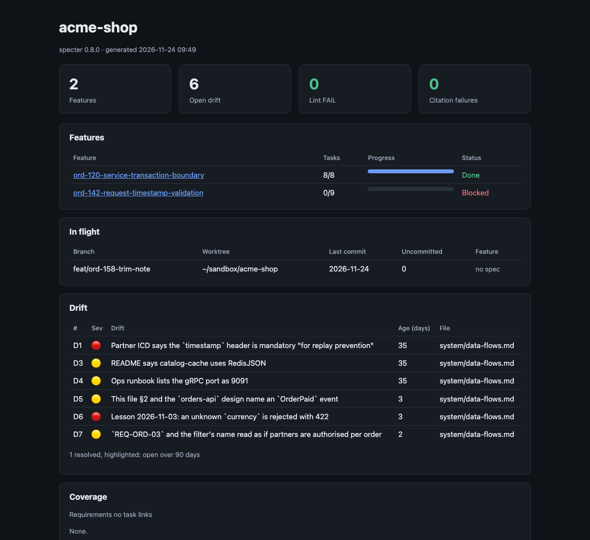
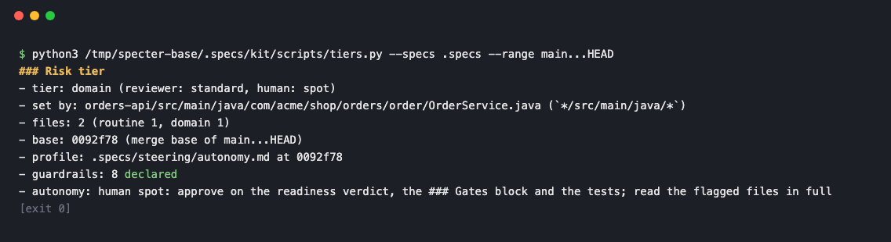

# Visual overview

Diagrams, screenshots from real runs, and a slide deck for specter. Releases 0.6.0 to 0.10.0 are shipped (0.10.0 is the v061 trust hardening). Stage 4 is built but off: the `none` human setting stays off until it is verified live. Next: 0.11 follow-ups, a live test of the recipe, then a stage 5 proposal (not built).

## Diagrams


`workflow.svg`: the one-time setup and the loop every change follows.


`trust-layer.svg`: how a change is judged, and how merged history reports which tier earned more autonomy. Drawn at 0.8.0; it does not yet show the 0.9.0 human values `required`, `spot` and `none`.


`roadmap.svg`: shipped and next work against the Kiro five-stage ladder. Stage 5 is a later, separate layer, to start after stage 4 runs live.

## Screenshots

Every screenshot comes from a command run on the acme-shop example in a sandbox built with the recipe in [`examples/acme-shop/README.md`](../../examples/acme-shop/README.md). The raw text sits next to each PNG. `tiers-staged`, `tiers-range`, `ready` and `evidence` were re-captured at 0.10.0 (new reason lines, `- relabelled:`, the `none` size and complexity rules); the spec report, `tiers --check` and `gates` are from 0.8.0, and their output has not changed since. Absolute paths are replaced by `~`.

| Screenshot | Command | Raw text |
|---|---|---|
|  | `spec_report.py`, page opened in headless Chrome | [txt](screenshots/07-spec-report.txt) |
|  | `tiers.py --check` | [txt](screenshots/01-tiers-check.txt) |
|  | `tiers.py` on a staged `pom.xml` change | [txt](screenshots/02-tiers-staged.txt) |
|  | `tiers.py --range main...HEAD` | [txt](screenshots/03-tiers-range.txt) |
|  | `gates.py` | [txt](screenshots/04-gates.txt) |
|  | `ready.py --range main...HEAD --pr pr.md` ([PR text](screenshots/05a-pr-text.txt)) | [txt](screenshots/05-ready.txt) |
|  | `tiers.py --evidence` | [txt](screenshots/06-evidence.txt) |

Sandbox changes you should know about, since the screenshots depend on them:

- `merged_ref` is set to `main`, so staged and range labels have a base.
- The Gates table is cut to the two script rows (G4, G5) because the Maven gates need JDK 21.
- Evidence thresholds are small (min merged 3, human-caught max 50%) so nine demo commits can show `eligible` and `breach`.
- The history has `Human-Findings: 0` trailers on the domain commits (the routine tier is `none`, so it carries none) and one `git revert`. The PR text (with `rounds:` and `complexity: trivial`), including the reviewer model ids, is written by hand as demo input; only the scripts' output is real.
- The terminal PNGs are the captured text rendered into a dark HTML page. The spec report is the real page.

## Deck

[`deck/slides.md`](deck/slides.md) is a Slidev source (14 slides). [`deck/specter-overview.html`](deck/specter-overview.html) is the hand-built deck. The exported [`deck/specter-overview.pdf`](deck/specter-overview.pdf) was re-exported at 0.10.0 in a `node:22` container (needs network).

```bash
cd docs/overview/deck && npm install
npx slidev slides.md                                   # live
npx slidev export slides.md --output specter-overview.pdf --dark false
```
