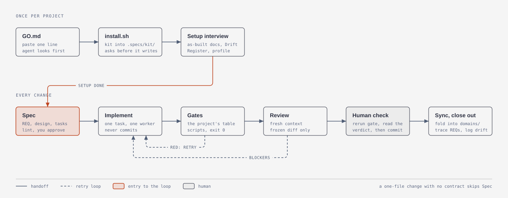
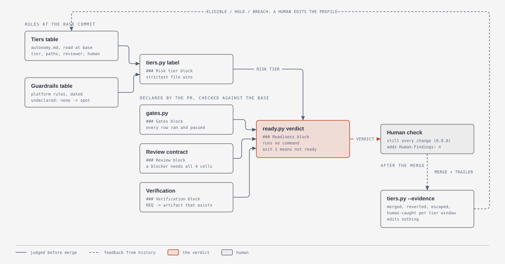
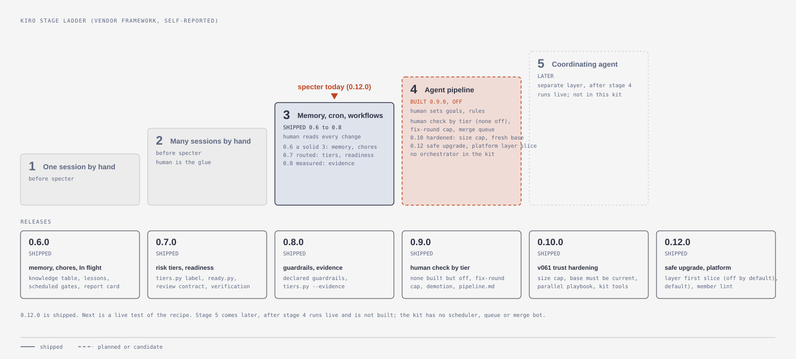
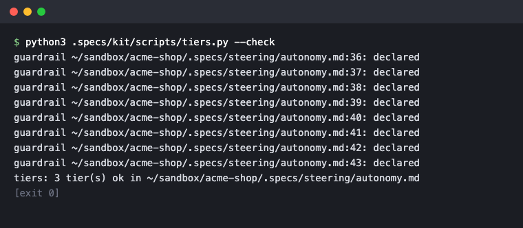
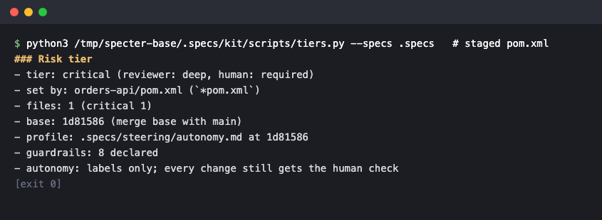
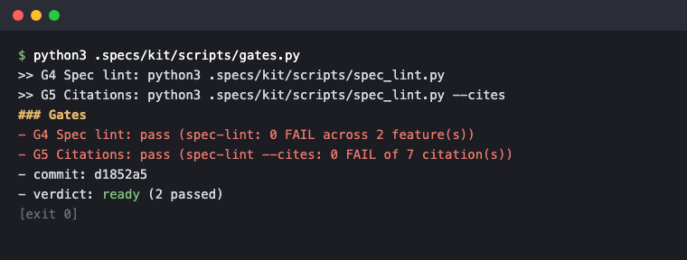
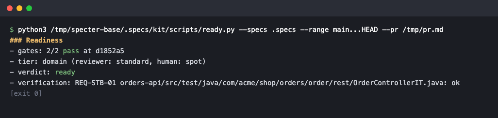
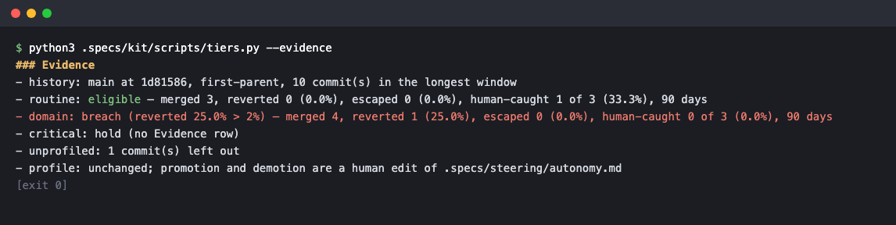

# Visual overview

Diagrams, screenshots from real runs, and a slide deck for specter. Release 0.8.0 is shipped. 0.9.0 is in progress and drawn as planned.

## Diagrams



`workflow.svg`: the one-time setup and the loop every change follows.



`trust-layer.svg`: how a change is judged today, and how merged history reports which tier earned more autonomy.



`roadmap.svg`: shipped, planned and candidate work against the Kiro five-stage ladder.

## Screenshots

Every screenshot comes from a command run on the acme-shop example at release 0.8.0 (`41583e2`), in a sandbox built with the recipe in [`examples/acme-shop/README.md`](../../examples/acme-shop/README.md). The raw text sits next to each PNG. Absolute paths are replaced by `~`.

| Screenshot | Command | Raw text |
|---|---|---|
|  | `spec_report.py`, page opened in headless Chrome | [txt](screenshots/07-spec-report.txt) |
|  | `tiers.py --check` | [txt](screenshots/01-tiers-check.txt) |
|  | `tiers.py` on a staged `pom.xml` change | [txt](screenshots/02-tiers-staged.txt) |
|  | `tiers.py --range main...HEAD` | [txt](screenshots/03-tiers-range.txt) |
|  | `gates.py` | [txt](screenshots/04-gates.txt) |
|  | `ready.py --range main...HEAD --pr pr.md` ([PR text](screenshots/05a-pr-text.txt)) | [txt](screenshots/05-ready.txt) |
|  | `tiers.py --evidence` | [txt](screenshots/06-evidence.txt) |

Sandbox changes you should know about, since the screenshots depend on them:

- `merged_ref` is set to `main`, so staged and range labels have a base.
- The Gates table is cut to the two script rows (G4, G5) because the Maven gates need JDK 21.
- Evidence thresholds are small (min merged 3, human-caught max 50%) so ten demo commits can show `eligible` and `breach`.
- The history has `Human-Findings:` trailers and one `git revert`. The PR text, including the reviewer model ids, is written by hand as demo input; only the scripts' output is real.
- The terminal PNGs are the captured text rendered into a dark HTML page. The spec report is the real page.

## Deck

[`deck/slides.md`](deck/slides.md) is a Slidev source (14 slides). The exported [`deck/specter-overview.pdf`](deck/specter-overview.pdf) is included.

```bash
cd docs/overview/deck && npm install
npx slidev slides.md                                   # live
npx slidev export slides.md --output specter-overview.pdf --dark false
```
