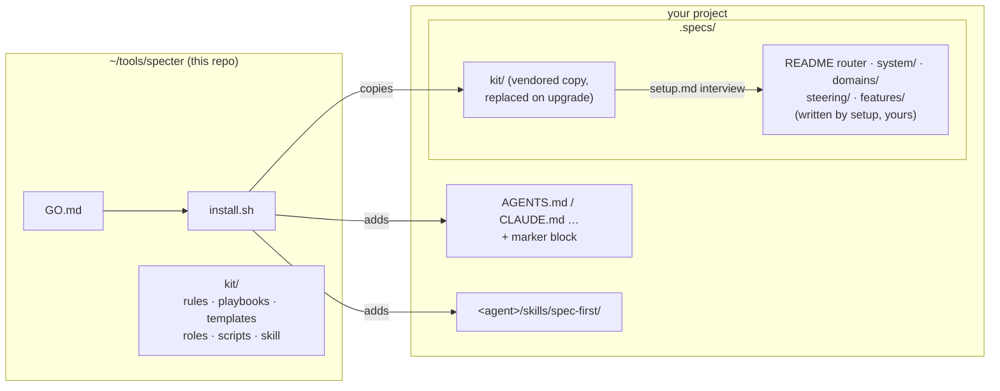
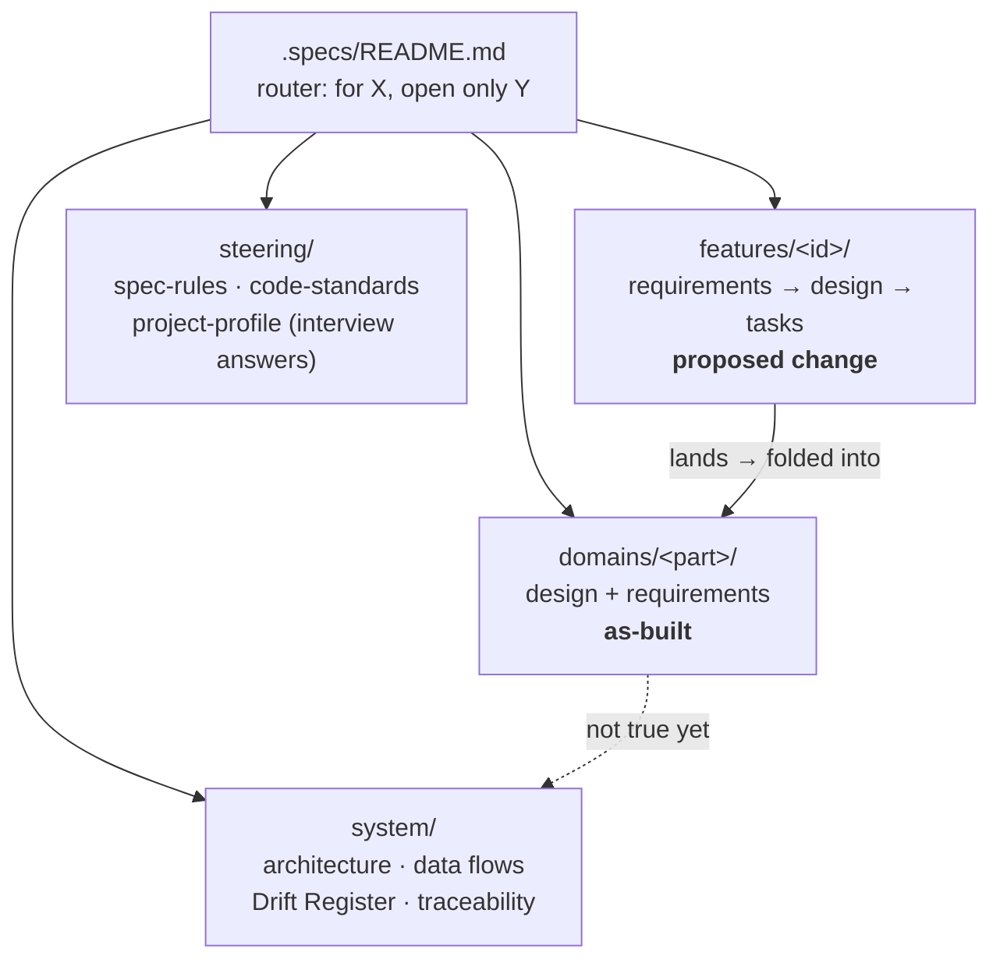

# specter reference

The README is the short version. This page holds the details: layout, roles, scripts, config, adopting, upgrades.

## What lives where



### The spec tree it builds



## The helpers: three roles

The person who writes the code never approves it, and the expensive model is only used where judgement matters.
The roles are plain markdown briefs in [`kit/roles/`](../kit/roles/README.md), so they work with any agent.

| Role | Model tier | Does | Never does |
|---|---|---|---|
| **planner** | deep: your strongest model, high effort | Setup and refresh, feature specs, architecture, root-cause diagnosis, security reviews, escalations | — |
| **generator** | standard: a mid-tier model | Implements **one** task, writes tests, runs the gate, reports the exit code | Commit; decide what the spec left open |
| **reviewer** | standard; deep for security paths | Reads the frozen diff in a **fresh context** and reports findings with `file:line` | Edit code |

How to use them:

- **Any agent:** start a new session: *"Act as `.specs/kit/roles/reviewer.md` on `<patch>`"*.
- **Model profiles:** map *deep* and *standard* to two profiles.
- **Claude Code:** gets the roles as native sub-agents automatically.

The rules are simple: a red gate gets one retry at the same tier, two reds escalate to the planner, and nothing
escalates without a failed gate. Details: [`kit/docs/model-routing.md`](../kit/docs/model-routing.md) ·
[`kit/docs/review-loop.md`](../kit/docs/review-loop.md).

## The scripts (no AI, Python 3.8+, stdlib only)

```bash
python3 .specs/kit/scripts/spec_lint.py           # files present, REQ traced both ways, links resolve
python3 .specs/kit/scripts/spec_lint.py --cites   # every `path:line` citation exists and points at real code
python3 .specs/kit/scripts/spec_lint.py --json    # same checks as JSON on stdout (also with --cites)
python3 .specs/kit/scripts/spec_report.py         # one HTML page: feature progress, open drift, coverage, citations
python3 .specs/kit/scripts/spec_sync_check.py     # code changed but no spec change? (the pre-commit hook)
python3 .specs/kit/scripts/gates.py               # run the Gates table in steering/spec-rules.md, print a block for the PR
```

Citations: `path:12`, `path:12-20,31`, `path#L12-L20`, and `<repo>:path:12` (repo = a `cite_aliases` key or a folder name).
Git repos up to two levels below the project are indexed (linked worktrees are skipped; submodules stay indexed).
Each feature's `requirements.md` starts with a `Status:` line (Proposed, In progress, Blocked on …, Done <date> (<branch, commit or PR>),
Dropped <date> (<why>)); the lint WARNs when it is missing or disagrees with the tasks. The report goes to `.specs/report.html` (git-ignored).

New `.specs/spec-kit.json` keys (all optional):

| Key | Default | Effect |
|---|---|---|
| `cite_aliases` | `{}` | Repo prefix to folder, e.g. `{"NS": "tools/load-sim"}` |
| `cite_ignore_globs` | `[]` | fnmatch on the root-relative path; drops these files when a citation matches several |
| `drift_max_age_days` | `90` | Unresolved Drift Register rows older than this WARN; `null` switches it off |
| `tracker_pattern` | `null` | Regex for ticket keys in feature folder names (`"ABC-[0-9]+"`). When set, the lint WARNs if commits on `merged_ref` name a feature's key while its spec says Proposed, has no `Status:` line, or has no task ticked |
| `decisions` | `{}` | `file` (default `steering/decisions.md`), `backlinks` (`false`, `"warn"` or `true`) and `enabled` (default `true`); any other value or key stops the lint; see below |
| `unresolved_req` | `"warn"` | `"off"` silences the WARN for REQ ids cited in `.specs/` but defined nowhere |
| `denylist_sha256` | `[]` | SHA-256 digests of terms that must not appear in `.specs/`; see below |
| `merged_ref` | `null` | Ref searched for those commits (e.g. `"origin/develop"`), in the project and in every indexed child repo; a repo without it is skipped. Unset: `origin/HEAD`, then `HEAD`. Commits touching only `.specs/` never count |

### Decisions, names, deploy impact, gates

A 0.4.1 project keeps its exit code: the new checks are off until their file or config key exists. The one new
default is a WARN for REQ ids that are cited but defined nowhere.

- **Decisions log.** `.specs/steering/decisions.md` (template in `kit/templates/steering/`) is a table of settled
  decisions: `| ID | Decision | Why | Where it lands | Supersedes |`. A decision changes only by a new dated row that
  supersedes it. Ids hold a digit (`D-7`, `D-AUTH-2`; `D-DAY` in prose is not one). Once the file holds a decision row
  (and unless `"decisions": {"enabled": false}`), the lint FAILs on a cited `D-<id>` without a row and on a "Where it lands" REQ
  that isn't defined. With `"decisions": {"backlinks": true}` (or `"warn"`), each such REQ must cite the decision back.
  A REQ cited anywhere in `.specs/` (outside inline code) that is defined nowhere WARNs once per id, with up to three
  `file:line` locations; `"unresolved_req": "off"` silences it.
- **Names denylist.** For specs that several teams or clients read: put `sha256` digests in `denylist_sha256`, so the
  config never names what it protects. A hit FAILs as `denylisted term (token #n)` and never prints the word. Get a
  digest with `python3 .specs/kit/scripts/spec_lint.py --hash-term <one or two words>`. Tokens are letters of any script
  and digits, lower-cased (`José` stays `josé`); a two-word term matches only on one line, not across a line break.
- **Deploy impact.** Each change states `Deploy impact: none` or `<job or env>: <what changes>`. If it isn't `none`,
  the people who run CI/CD hear before the merge. Setup asks how CI/CD consumes the repo: a job that runs from the
  default branch picks up every merge.
- **Gates.** `gates.py` executes, with `sh -c` from the project root, the commands in this project's own
  `| # | Gate | Command |` table of `steering/spec-rules.md` (or `--file`), in order, and nothing else. Whoever can edit
  that table decides what runs, so treat it like code: read it before you run `gates.py` on a branch you didn't write.
  It stops at the first failure and prints a `### Gates` block with the commit as it was before the run (`+dirty` when
  the tree had changes; `none` outside git). It never guesses a command: no table, no run.
- **Onboarding and grilling.** Setup offers a `.specs/ONBOARDING.md` with starter prompts, and
  [`kit/docs/review-loop.md`](../kit/docs/review-loop.md) describes grilling a spec or plan before any code is written.

## Adding specter to a project that already has specs

```bash
./install.sh ~/code/my-project --dry-run   # lists every path it would create, modify or replace, and the mode; writes nothing
./install.sh ~/code/my-project             # then install
```

When `.specs/` already holds `features/`, `domains/`, `system/` or `steering/` and no kit, the installer runs in **adopt mode** (`--fresh` forces the normal install). It keeps what works:

- Nothing under `.specs/` is created or changed except `.specs/kit/`, `.specs/spec-kit.json` (only if absent), a `report.html` line appended to `.specs/.gitignore`, and a seeded `steering/project-profile.md` (only if absent) marked `status: active` with an `adopted:` line, so agents don't wait for the setup interview. The project's own `steering/spec-rules.md` wins over the kit's defaults.
- `AGENTS.md`, `CLAUDE.md` and the other instruction files only get the marker block appended; your text stays byte for byte.
- No git hook is installed (adopting never changes how commits behave). Add `--hook` to enable the spec-sync check.
- An existing `spec-kit.json` is never rewritten, in any mode; the installed version is in `.specs/kit/VERSION`.
- A role agent is not written into `.claude/agents/` when `~/.claude/agents/<role>.md` exists (any mode), so your user-level pins keep applying. A skill, Cursor rule or project agent that specter didn't write is kept, and uninstall leaves it too.
- A `.specs/kit/` that isn't specter's stops the install with exit 2 before anything is written.
- Features marked `Done` or `Dropped` are history: their structural lint FAILs show as `WARN history: ...` and don't fail the run. Broken links and citations still fail.

Afterwards, set `tracker_pattern` (your ticket key regex) and `merged_ref` in `.specs/spec-kit.json` to get merged-work detection.

## Upgrade, uninstall, versions

```bash
cd ~/tools/specter && git pull && ./install.sh ~/code/my-project   # upgrade: replaces .specs/kit/, keeps your specs and settings
./install.sh ~/code/my-project --uninstall                         # removes what specter wrote (only if still ours), marker blocks byte for byte; keeps .specs/ content
./install.sh ~/code/my-project --detect                            # which agents it would wire, and why
```

The installed version is in `.specs/kit/VERSION`. The `spec-kit.json` the installer creates records the first-install version in `kit_version`; it is never rewritten afterwards, and an existing config is never touched. Changes are listed in [`CHANGELOG.md`](../CHANGELOG.md).
Self-test, run locally: `tests/selftest.sh`.
