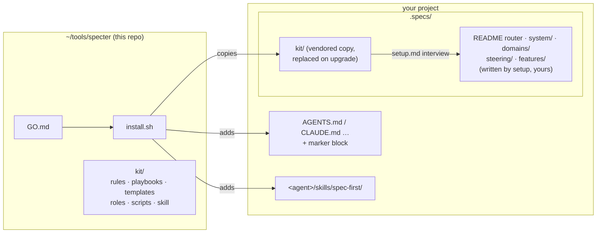
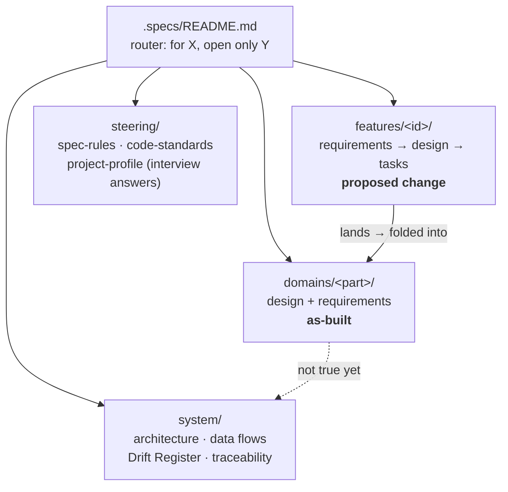

# specter reference

The README is the short version. This page holds the details: layout, roles, scripts, config, adopting, upgrades.

## What lives where



### The spec tree it builds



## The helpers: three roles

The person who writes the code never approves it, and the expensive model is only used where judgement matters.
The roles are plain markdown briefs in [`kit/roles/`](../kit/roles/README.md), so they work with any agent.

| Role | Model tier | Does | Never does |
|---|---|---|---|
| **planner** | deep: your strongest model, high effort | Setup and refresh, feature specs, architecture, root-cause diagnosis, security reviews, escalations | — |
| **generator** | standard: a mid-tier model | Implements **one** task, writes tests, runs the gate, reports the exit code | Commit; decide what the spec left open |
| **reviewer** | standard; deep for security paths | Reads the frozen diff in a **fresh context** and reports findings with `file:line` | Edit code |

How to use them:

- **Any agent:** start a new session: *"Act as `.specs/kit/roles/reviewer.md` on `<patch>`"*.
- **Model profiles:** map *deep* and *standard* to two profiles.
- **Claude Code:** gets the roles as native sub-agents automatically.

The rules are simple: a red gate gets one retry at the same tier, two reds escalate to the planner, and nothing
escalates without a failed gate. Details: [`kit/docs/model-routing.md`](../kit/docs/model-routing.md) ·
[`kit/docs/review-loop.md`](../kit/docs/review-loop.md). The stages, their hand-offs and when the human enters:
[`kit/docs/pipeline.md`](../kit/docs/pipeline.md).

## The scripts (no AI, Python 3.8+, stdlib only)

```bash
python3 .specs/kit/scripts/spec_lint.py           # files present, REQ traced both ways, links resolve
python3 .specs/kit/scripts/spec_lint.py --cites   # every `path:line` citation exists and points at real code
python3 .specs/kit/scripts/spec_lint.py --json    # same checks as JSON on stdout (also with --cites)
# exit 0 clean, 1 a FAIL, 2 a --specs path that is not a directory
python3 .specs/kit/scripts/spec_report.py         # one HTML page: feature progress, open drift, coverage, citations
python3 .specs/kit/scripts/spec_sync_check.py     # code changed but no spec change? (the pre-commit hook)
python3 .specs/kit/scripts/gates.py               # run the Gates table in steering/spec-rules.md, print a block for the PR
python3 .specs/kit/scripts/tiers.py --check       # validate the Tiers table in steering/autonomy.md (tiers.py alone labels the staged change)
python3 .specs/kit/scripts/tiers.py --evidence    # per tier from merged history: eligible, hold (why) or breach (metric, plus the demote: line); edits nothing
python3 .specs/kit/scripts/readme_check.py       # README: links, anchors, alt text, line cap; `readme` in spec-kit.json adds sections and denied words (exit 1 a FAIL, 2 a bad setting)
```

Citations: `path:12`, `path:12-20,31`, `path#L12-L20`, and `<repo>:path:12` (repo = a `cite_aliases` key or a folder name).
Git repos up to two levels below the project are indexed (linked worktrees are skipped; submodules stay indexed).
Each feature's `requirements.md` starts with a `Status:` line (Proposed, In progress, Blocked on …, Done <date> (<branch, commit or PR>),
Dropped <date> (<why>)); the lint WARNs when it is missing or disagrees with the tasks. The report goes to `.specs/report.html` (git-ignored).

New `.specs/spec-kit.json` keys (all optional):

| Key | Default | Effect |
|---|---|---|
| `cite_aliases` | `{}` | Repo prefix to folder, e.g. `{"NS": "tools/load-sim"}` |
| `readme` | `{}` | Settings of `readme_check.py`: `path` (`README.md`, relative to the project root), `max_lines` (`200`, the README must be shorter), `sections` (`##` headings required in this order, default none), `deny` (words refused outside code fences, default none). A wrong type exits 2 |
| `cite_ignore_globs` | `[]` | fnmatch on the root-relative path; drops these files when a citation matches several |
| `drift_max_age_days` | `90` | Unresolved Drift Register rows older than this WARN; `null` switches it off |
| `tracker_pattern` | `null` | Regex for ticket keys in feature folder names (`"ABC-[0-9]+"`). When set, the lint WARNs if commits on `merged_ref` name a feature's key while its spec says Proposed, has no `Status:` line, or has no task ticked |
| `decisions` | `{}` | `file` (default `steering/decisions.md`), `backlinks` (`false`, `"warn"` or `true`) and `enabled` (default `true`); any other value or key stops the lint; see below |
| `unresolved_req` | `"warn"` | `"off"` silences the WARN for REQ ids cited in `.specs/` but defined nowhere |
| `denylist_sha256` | `[]` | SHA-256 digests of terms that must not appear in `.specs/`; see below |
| `merged_ref` | `null` | Ref searched for those commits, in the project and in every indexed child repo: a full ref name (`"refs/remotes/origin/develop"`, the safe spelling) or a short name that names exactly one branch or remote-tracking ref. A tag or an ambiguous name (a tag `origin/develop` next to the remote) is refused: the lint skips that repo with a WARN (a repo without the ref is skipped quietly); `tiers.py` labels `spot` and `--evidence` exits 2. Unset: `refs/remotes/origin/HEAD` when it is a symbolic ref (a plain one, as a pushed branch named `HEAD` makes, is refused), then `HEAD`. Commits touching only `.specs/` never count. Since 0.7.0 it also sets the staged base of `tiers.py` and `ready.py`: with neither it nor `refs/remotes/origin/HEAD`, every staged change takes the last tier. A CI checkout (`actions/checkout`) has no `origin/HEAD`: set it |

### Decisions, names, deploy impact, gates

A 0.4.1 project keeps its exit code: the new checks are off until their file or config key exists. The one new
default is a WARN for REQ ids that are cited but defined nowhere.

- **Decisions log.** `.specs/steering/decisions.md` (template in `kit/templates/steering/`) is a table of settled
  decisions: `| ID | Decision | Why | Where it lands | Supersedes |`. A decision changes only by a new dated row that
  supersedes it. Ids hold a digit (`D-7`, `D-AUTH-2`; `D-DAY` in prose is not one). Once the file holds a decision row
  (and unless `"decisions": {"enabled": false}`), the lint FAILs on a cited `D-<id>` without a row and on a "Where it lands" REQ
  that isn't defined. With `"decisions": {"backlinks": true}` (or `"warn"`), each such REQ must cite the decision back.
  A REQ cited anywhere in `.specs/` (outside inline code) that is defined nowhere WARNs once per id, with up to three
  `file:line` locations; `"unresolved_req": "off"` silences it.
- **Names denylist.** For specs that several teams or clients read: put `sha256` digests in `denylist_sha256`, so the
  config never names what it protects. A hit FAILs as `denylisted term (token #n)` and never prints the word. Get a
  digest with `python3 .specs/kit/scripts/spec_lint.py --hash-term <one or two words>`. Tokens are letters of any script
  and digits, lower-cased (`José` stays `josé`); a two-word term matches only on one line, not across a line break.
- **Deploy impact.** Each change states `Deploy impact: none` or `<job or env>: <what changes>`. If it isn't `none`,
  the people who run CI/CD hear before the merge. Setup asks how CI/CD consumes the repo: a job that runs from the
  default branch picks up every merge.
- **Gates.** `gates.py` executes, with `sh -c` from the project root, the commands in this project's own
  `| # | Gate | Command |` table of `steering/spec-rules.md` (or `--file`), in order, and nothing else. Whoever can edit
  that table decides what runs, so treat it like code: read it before you run `gates.py` on a branch you didn't write.
  It stops at the first failure and prints a `### Gates` block, also on a red run (`pass (…)`, `FAIL (exit n)`, `not run`, then `verdict:`), with the commit as it was before the run (`+dirty` when
  the tree had changes; `none` outside git). It never guesses a command: no table, no run.
- **Onboarding and grilling.** Setup offers a `.specs/ONBOARDING.md` with starter prompts, and
  [`kit/docs/review-loop.md`](../kit/docs/review-loop.md) describes grilling a spec or plan before any code is written.

## The example codebase (0.6.5)

`examples/acme-shop/` is a working Java 21 / Spring Boot 4 service with a full `.specs/` tree, and the project the
factory slices are tested on. Its README covers the build (JDK 21) and the sandbox recipe: copy it, `git init`, run
`install.sh`, commit, then hand an agent one of the seed tasks. Specter's optional gate G5 (`sh tests/acme-build.sh`)
builds it.

## Autonomy profile

`.specs/steering/autonomy.md` (template in `kit/templates/steering/`) holds what agents may do here without a human.
Sections: Knowledge, Tiers, Chores, Guardrails (0.8.0), Evidence (0.8.0). Without the file, the lint and the playbooks
behave as in 0.5.0; the report always gains the In flight card. Setup asks about it in Q10.

- **Knowledge.** A table of where the project keeps what an agent must know (router, steering, decisions, ADRs,
  architecture tests, memory) with a `Read` column. Agents read the `start` rows at the start of a task and the
  others at the moment the row names.
- **Lessons.** `.specs/steering/lessons.md` takes one dated line per correction. A lesson seen twice becomes a check first
  (a Gates row, a lint rule or a test), and a rule in spec-rules, code-standards or decisions only when no check can
  catch it (`sync.md`). After a merge, a mistake becomes one lessons line plus the check that catches it, proposed by
  the agent and approved by a human (`review-loop.md`). Several agents at once follow `kit/playbooks/parallel.md`.
- **Tiers.** A `| Tier | Paths | Reviewer | Human |` table, rows from most to least autonomous (setup suggests routine: tests,
  docs; domain: source; critical: security, interfaces, migrations, CI). Each changed file takes the lowest row a
  glob matches; the change takes its strictest file. Guarded paths (the profile, the kit, agent files) always take the last row.
  `tiers.py --check` validates the table; `tiers.py` prints the `### Risk tier` label for the staged change or `--range`.
  Nothing in the kit merges: every PR needs an approval; for Human `none` a non-required job runs
  `ready.py --range <base sha>...<head sha> --pr <pr text> --auto-merge` (exit 0 only when ready, `none` and no warning)
  from a trusted worktree of the base and, on exit 0 only, approves with a non-agent identity and enables the
  platform's auto-merge; every other PR waits for a human approval. `ready.py` reads a PR text and prints a `### Readiness` verdict (Gates at the
  head commit, the Review block with its `rounds: <n>` line (above 2 or malformed is not ready, missing a warning),
  Verification lines) and runs no command; exit 1 means not ready.
  Run both from a trusted copy, never the PR's own `.specs/kit/`: `git worktree add --detach /tmp/specter-base <base sha>`,
  then `python3 /tmp/specter-base/.specs/kit/scripts/ready.py --specs .specs --pr /tmp/pr.md` as a staged preflight
  before the commit, and `… tiers.py --specs .specs --range <base sha>...HEAD` plus `… ready.py --specs .specs --range
  <base sha>...HEAD --pr /tmp/pr.md` after it (a `--range` end is `HEAD`, a sha or one branch or remote-tracking ref: a
  tag or an ambiguous name is exit 2) (the only binding check; steps in `kit/docs/review-loop.md`). The first
  upgrade to 0.7.0 has no kit at its base: run them from the specter release checkout. `ready` means the PR's
  declarations agree with the base's rules and the head commit; it does not prove the gates ran: rerun them, or run them in CI.
- **Chores.** A `| # | Gate | Command |` table that a schedule runs with
  `python3 .specs/kit/scripts/gates.py --file .specs/steering/autonomy.md`. The runner stops at the first failure (exit 1); it prints
  the same `### Gates` block on success and on failure. A chore that writes works on a branch. Schedule recipes for cron, launchd and CI
  are in [`kit/docs/chores.md`](../kit/docs/chores.md).
- **Guardrails (0.8.0).** A `| Guardrail | Enforced by | Verified |` table of what the platform enforces. The template
  lists eight rows: protected default branch, the Gates as required checks, an approval on every PR (only the
  `--auto-merge` job's identity approves a `none` PR), agent credentials that cannot approve or merge, agent
  permissions from the host's configuration, history, tags and review records agents cannot edit, agent jobs triggered by untrusted text run read-only and without secrets, and chores
  from a clean clone. A row is declared when Enforced by names something (no `<placeholder>`, and not a word that
  names nothing: `-`, `—`, `–`, `?`, `tbd`, `todo`, `n/a`, `na`, `none`, `pending`, in any case, a trailing `.` ignored)
  and Verified is a `YYYY-MM-DD` date that is not in the future; "no such job, checked <how>" with a date counts. Until every row is declared, a tier whose Human
  is `none` is labelled `spot`, and the `### Risk tier` block says `- guardrails: <m> of <n> undeclared, none → spot`.
  `tiers.py --check` lists each row as declared or undeclared. Specter records the declaration; it probes nothing.
- **Evidence (0.8.0).** A `| Tier | Window (days) | Min merged | Max reverted % | Max escaped % | Max human-caught % |`
  table. `tiers.py --evidence` reads its thresholds from the profile at the `merged_ref` tip, never the working tree, and prints
  that commit; it reads first-parent commits on `merged_ref` inside each tier's window, labels each with
  the profile as of its parent, and counts per tier: merged, reverted (a later commit whose change set has
  `This reverts commit <sha>` naming one of this commit's), escaped (the same with a `Fixes: <sha>` trailer) and
  human-caught (a `Human-Findings: <n>` trailer written at the merge, caught when above 0 or not plain digits; a merge labelled `none` carries none, so its `0` is ignored and its tier never holds on the trailer; see
  `kit/playbooks/sync.md` § Trailers). The window is by position: it runs from the tip down to the oldest commit dated
  inside it, and every commit above that counts whatever its own date; a future date never sets it. Human-caught is a
  rate over the merges that carry the trailer, printed `human-caught <c> of <k> (<pct>%)`. Each tier is `eligible`,
  `hold (<why>)` or `breach (<metric>)`; a placeholder row, too few merges, fewer trailered merges than
  max(Min merged, 1) or a shallow clone is a hold, never a pass. A Max of `-` is not checked.
  Under a `breach` it prints `  demote: <file>:<line> Human <cur> → <one step stricter>`, the tier's row in the profile
  at the `merged_ref` tip (`none` → `spot`, `spot` → `required`; `required` says already required); `--json` has `demote`
  (`{file, line, from, to}`, or null off breach). It edits nothing: demoting or raising a tier is a human edit of the
  profile, a guarded path. A commit counts for a tier only if its parent's row has the same name and the same Paths globs as the row read now (Reviewer and Human are not compared, so a promotion keeps its evidence); the others are printed on `- relabelled: <n> commit(s) …` (`--json` `relabelled`), so a renamed or widened tier re-earns its evidence. Evidence counts first-parent commits, so it assumes squash or merge commits. A rebase merge or fast-forward puts each PR commit on the chain: Min merged is reached faster, and one revert is diluted over the PR's commits.
- **Human value by tier (0.9.0).** `required` is the human check; `spot` is approval on the readiness verdict, the
  `### Gates` block and the tests, with the flagged files read in full; `none` is no human before merge, and the merge
  is the platform's auto-merge, never a specter script's. A label keeps `none` only on the lowest Tiers row, with every
  guardrail declared and that tier `eligible` in `tiers.py --evidence`; otherwise it says `spot` and
  `- human: none → spot (<why>)` (`--json`: `reasons`; `labels_only` is `false`). A `### Review` whose reviewer shares
  the implementer's model family makes `ready.py` report `spot` too, and so does a `complexity:` line that is missing or not
  `trivial` (`reviewer: complexity <value or missing>`; a repeated one is not ready). A change in a `none` tier is also
  `spot` when it has more files or lines than the cap (`size <f> files / <l> lines > cap <F>/<L>`; a binary file counts as over),
  more changed bytes than `Max bytes` (`bytes <b> > cap <B>`; a diff that cannot be read counts as over), or changes a Git LFS pointer line (`LFS pointer: <path>`),
  or deletes or edits a line of a test file, deletes or re-modes one, or adds or changes a `conftest.py` or `__init__.py`
  (`tests changed, not only added: <path>`; a gitlink counts as over the cap). The cap is three optional trailing
  Evidence columns, `Max files`, `Max lines` and `Max bytes` (defaults 3, 50 and 4000; `-` is the default; any other non-number is exit 2 with
  `file:line`), and the test files are the globs of an optional `## Tests` section (defaults `tests/*`, `*/tests/*`, `test/*`, `*/test/*`, `__tests__/*`, `*/__tests__/*`, `spec/*`, `*/spec/*`, `*_test.*`, `*.test.*`, `*_spec.*`, `*.spec.*`, `test_*`, `*/test_*`, `conftest.py`, `*/conftest.py`,
  matched case- and Unicode-folded), both read at the base. `ready.py` applies the evidence and size rules as the label does, and the label reads the Evidence thresholds at the
  base; with no `merged_ref` (or `refs/remotes/origin/HEAD`), or a history that holds a commit of the change, it says
  `spot`. A `--range` label (and `ready.py`) also says `spot` when its base, the merge base, is not the `merged_ref`
  tip that `--evidence` reads: `base <sha7> is behind <ref>: update the branch`. Staged mode is a preflight and keeps
  its base. `ready.py --auto-merge` exits 0 only when the verdict is `ready`, the reported human is `none` and there is no
  warning. The platform recipe (one approval on every PR, dropped on a new commit; a non-required job that runs that
  check from a trusted worktree of the base and, on exit 0 only, approves with a non-agent identity and enables
  auto-merge; the merge queue re-runs the Gates, not `ready.py`), with a GitHub and a GitLab line, is in
  `kit/docs/review-loop.md` step 5.
- **In flight.** `spec_report.py` adds a card listing worktrees and unmerged branches, so you see work that no
  `Status:` line shows yet.

## Adding specter to a project that already has specs

```bash
./install.sh ~/code/my-project --dry-run   # lists every path it would create, modify or replace, and the mode; writes nothing
./install.sh ~/code/my-project             # then install
```

When `.specs/` already holds `features/`, `domains/`, `system/` or `steering/` and no kit, the installer runs in **adopt mode** (`--fresh` forces the normal install). It keeps what works:

- Nothing under `.specs/` is created or changed except `.specs/kit/`, `.specs/spec-kit.json` (only if absent), a `report.html` line appended to `.specs/.gitignore`, and a seeded `steering/project-profile.md` (only if absent) marked `status: active` with an `adopted:` line, so agents don't wait for the setup interview. The project's own `steering/spec-rules.md` wins over the kit's defaults.
- `AGENTS.md`, `CLAUDE.md` and the other instruction files only get the marker block appended; your text stays byte for byte.
- No git hook is installed (adopting never changes how commits behave). Add `--hook` to enable the spec-sync check.
- An existing `spec-kit.json` is never rewritten, in any mode; the installed version is in `.specs/kit/VERSION`.
- A role agent is not written into `.claude/agents/` when `~/.claude/agents/<role>.md` exists (any mode), so your user-level pins keep applying. A skill, Cursor rule or project agent that specter didn't write is kept, and uninstall leaves it too.
- A `.specs/kit/` that isn't specter's stops the install with exit 2 before anything is written.
- Features marked `Done` or `Dropped` are history: their structural lint FAILs show as `WARN history: ...` and don't fail the run. Broken links and citations still fail.

Afterwards, set `tracker_pattern` (your ticket key regex) and `merged_ref` in `.specs/spec-kit.json` to get merged-work detection.

## Upgrade, uninstall, versions

```bash
cd ~/tools/specter && git pull && ./install.sh ~/code/my-project   # upgrade: replaces .specs/kit/, keeps your specs and settings
./install.sh ~/code/my-project --uninstall                         # removes what specter wrote (only if still ours), marker blocks byte for byte; keeps .specs/ content
./install.sh ~/code/my-project --detect                            # which agents it would wire, and why
```

The installed version is in `.specs/kit/VERSION`. The `spec-kit.json` the installer creates records the first-install version in `kit_version`; it is never rewritten afterwards, and an existing config is never touched. Changes are listed in [`CHANGELOG.md`](../CHANGELOG.md).
Self-test, run locally: `tests/selftest.sh`.

## Questions moved from the README

**Which model should run setup?** Your strongest: setup reads the whole codebase and writes the Drift Register, where a
shallow read costs most. In the maintainer's trial on one app, a fast model produced a correct but shallow map; no data
from that trial is kept, so treat it as an impression. Day-to-day tasks are fine on a mid-tier model
([`kit/docs/model-routing.md`](../kit/docs/model-routing.md)).

**Does it need Claude?** No. Everything is markdown and stdlib Python.

**Can I stop it nagging?** Set `"spec_sync": "off"` in `.specs/spec-kit.json`, or `"block"` to make the hook refuse
commits.

**What does it cost?** Nothing to run: no service, no CI to pay for. Your agent's usage is billed by its vendor.
