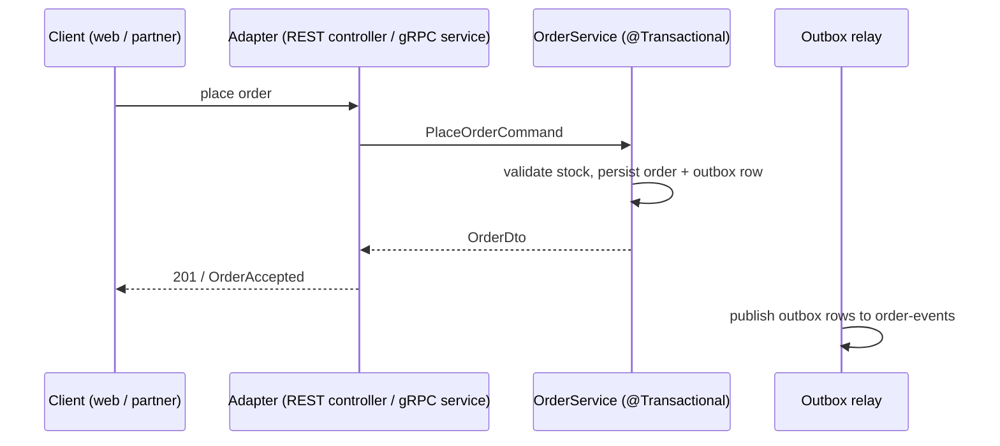

# orders-api — Design (as-built)

> Path `orders-api/`, version `2.4.0-SNAPSHOT`, grounded on `4e1c2a7` 2026-10-20. Decisions: ADR-007 (outbox), ADR-012 (service boundary).

## Stack
Java 21 · Spring Boot 4.1 · Spring Modulith 2.1 · grpc-java (in-process server, no starter, no listening port) · Spring Data JPA · Flyway · H2. No Kafka client: events end in a logging sink behind `OrderEventSink`.

## Behaviour

- Three Spring Modulith modules, verified by `ModulesTest` (ADR-013): `order` (service, REST), `partner` (gRPC), `outbox` (event relay).
- Adapters own no transaction and never see JPA entities (`ServiceBoundaryTest`, since ord-120).
- Events are published through the transactional outbox (`OutboxRelay`, ADR-007), at least once; each event carries an id.

## Public interface
- **REST** `/api/v1/orders`: create, get, list, cancel (OpenAPI `src/main/resources/openapi.yaml`).
- **gRPC** `acme.orders.v1.PartnerOrders`: `PlaceOrder`, `GetOrder`, `CancelOrder`.
- **Events** (topic `order-events` by config): `OrderPlaced`, `OrderCancelled`. `OrderPaid` is named in older docs and not implemented (system D5).

## Data
Schema `orders` (owner: orders-api): H2 in PostgreSQL mode in the example, PostgreSQL when deployed. Flyway migrations in `src/main/resources/db/migration` (V1–V2).

## Config / ports
Local REST 8080; gRPC runs in-process, no port (the deployed 9090 is not in the example). Config is in `application.yml`. The example ships no deploy charts.

## Drift register (local)
- Timestamp header presence-only check → system D1 / ord-142.
- `OrderPaid` named, not implemented → system D5.
- Partner gRPC path skips the currency rule → system D6.
