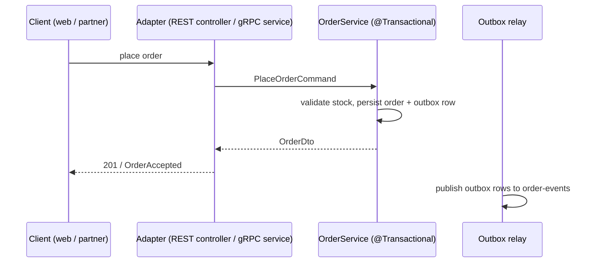

# orders-api — Design (as-built)

> Path `orders-api/`, version `2.4.0-SNAPSHOT`, grounded on `4e1c2a7` 2026-10-20. Decisions: ADR-007 (outbox), ADR-012 (service boundary).

## Stack
Java 21 · Spring Boot 3.5 · gRPC (`grpc-spring-boot-starter`) · Spring Data JPA · Flyway · Kafka (Spring Kafka).

## Behaviour

- Adapters own no transaction and never see JPA entities (`ServiceBoundaryTest`, since ord-120).
- Events are published through the transactional outbox (`OutboxRelay`, ADR-007).

## Public interface
- **REST** `/api/v1/orders`: create, get, list, cancel (OpenAPI `src/main/resources/openapi.yaml`).
- **gRPC** `acme.orders.v1.PartnerOrders`: `PlaceOrder`, `GetOrder`, `CancelOrder`.
- **Kafka (producer)**: `order-events` with `OrderPlaced`, `OrderPaid`, `OrderCancelled`.

## Data
PostgreSQL schema `orders` (owner: orders-api). Flyway migrations in `src/main/resources/db/migration` (V1–V9).

## Config / ports
Local REST 8080 / gRPC 9090 (`application.yml`). Deployed values are in `deploy/charts/orders-api/values.yaml`.

## Drift register (local)
- Timestamp header presence-only check → system D1 / ord-142.
