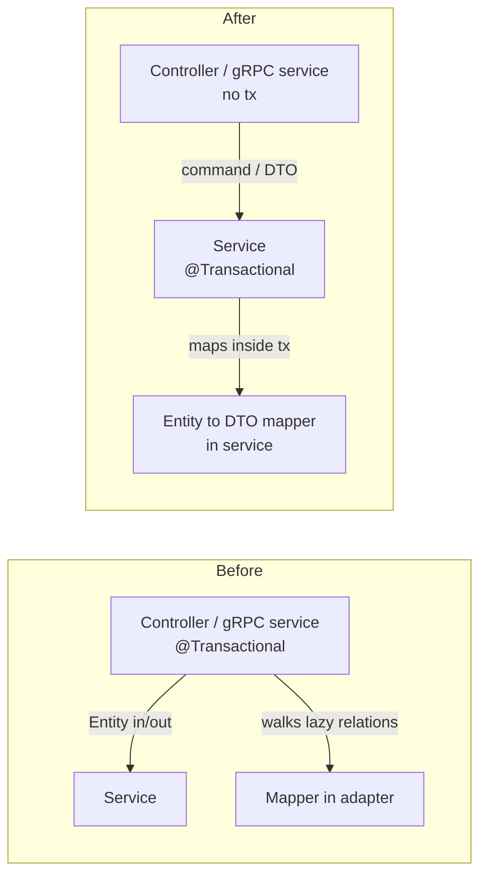

# ORD-120 Service transaction boundary — Design

## Current vs target ([REQ-STB-01] [REQ-STB-02] [REQ-STB-03])

## Decisions

| # | Decision | Rationale |
|---|---|---|
| D1 | Boundary types = the existing REST DTOs where one exists, otherwise a `record` in `..service.model`. | No parallel model. Traces [REQ-STB-03]. |
| D2 | Entity → DTO mapping moves into the service and runs inside its transaction; the existing mapper code is moved, not rewritten. | Same SQL as before, so no behaviour or performance change ([REQ-STB-04]). |
| D3 | Order: orders → cancellations → partners → reporting; each domain = net PR, then refactor PR. | Small, reviewable diffs ([REQ-STB-05]). |

## Safety net ([REQ-STB-04] [REQ-STB-05])

`*SafetyNetIT` per domain, goldens under `src/test/resources/safety-net/<domain>/`. Re-record only on **unchanged**
code (`-Dsafetynet.record=true`). Hibernate statistics give the SQL counts.

## Ratchet ([REQ-STB-06])

`ServiceBoundaryTest` runs in report mode for all domains and strict for those in `CLEAN_DOMAINS`. The report
(`target/service-boundary-report.md`) numbers only go down.

## Spec and doc impact

- `domains/orders-api/design.md` § Behaviour (adapters own no transaction).
- `system/data-flows.md` D2 → RESOLVED. ADR-012 Proposed → Accepted.
