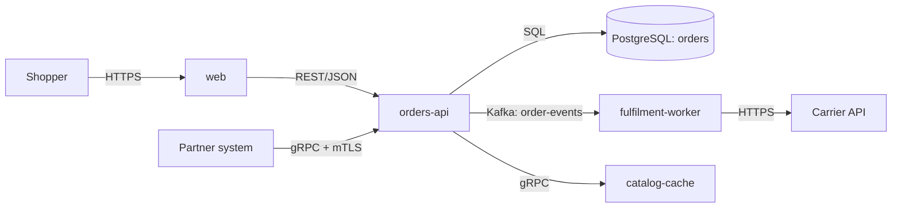

# Acme Shop — Architecture

> Grounded on `4e1c2a7` 2026-10-20. Authority: ADRs in `docs/adr/`. Where this summarises, the source wins.

## Overview
Acme Shop takes orders from the web shop and from partner systems, reserves stock, and hands paid orders to
fulfilment. Partners integrate over gRPC with mutual TLS; shoppers use the web UI over REST.

## Domain map

| Domain | Kind | Responsibility | Spec |
|---|---|---|---|
| orders-api | deployable | Orders lifecycle, REST + gRPC, owns `orders` schema | [`domains/orders-api/`](../domains/orders-api/design.md) |
| fulfilment-worker | deployable | Consumes `order-events`, books shipments | not written out in the example |
| catalog-cache | deployable | Read-through cache of the product catalog | not written out in the example |
| web | deployable | Shopper UI | not written out in the example |
| shop-common | library | Security filters, error model, event schemas | not written out in the example |

## Master diagram (protocols, no ports)

## Component registry (ports and endpoints live here only)

| Component | Path | Stack | Key deps | Ports / endpoints |
|---|---|---|---|---|
| orders-api | `orders-api/` | Java 21, Spring Boot 3.5 | shop-common, PostgreSQL, Kafka | REST 8080 `/api/v1/orders`, gRPC 9090 |
| fulfilment-worker | `fulfilment-worker/` | Java 21, Spring Boot 3.5 | Kafka, Carrier API | actuator 8081 |
| catalog-cache | `catalog-cache/` | Java 21, Redis | orders-api | gRPC 9095 |
| web | `web/` | React 19, Vite | orders-api | 443 (ingress) |
