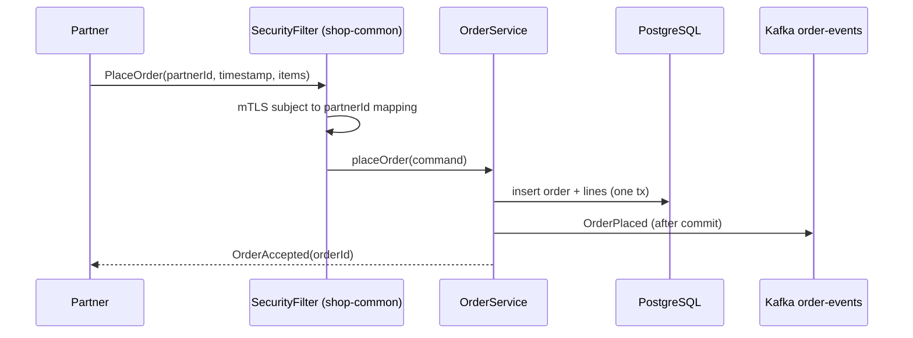

# Acme Shop — Data Flows and Drift Register

## 1. Partner places an order (gRPC)

## 2. Order paid → fulfilment

`orders-api` publishes `OrderPaid`, `fulfilment-worker` consumes it and books a shipment. Retries go through
`order-events.retry`, and dead letters to `order-events.dlt`.

## Drift Register

Severity: 🔴 material (fix or decide) · 🟡 doc staleness · 🟢 informational. Resolved rows stay, marked **RESOLVED**.

| # | Sev | Drift | Ground truth | Source to fix | Logged |
|---|---|---|---|---|---|
| D1 | 🔴 | Partner ICD says the `timestamp` header is mandatory "for replay prevention" | Only its presence is checked; the value is never compared to the clock | Decide: validate or amend the ICD → [`ord-142`](../features/ord-142-request-timestamp-validation/requirements.md) | 2026-10-20 |
| D2 | 🟢 | Controllers own transactions and pass ORM entities around | **RESOLVED 2026-11-03** by [`ord-120`](../features/ord-120-service-transaction-boundary/requirements.md); enforced by `ServiceBoundaryTest` | — | 2026-10-01 |
| D3 | 🟡 | README says catalog-cache uses RedisJSON | The runtime path is plain key/value `SCAN` | `catalog-cache/README.md` | 2026-10-20 |
| D4 | 🟡 | Ops runbook lists the gRPC port as 9091 | `application.yml` and chart both say 9090 | Runbook (owner: ops) | 2026-10-20 |
