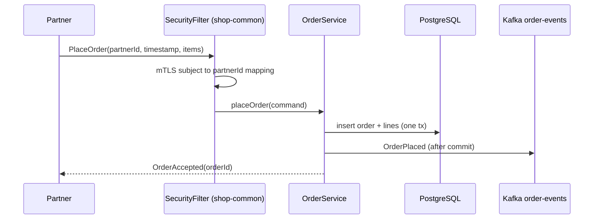

# Acme Shop — Data Flows and Drift Register

## 1. Partner places an order (gRPC)

## 2. Order paid → fulfilment

`orders-api` publishes `OrderPaid`, `fulfilment-worker` consumes it and books a shipment. Retries go through
`order-events.retry`, and dead letters to `order-events.dlt`. Not implemented in the example: nothing marks an order paid and
`OrderPaid` is never published (D5); the topic names are config only (the logging sink uses `order-events`).

## Drift Register

Severity: 🔴 material (fix or decide) · 🟡 doc staleness · 🟢 informational. Resolved rows stay, marked **RESOLVED**.

| # | Sev | Drift | Ground truth | Source to fix | Logged |
|---|---|---|---|---|---|
| D1 | 🔴 | Partner ICD says the `timestamp` header is mandatory "for replay prevention" | Only its presence is checked; the value is never compared to the clock | Decide: validate or amend the ICD → [`ord-142`](../features/ord-142-request-timestamp-validation/requirements.md) | 2026-10-20 |
| D2 | 🟢 | Controllers own transactions and pass ORM entities around | **RESOLVED 2026-11-03** by [`ord-120`](../features/ord-120-service-transaction-boundary/requirements.md); enforced by `ServiceBoundaryTest` | — | 2026-10-01 |
| D3 | 🟡 | README says catalog-cache uses RedisJSON | The runtime path is plain key/value `SCAN` | `catalog-cache/README.md` | 2026-10-20 |
| D4 | 🟡 | Ops runbook lists the gRPC port as 9091 | The deployed chart says 9090 (the chart is not in the example; its gRPC server is in-process, no port) | Runbook (owner: ops) | 2026-10-20 |
| D5 | 🟡 | This file §2 and the `orders-api` design name an `OrderPaid` event | The code publishes `OrderPlaced` and `OrderCancelled` only; no order can be marked paid | Implement it (seed S4, see the example README) or drop it from the docs | 2026-11-21 |
| D6 | 🔴 | Lesson 2026-11-03: an unknown `currency` is rejected with 422 | Only REST checks it (`CurrencyPolicy`, in `order.rest`); gRPC `PlaceOrder` accepts any 3-letter currency code | Decide: move the rule into the order API, 422 on REST and `INVALID_ARGUMENT` on gRPC (seed S7, see the example README) | 2026-11-21 |
| D7 | 🟡 | `REQ-ORD-03` and the filter's name read as if partners are authorised per order | The filter only authenticates (certificate CN equals the claimed `partner_id`); orders store no owner, so any authenticated partner can `GetOrder` or `CancelOrder` any order | Labelled `shortcut:` in `PartnerOrdersService`; add `partner_id` to orders when a seed needs tenant isolation | 2026-11-22 |
