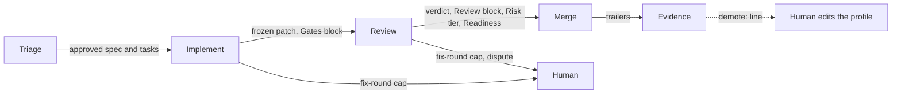

# Pipeline (optional)

The kit's playbooks and roles already cover each stage of a change. This page maps the stages to them, names what each
hands on, and lists the moments a human must step in. It adds no new tool.

| Stage | Done by | Hands on |
|---|---|---|
| Triage | planner, [`new-feature.md`](../playbooks/new-feature.md) (a small change skips it) | approved spec and tasks, or "small change" |
| Implement | generator, [`next-task.md`](../playbooks/next-task.md) | the frozen patch and the `### Gates` block (`gates.py`) |
| Review | reviewer at the label's tier, [`review-loop.md`](review-loop.md) | the verdict table and the `### Review` block with `rounds: <n>`; the `### Risk tier` block (`tiers.py`) and the `### Readiness` block (`ready.py`) |
| Merge | a human approval, or for Human `none` only the approval of a non-required job that runs `ready.py --range <base sha>...<head sha> … --auto-merge` and approves with a non-agent identity; the merge queue re-runs the Gates ([review-loop.md](review-loop.md) step 5) | the merge commit, with `Human-Findings: <n>` when a human checked |
| Evidence (after merge) | `tiers.py --evidence` over the trailers `Human-Findings:` and `Fixes:` ([sync.md](../playbooks/sync.md) § Trailers) | per tier: eligible, hold or breach; on breach, a `demote:` line |

## When the human enters

- **Spec approval.** Nothing is implemented from a spec the human has not approved.
- **The fix-round cap is reached.** A task gets two fix rounds: the worker's retry, then the planner's. If round 2
  ends with a red gate or a complete blocker, the task goes to the human with both rounds' outputs and no agent
  retries it until the human acts. (It is the cap, not a second red gate: the planner round comes first.)
- **A disputed finding.** It goes to the planner; if it stays disputed, it is the human's call.
- **The tier's Human value** (`### Risk tier`): `required`, `spot` or `none`, as in [review-loop.md](review-loop.md)
  step 5. `none` means no human before merge.
- **An edit to a guarded path.** The human reviews and merges it, including the profile and the Gates table.
- **`Deploy impact` is not `none`.** The people who run CI/CD hear before the merge.
- **A `demote:` line** in the evidence report: the human edits the profile (`tiers.py` never does).

## The queue is the host's

Issues, draft PRs, CI and the platform's merge queue hold the work in flight. The kit ships no queue, scheduler,
orchestrator or merge bot, and nothing in it merges: the merge is the platform's, on the Gates as required checks.

An orchestrator you build or buy reads the blocks above: `### Gates`, `### Review` (`rounds:`), `### Risk tier` and
`### Readiness`, plus `--evidence` after the merge. A pipeline that works by hand comes before an orchestrator.
