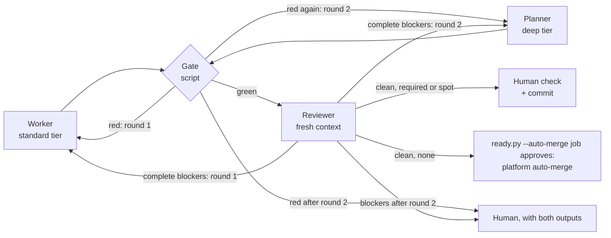

# Review loop (optional)

An agent reviewing its own work in the same context mostly confirms what it already believes. The loop below makes
review independent and makes the feedback reach the implementer. The stages around it and when the human enters are in
[pipeline.md](pipeline.md).



## Steps

1. **Worker** implements one task and runs the gate. It reports the exit code and any failing output verbatim. It
   never reports success without a green gate. **Workers never commit.**
2. **Freeze the diff:** save it to a patch file (`git diff > /tmp/<feature>-task-N.patch`) so later edits don't blur
   what was reviewed.
3. **Reviewer** starts in a **fresh context** (a new session or sub-agent) with only the patch, the feature spec and
   the project rules **as they are at the base commit**: `git show <base>:AGENTS.md`, and each `.specs/steering/*`
   and Knowledge `start` file the same way. Never the working tree or the PR head: a change cannot edit its own
   review rules. It reports real issues only, in the verdict table below. It does not edit code.
   The lead labels the frozen diff with a **trusted copy** of the kit, never the PR's own `.specs/kit/` (the PR can
   edit it). From the repo root:

   ```sh
   git worktree add --detach /tmp/specter-base <base sha> # the kit as it is at the base; a sha, never a name a tag could shadow
   python3 /tmp/specter-base/.specs/kit/scripts/tiers.py --specs .specs
   ```

   Its `reviewer:` is the reviewer's tier. No profile: security-sensitive paths (auth, crypto, input validation,
   permissions) get the deep tier.
4. **Only complete blockers go back to the worker.** The lead files each advisory as a follow-up (a task in the
   feature's `tasks.md`, or an issue); advisories never block. **A task gets at most 2 fix rounds.** A round is one
   attempt to fix a red gate or the complete blockers of a review: round 1 is the worker's retry, round 2 the
   planner's (deep) with the spec, the diff and both outputs. A disputed finding goes to the planner too. When round 2
   ends with a red gate or a complete blocker, the task goes to the human with both rounds' outputs (the gate output
   or the verdict table), and no agent retries it until the human acts. The lead writes `rounds: <n>` in `### Review`;
   `ready.py` says `not ready` above 2 and warns when the line is missing.
   <!-- shortcut: the cap is fixed at 2; make it a profile value when a repository asks for another number. -->
   <!-- shortcut: rounds are declared by the lead, not counted by a script; count them from the frozen patch files when the declared numbers prove wrong. -->
5. **Human check, by the label's Human value** (`tiers.py`; `none` is kept only on the lowest tier with every
   guardrail declared and the tier `eligible`; a shared model family in `### Review` bars it, `ready.py` says so; so does a change over the size cap, an edited or deleted test line, and a reviewer `complexity:` line that is not `trivial`):
   - `required`: rerun the gate yourself (and the UI in a real browser when the change is visual) and read the
     reviewer's verdict table, as below.
   - `spot`: approve on the readiness verdict, the `### Gates` block and the tests, and read the flagged files in full.
   - `none`: no human before merge, through one job and the platform's own rules; nothing in the kit merges.
     1. Branch protection requires one approval on every PR (not only on the `required` paths) and drops it when a
        commit is pushed. The required checks are the Gates, and only the Gates.
     2. A non-required job, defined where the PR cannot edit it, runs from a trusted worktree of the base (as step 3
        shows) `ready.py --specs .specs --range <base sha>...<head sha> --pr <pr text> --auto-merge`. Pass full shas: a
        name can be shadowed by a pushed tag, and `ready.py` refuses a tag or an ambiguous name (exit 2). `<base sha>` is the
        `merged_ref` tip and must equal the merge base: a PR behind it is `spot` until the branch is updated. It exits 0
        only when the verdict is `ready`, the reported human is `none` (the lowest tier, with evidence earned at the base,
        every guardrail declared, another model family, a change within the size cap with tests only added, and
        `complexity: trivial`)
        and there is no warning. Set `merged_ref` to a ref the job's checkout has (`refs/remotes/origin/main`), and fetch it
        with an explicit refspec (`+refs/heads/main:refs/remotes/origin/main`), never the wildcard: on a case-insensitive
        disk a pushed `MAIN` shadows `main`, and `ready.py` refuses the ref only when it sees both spellings. Fetch full
        history too: `git fetch --no-tags --unshallow origin +refs/heads/main:refs/remotes/origin/main <head sha>` (or
        `fetch-depth: 0` with that refspec overriding the default), because a shallow clone hides the merged history the
        evidence windows read.
     3. On exit 0 only, the job approves with a non-agent identity, never the agent's token (an agent's cannot approve
        or merge: the Guardrails row), whose credential only this job can read, and enables auto-merge; the platform
        merges when the Gates pass. The job passes the head sha it checked to every platform call, so a push after the
        check is never approved or merged, and one job per PR runs at a time. Any other exit does nothing: the PR waits
        for a human approval, as for `spot`. The job is not required, so its failure never blocks a PR a human approved.
     4. The merge queue (GitHub merge queue, GitLab merge trains or the equivalent) re-runs the Gates on the merged
        result, so changes that are green alone are gated together. It does not re-run `ready.py`: its block-commit
        and rules-at-base checks are for the PR head and its base, and on the queue's merge commit they fail every PR.
        <!-- shortcut: the label is the one made at approval; a base that moves under the PR re-labels it only when the branch is updated (a new commit drops the approval and the job runs again); re-run ready.py in the queue against the PR head when evidence that moved must bar a queued merge. -->

     - GitHub, in this order:
       1. A ruleset (or branch protection) with "Require a pull request before merging", 1 required approval and
          "Dismiss stale pull request approvals when new commits are pushed".
       2. The approver is a GitHub App, never `GITHUB_TOKEN`: leave "Allow GitHub Actions to create and approve pull
          requests" off. Its private key is a secret of an environment whose deployment branches allow only the default
          branch.
       3. The job is a `pull_request_target` workflow that uses that environment, so it runs from the base branch's
          definition. It checks out the base, fetches the PR head as data without running it (full history, with the explicit refspec of item 2), passes the PR body through
          an environment variable (never `${{ }}` in the script), and on exit 0, with the App's token and the head sha
          it checked: approves through `POST …/pulls/{n}/reviews` with `commit_id=<head sha>`, runs
          `gh pr merge --auto --match-head-commit <head sha>`, then reads the head again. If it moved, it dismisses that
          review and runs `gh pr merge --disable-auto`. The workflow has `concurrency: specter-auto-merge-<pr number>`
          with `cancel-in-progress: false`: cancelling a job between its approval and its re-read would leave the
          approval on the new head.
       4. Every workflow that runs PR code (the Gates, an agent) has `permissions: contents: read` and checks out with
          `persist-credentials: false`, so a `pull_request` run cannot reach the key.
     - GitLab (a sketch, untested on a live instance; verify each setting when you declare the row):
       1. An approval rule requiring 1 approval, with "Prevent approval by author" and "Remove all approvals when
          commits are added to the source branch".
       2. A trusted project (`<group>/specter-approver`; MR authors have Reporter at most) holds the bot's project
          access token as a protected, masked variable. Never put that token in the MR's own project: there it is
          either unprotected (the Gates jobs read it) or protected (an unprotected source branch never gets it).
       3. The MR pipeline's last job (`allow_failure: true`, from a CI/CD configuration the MR cannot edit) starts the
          trusted project's pipeline with a pipeline trigger token, passing only the MR iid.
       4. The trusted job checks the project id against a fixed value, reads the base and head shas from the MR API
          (never from the trigger's variables), and on exit 0 approves the MR (`POST …/approve`) and sets auto-merge
          (`PUT …/merge`) through the merge requests API as the bot, both with `sha=<head sha>` (GitLab refuses a moved
          head with 409). The job runs under `resource_group: mr-<iid>`.

   For `required` and `spot`, write the PR description to a file outside the repo (`/tmp/pr.md`): the `### Gates`
   block from `gates.py`, the `### Risk tier` block, the `### Review` block and, when there are artifacts, the
   `### Verification` block. Then check it with the trusted copy from step 3, in two modes:

   ```sh
   # preflight, staged, before the commit (a +dirty Gates block binds no content)
   python3 /tmp/specter-base/.specs/kit/scripts/ready.py --specs .specs --pr /tmp/pr.md
   git commit                                            # then rerun gates.py and put its new block in /tmp/pr.md
   # the binding check, after the commit: the label and the verdict for <base sha>...HEAD
   python3 /tmp/specter-base/.specs/kit/scripts/tiers.py --specs .specs --range <base sha>...HEAD
   python3 /tmp/specter-base/.specs/kit/scripts/ready.py --specs .specs --range <base sha>...HEAD --pr /tmp/pr.md
   git worktree remove /tmp/specter-base
   ```

   Only the `--range` run binds the blocks to a commit. `ready` means the declarations agree with the base's rules
   and the head commit; it does not prove the gates ran: rerun them, or run them in CI. The first change that
   upgrades a project to 0.7.0 has no `ready.py` at its base: run both scripts from the specter release checkout
   (`python3 <specter>/kit/scripts/ready.py --specs .specs …`). Paste the `### Readiness` block into the PR and read
   it next to `### Gates` and `### Review`. A change to the Gates table itself is never ready: the human reviews the
   new gates, runs them, and merges on their own check. Check the change's `Deploy impact:` line: if it is not `none`, the people who
   run CI/CD hear before the merge. A job that runs from the default branch picks up every merge on its next run.
   At the merge, the human adds `Human-Findings: <n>` to the merge (or squash) commit message: the number of
   problems the human found that the gates and the reviewer missed, `0` when none. Write it on every merge, so
   `tiers.py --evidence` can tell "no findings" from "no data": human-caught % counts only merges that carry the trailer,
   and a window with too few of them is a hold. A `none` merge carries no `Human-Findings:`: nobody writes it for the
   human, so its `0` is ignored and a tier whose Human is `none` never holds on it (a value above 0 still counts; see [sync.md](../playbooks/sync.md) § Trailers).

A review finding that reaches `human: none` or `auto-merge: yes` without a human is a security finding. File it
privately, through the project's `SECURITY.md` channel (on GitHub, a draft advisory), not as a public issue or
review doc, and publish it after the fix ships.

## Reviewer prompt (works with any agent)

```text
Review ONLY the change in <patch file> against <.specs/features/<feature>/> and the project rules, read at the
base commit <base> (git show <base>:AGENTS.md), never the working tree. Check: every changed behaviour traces to a
REQ; acceptance criteria are actually tested; nothing outside the task's scope; spec docs updated per
.specs/kit/playbooks/sync.md; error paths and edge cases; security. Open each `### Verification` artifact and say
whether it shows that REQ's acceptance; one that does not is a blocker with the artifact as its evidence.
Output the table below. A blocker needs all four of Location (`path:line`), Evidence (a quote from that line),
Trigger (the input or state that fails) and Consequence (what goes wrong). A blocker missing any of them is advisory.
No style nits the linter already covers. Do not edit files.
```

Verdict table (the lead copies it into the PR as the `### Review` block; `ready.py` checks it):

```text
### Review
- implementer: <model id>
- reviewer: <model id>
- rules: <base sha>
- rounds: <n>
- complexity: <trivial|non-trivial>
| Severity | Location | Evidence | Trigger | Consequence | Fix |
|---|---|---|---|---|---|
| blocker | src/shop/Order.java:42 | "if (total > 0)" | an order with total 0 | it ships unpaid | ">= 0", and a test |
| advisory | src/shop/Cart.java:10 | | | | follow-up: tasks.md task 9 |
```

| Severity | Meaning | Effect |
|---|---|---|
| `blocker` | A defect with all four cells filled | `ready.py` says `not ready`; goes back to the worker |
| `advisory` | Anything else, including a blocker missing a cell | Filed as a follow-up; does not block |

`rules:` is the base sha (a prefix of at least 7 characters). `rounds:` is the fix rounds this task used (0 to 2). Verification lines are
`- [REQ-<FEAT>-NN] <path or URL>: <what it shows>`; a path must exist at the head, a URL is not fetched.

## Running parallel workers safely

- Never run two workers on the same files at once.
- Two workers sharing one checkout must not use `git stash`, `reset`, `checkout` or `restore`: one worker's
  stash wipes the other's edits. Give each its own `git worktree`, or read old code with `git show HEAD:path`.

## Retro after a merge

After a merge, a mistake that got through becomes one line in `.specs/steering/lessons.md` plus the check that now
catches it (a Gates row, a lint rule, a test or a playbook step). The agent proposes the line and the check; a human
approves them before they land. Several agents at once: [parallel.md](../playbooks/parallel.md).

## Grill the artifact (optional, before implementation)

A spec or plan is cheapest to fix before code exists. For a large or risky one, attack the document instead of
waiting for the code review to find its gaps.

1. **Independent reviewers.** Start two or more reviewers in fresh contexts, each with the artifact, the project rules
   and read access to the code. Give each a different angle (correctness, security, operations, scope).
2. **Questions with a recommended answer.** Each reviewer lists the questions the artifact leaves open or gets wrong.
   For each it writes the answer it recommends, then tries to refute that answer with evidence: `path:line`, a command
   and its output, a test. An answer that survives goes in; one that doesn't is replaced or becomes an open question.
3. **Rounds until clean.** Fix the artifact and run a new round with fresh reviewers. Stop when a round finds nothing
   material: no wrong claim, no missing requirement, no contradiction. Style is not material.
4. **Settled answers go into the decisions log.** Each becomes a row in `.specs/steering/decisions.md` with its reason
   and where it lands, and the REQs it governs cite it. From then on it is cited, not argued again. A changed mind is a
   new dated row that supersedes the old one.
5. **Ask the human only what is theirs.** Product, risk, client and budget calls go to the human, with the options and
   the recommended one. Questions the code, the docs or a test can answer never go to the human.

Reviewer prompt:

```text
Grill <artifact> against the code and the project rules in AGENTS.md. Angle: <correctness | security | operations | scope>.
List every claim that is wrong or unsupported, every missing requirement and every contradiction. For each, give your
recommended answer, then try to refute it with evidence (path:line, a command and its output, a test) and say whether
it survived. Mark the ones only the human can decide, and why. Report material issues only. Do not edit files.
```
