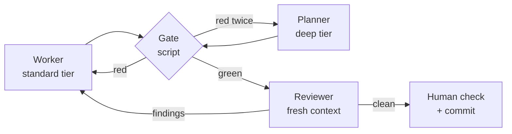

# Review loop (optional)

An agent reviewing its own work in the same context mostly confirms what it already believes. The loop below makes
review independent and makes the feedback reach the implementer.



## Steps

1. **Worker** implements one task and runs the gate. It reports the exit code and any failing output verbatim. It
   never reports success without a green gate. **Workers never commit.**
2. **Freeze the diff:** save it to a patch file (`git diff > /tmp/<feature>-task-N.patch`) so later edits don't blur
   what was reviewed.
3. **Reviewer** starts in a **fresh context** (a new session or sub-agent) with only the patch, the feature spec and
   the project rules. It reports real issues only, each with `file:line` and a severity. It does not edit code.
   Security-sensitive paths (auth, crypto, input validation, permissions) get the deep tier.
4. **Findings go back to the same worker** for one retry. After a second red gate or a disputed finding,
   escalate to the planner (deep) with the spec, the diff and both outputs.
5. **Human check:** rerun the gate yourself (and the UI in a real browser when the change is visual), read the
   reviewer's verdict table, then commit.

## Reviewer prompt (works with any agent)

```text
Review ONLY the change in <patch file> against <.specs/features/<feature>/> and the project rules in AGENTS.md.
Check: every changed behaviour traces to a REQ; acceptance criteria are actually tested; nothing outside the
task's scope; spec docs updated per .specs/kit/playbooks/sync.md; error paths and edge cases; security.
Output a table: severity (blocker/major/minor) | file:line | issue | suggested fix.
Report real issues only. No style nits the linter already covers. Do not edit files.
```

## Running parallel workers safely

- Never run two workers on the same files at once.
- Two workers sharing one checkout must not use `git stash`, `reset`, `checkout` or `restore`: one worker's
  stash wipes the other's edits. Give each its own `git worktree`, or read old code with `git show HEAD:path`.
