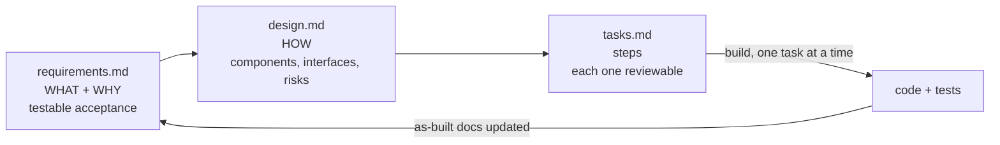

# Spec-driven development, in one page

*How the method works, independent of any tool. Specter is one way to run it.*

## The idea

You describe **what** and **why** before anyone (human or AI) writes the **how**. The description is short, structured
and checkable, so mistakes surface in a 40-line markdown file instead of a 400-line diff.

That matters more with AI agents than without. An agent will implement whatever it understood, quickly and
confidently. A spec is the cheapest place to find out what it understood.

## Three documents per change

| Document | Answers | Good when |
|---|---|---|
| **requirements** | What must be true afterwards, and why we're doing it | Every requirement has an ID and an acceptance criterion someone could test |
| **design** | How we'll make it true | Every requirement points to the components that satisfy it; risks, rollout and rollback are stated |
| **tasks** | In what steps | Each step fits in one reviewable diff and links to the requirements it serves |

## Writing acceptance criteria that can be tested

A useful pattern is **EARS** (Easy Approach to Requirements Syntax), a public notation from requirements engineering.
It gives each requirement a fixed shape:

| Shape | Template | Example |
|---|---|---|
| Always | The `<system>` shall `<response>`. | The orders API shall return amounts in minor units. |
| Event | **When** `<trigger>`, the `<system>` shall `<response>`. | When a partner request is older than 5 minutes, the API shall reject it with `PERMISSION_DENIED`. |
| State | **While** `<state>`, the `<system>` shall `<response>`. | While enforcement is off, the API shall log stale requests and accept them. |
| Unwanted | **If** `<condition>`, **then** the `<system>` shall `<response>`. | If the timestamp is missing, then the API shall treat it as stale. |
| Optional | **Where** `<feature>`, the `<system>` shall `<response>`. | Where the cache is enabled, the API shall serve catalog reads from it. |

EARS is optional in specter. A plain table of *requirement | acceptance* works just as well, as long as every row can be
tested. Use whichever your team will actually keep doing.

## What specter adds to the basic method

The three-document method is widely used. Several tools build on it, including Amazon's Kiro IDE, which popularised
it for AI-assisted development. Specter keeps the same core and adds the parts that we found stop specs from going stale:

| Addition | Why |
|---|---|
| **As-built `domains/`** next to proposed `features/` | Readers always know whether a doc describes today or a plan |
| **Drift Register** | A place for "this isn't true yet", instead of leaving the spec silently wrong |
| **Evidence rule** (`path:line`, commit, how it was checked) + `UNKNOWN` | Makes an agent's confidence checkable |
| **Setup interview** | The agent learns the project and asks only what the code can't tell it |
| **Script gates** (lint, citation check, spec-sync hook) | Structure is checked for free, the same way every time |
| **Roles and a review loop** | The writer never approves; strong models only where judgement matters |
| **Agent-neutral** | Plain markdown + stdlib Python; any agent can follow it |

---

*Kiro is a trademark of its owner. Specter is an independent project, not affiliated with or endorsed by Amazon or
the Kiro team. No Kiro code, text or assets are used. The method above is described in our own words.*
