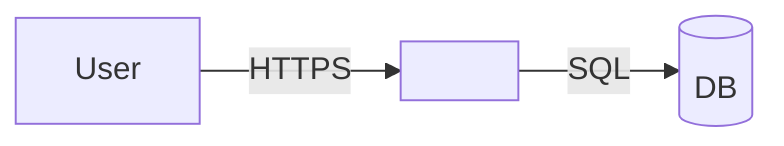

# <System> — Architecture

> Grounded on `<sha>` <YYYY-MM-DD>. Authority: <ADR folder / architecture doc>. Where this summarises, the source wins.

## Overview
<3–5 lines: what the system does, for whom.>

## Domain map

| Domain | Kind | Responsibility | Spec |
|---|---|---|---|
| <name> | deployable / library | <one line> | [`domains/<name>/`](../domains/<name>/design.md) |

## Master diagram (protocols, no ports)

## Component registry (ports and endpoints live here only)

| Component | Path / repo | Stack | Key deps | Ports / endpoints |
|---|---|---|---|---|
