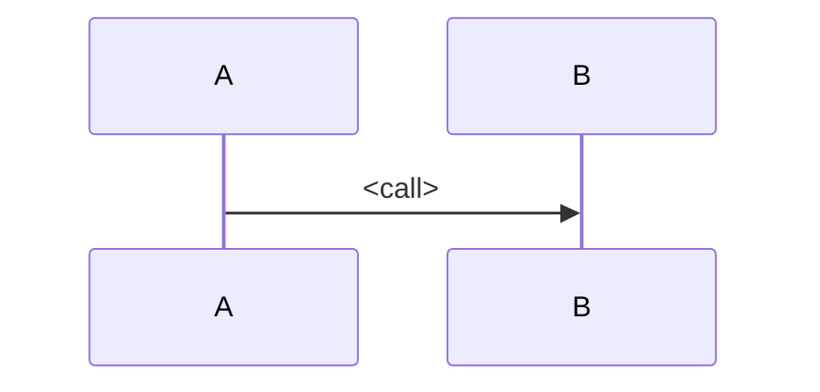

# <System> — Data Flows and Drift Register

## 1. <Flow name>

## Drift Register

Where docs, code and the people you asked disagree. Severity: 🔴 material (fix or decide) · 🟡 doc staleness · 🟢 informational.
Resolved rows stay, marked **RESOLVED YYYY-MM-DD**.

| # | Sev | Drift | Ground truth | Source to fix | Logged |
|---|---|---|---|---|---|
| D1 | | | | | |
